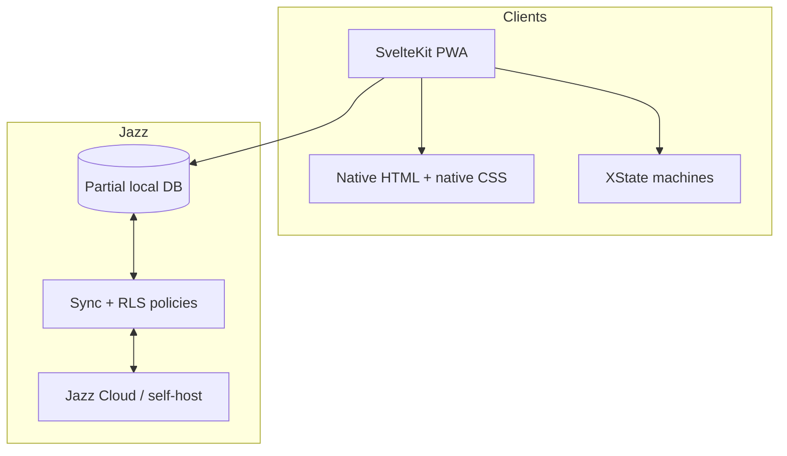

# Finance tracking app (Jazz + SvelteKit)

## Locked stack decisions

| Concern           | Choice                                                                                    |
| ----------------- | ----------------------------------------------------------------------------------------- |
| Data / sync       | [Jazz](https://jazz.tools/) (`jazz-tools` v2, Jazz Cloud or self-host later)              |
| Framework         | SvelteKit + latest Svelte 5                                                               |
| Styling           | Native Svelte CSS + CSS variables (no Tailwind)                                           |
| UI primitives     | Accessible native HTML controls                                                           |
| Complex UI state  | XState + `@xstate/svelte`                                                                 |
| Simple UI state   | Svelte runes / stores                                                                     |
| i18n              | [Paraglide JS](https://paraglidejs.com/sveltekit) (English message catalog only at first) |
| Installable shell | PWA via a native SvelteKit service worker                                                 |
| Native wrap       | Deferred (Capacitor/Tauri later; Socket Runtime is deprecated)                            |

Project directory: `~/finance` (adjust if you prefer another name).

## Spec Kit bootstrap (step 0)

Adopt full [GitHub Spec Kit](https://github.com/github/spec-kit) with the Codex integration before app scaffolding.

1. Install CLI: `uv tool install specify-cli` (or pinned release from Spec Kit docs).
2. Init: `specify init finance --integration codex --non-interactive` (or `specify init --here --force --integration codex` if the folder already exists).
3. This installs Spec Kit skills under `.agents/skills/` (`speckit-constitution`, `speckit-specify`, `speckit-plan`, `speckit-tasks`, etc.).
4. **Migrate these planning notes into Spec Kit artifacts:**
   - `.specify/memory/constitution.md` — TypeScript hard rules (no `any` / no `as` / discriminated unions); Jazz local-first; organizations not “accounts” for tenancy; money as `amountMinor` + ISO 4217; SimpleFIN BYOK per org; Paraglide for all UI strings; semantic HTML controls + native CSS (no Tailwind).
   - `specs/001-finance-mvp/spec.md` — product requirements (MVP vs later, transaction shape, tags, orgs/grants, SimpleFIN).
   - `specs/001-finance-mvp/plan.md` — technical design (stack, schema, RLS, sync worker).
   - `specs/001-finance-mvp/tasks.md` — implementation checklist aligned with the todos below.
5. Keep this planning file as a working scratchpad only until migration is done; Spec Kit files become the source of truth.

Then scaffold with `pnpm create jazz` (Svelte template) inside/alongside that repo, and add XState, Paraglide, and PWA.

## TypeScript rules (hard)

- **No `any`** — use `unknown` + narrowing, generics, or proper library types.
- **No `as` casts** — prefer `satisfies`, type guards, discriminated narrowing, and generics. If a third-party API is under-typed, wrap it once in a typed adapter that validates/narrows instead of casting at call sites.
- **Discriminated unions over optional soup** — model variants with a tag field (`kind`, `paymentMethod`) and required fields per variant, not “everything optional.”

Example domain view (app layer; Jazz rows stay relational and are mapped at the boundary):

```ts
type Money = { amountMinor: number; currency: string }

type ExpenseTx = {
	kind: 'expense'
	money: Money
	categoryId: string
	accountId: string
	bookedOn: string // mapped from Jazz date
	memo?: string
}

type IncomeTx =
	| {
			kind: 'income'
			paymentMethod: 'cash' | 'transfer' | 'electronic'
			money: Money
			categoryId: string
			accountId: string
			bookedOn: string
			memo?: string
	  }
	| {
			kind: 'income'
			paymentMethod: 'check'
			money: Money
			categoryId: string
			accountId: string
			bookedOn: string
			memo?: string
			check: {
				checkNumber: string
				checkDate?: string
				payerName?: string
				bankName?: string
			}
	  }

type AppTransaction = ExpenseTx | IncomeTx
```

Encode these in Spec Kit **constitution** (primary) and mirror them in `AGENTS.md` so Codex sees them outside Spec Kit skills.

## Architecture



- **Jazz owns durable data and authz.** Row-level policies in `permissions.ts` filter reads and reject illegal writes; offline optimistic writes reconcile when online ([group permissions recipe](https://jazz.tools/docs/recipes/access-control/group-permissions)).
- **XState owns multi-step UI flows** (transaction compose, org invite, tag typeahead + create). Tiny toggles stay in Svelte.
- **Paraglide owns all user-visible strings** from day one so UI never hardcodes English.

## Domain model (forward-compatible)

Keep finance **accounts** distinct from login identity. Multi-tenancy uses **organizations**.

### Core tables (MVP implements + uses)

- `profiles` — display name for a Jazz user (`session.user.account`)
- `organizations` — personal or business workspace (`kind: personal | business`, `defaultCurrency: "USD"`)
- `organizationMembers` — `{ organizationId, userId, role: owner | admin | member | viewer }`
- `accounts` — cash/bank/card ledgers belonging to an org (`name`, `currency`, `organizationId`, `archivedAt?`)
- `categories` — org-scoped; every org is seeded with a system **Uncategorized** row (`isSystem: true`, not deletable). Categories are required on transactions.
- `tags` — org-scoped; `{ name, categoryId?, archivedAt?, organizationId }` (archived tags stay on old txs, hidden from typeahead)
- `transactions` — see shape below
- `transactionTags` — M2M join (`transactionId`, `tagId`)

### Transaction shape (locked)

Transactions **reference** an account via `accountId` (not nested-only children). Also store `organizationId` for RLS and cross-account queries.

| Field            | Type                                                           | Required             | Notes                                                                                                               |
| ---------------- | -------------------------------------------------------------- | -------------------- | ------------------------------------------------------------------------------------------------------------------- |
| `amountMinor`    | `s.int()`                                                      | yes                  | Always ≥ 0 (minor units / cents). Never floats.                                                                     |
| `kind`           | `s.enum("expense", "income")`                                  | yes                  | Sign is not encoded in the amount. Account-to-account `transfer` can be added later as a third kind or linked pair. |
| `currency`       | `s.string()`                                                   | yes                  | **ISO 4217** code (`"USD"`). Copied from the account on create; stored on the row even when the UI locks editing.   |
| `categoryId`     | `s.uuid()`                                                     | yes                  | Always set; default to the org’s Uncategorized category for that `kind`.                                            |
| `accountId`      | `s.uuid()`                                                     | yes                  | FK to financial account.                                                                                            |
| `organizationId` | `s.uuid()`                                                     | yes                  | Denormalized for permissions/queries.                                                                               |
| `bookedOn`       | `s.date()`                                                     | yes                  | Business/calendar date the user assigns (“happened on”).                                                            |
| `memo`           | `s.string().optional()`                                        | no                   | Optional note.                                                                                                      |
| `paymentMethod`  | `s.enum("cash", "check", "transfer", "electronic").optional()` | income: yes          | How the income was received. Nullable on expenses for now; same column can be reused for expenses later if needed.  |
| `source`         | `s.enum("manual", "simplefin")`                                | yes                  | Provenance; default `manual`.                                                                                       |
| `externalId`     | `s.string().optional()`                                        | simplefin: yes       | Provider transaction id for idempotent sync.                                                                        |
| `batchId`        | `s.uuid().optional()`                                          | no                   | Ready for future batch/salary flows.                                                                                |
| tags             | `transactionTags`                                              | no                   | 0..n                                                                                                                |
| images           | `transactionAttachments`                                       | no                   | 0..n (MVP UI may allow 0–1)                                                                                         |
| check details    | `checkDetails` 1:1                                             | when method is check | See below — not sparse null columns on every row.                                                                   |

**Categories** also carry `kind: expense | income` so pickers only show matching categories. Seed system **Uncategorized** per org per kind.

**Income payment methods + check-specific fields**

Keep one `transactions` table. Method-specific data lives in a sibling row so cash/electronic stay lean:

- `checkDetails` — `{ transactionId, checkNumber, checkDate?, payerName?, bankName?, memoOnCheck? }` (exact check fields can be trimmed at implementation; schema reserves the 1:1 pattern)
- XState income form: `paymentMethod` → if `check`, require check details; otherwise skip that step
- Future methods with their own fields (e.g. electronic reference id) get their own 1:1 table the same way — avoid a grab-bag JSON blob unless Jazz querying on those fields is never needed

**Do not add `createdOn` / `updatedOn` columns.** Jazz already stamps `$createdAt`, `$updatedAt`, `$createdBy`, `$updatedBy`. Select them explicitly when needed. Keep `bookedOn` separate from `$createdAt`.

**Money rule:** `amountMinor` + ISO `currency`. UI formats via `Intl.NumberFormat` / Paraglide. Multi-currency ready; MVP forms only offer `USD`.

### Access grants (schema + policies now; business UI later)

Jazz’s workspace recipe is org-wide roles. Account-scoped sharing needs an extra grant table:

- `accountMemberships` — `{ organizationId, userId, accountId, access: read | write }`

**Policy rule (encode from day one):**

- Org `owner`/`admin`: all accounts in that org
- Org `member`/`viewer` with **no** `accountMemberships` rows: treat as full-org access (personal org default)
- Org `member`/`viewer` **with** any grant rows: only those accounts (and their transactions/tags inherited via `allowedTo` / `exists` checks)

This matches “grant all accounts or only certain accounts” without a later rewrite. See [Jazz permissions](https://jazz.tools/docs/auth/permissions) and [nested inheritance](https://jazz.tools/docs/recipes/data-patterns/nested-data).

### SimpleFIN bank sync (BYOK, org-scoped) — schema now, sync later

Optional bank import via [SimpleFIN](https://www.simplefin.org/) (read-only “RSS for bank data”), same bring-your-own-key pattern as [Actual Budget](https://actualbudget.org/docs/advanced/bank-sync/simplefin/):

1. User creates a **setup token** at a SimpleFIN provider (e.g. [SimpleFIN Bridge](https://beta-bridge.simplefin.org/info/developers)).
2. They paste it into **organization settings** (personal or business).
3. App **claims once** (base64-decode → `POST` claim URL → receives **Access URL** with Basic Auth). Store the Access URL; the setup token is single-use.
4. Sync uses `GET {ACCESS_URL}/accounts?version=2` ([protocol](https://www.simplefin.org/protocol.html)).
5. Feature is **off** until that org has a claimed connection — no global app API key.

**Tables (ready from day one; MVP UI can stop at “paste token / show connected”):**

- `simplefinConnections` — `{ organizationId, accessUrl, status: active | error | revoked, lastSyncAt?, lastError?, claimedAt }`
  - One active connection per org (or allow multiple later; start with one).
  - **Secret:** `accessUrl` is a credential. Restrict with Jazz RLS to org `owner`/`admin` only (members/viewers must not read it). Document that, like Actual, sync credentials are not end-to-end encrypted relative to whoever can read that row / operate the sync worker.
- `simplefinAccountLinks` — `{ organizationId, accountId, simplefinAccountId, simplefinOrgId? }` maps our financial account ↔ SimpleFIN account id after user links them.
- On `transactions`:
  - `source: manual | simplefin` (discriminated in app types; extend later with more importers)
  - `externalId: string.optional()` — SimpleFIN transaction id for **idempotent** imports
  - Imported rows still get `categoryId` (default Uncategorized), `currency`, `amountMinor`, `bookedOn`, `accountId`; `paymentMethod` / check details usually unset for bank imports unless we infer later.

**Architecture constraint:** claim + periodic fetch need outbound HTTP and must not expose `accessUrl` to every client replica. Plan a small **sync worker** (Jazz TypeScript server / background job) that:

- runs claim when an admin submits a setup token (token never stored; only Access URL persisted under admin-only policy)
- pulls accounts/transactions on demand or on a schedule
- writes into Jazz with the same RLS-safe inserts the app uses

Browser-only claim is unreliable (CORS + secret leakage into every partial replica). Manual entry remains the default path when no connection exists.

**App-layer union (no optional soup):**

```ts
type TxSource = { source: 'manual' } | { source: 'simplefin'; externalId: string }
```

### Tables stubbed for later (schema + policies; limited or no UI in MVP)

- Jazz file tables (`file_parts`, `files`, `uploads`) + `transactionAttachments` (`transactionId`, `fileId`) — images later via Jazz blob APIs
- `transactionBatches` / `batchTemplates` — monthly salary / bulk entry later; `transactions.batchId` optional FK ready now
- SimpleFIN sync worker + account-link UI (connection claim UI can be minimal)

### Migrations mindset

Use Jazz fluid migrations when schema evolves; keep additive columns/tables first. Permissions redeploy without migrations.

## MVP product scope (slice #2)

Working **personal** flow in English/USD:

1. Sign in (Jazz scaffold auth)
2. Auto-create a personal organization + membership on first login
3. Create/list/archive financial accounts
4. Create/list transactions on an account (amount, date, memo, tags)
5. Manage categories + tags (create, assign category, archive; typeahead excludes archived)
6. Org switcher shell (personal org works; create/join second org can be minimal invite-by-user-id or deferred UI, but **membership + grant schema/policies exist**)

Out of MVP UI (but not out of schema): SimpleFIN pull/sync worker + account linking, multi-currency FX, image upload, batch templates, fine-grained invite UX, native wrappers. Org settings may include a stub “Add SimpleFIN token” that claims and stores the connection without importing yet.

## App structure

```
src/lib/schema.ts          # Jazz tables + relations
src/lib/permissions.ts     # RLS policies
src/lib/money.ts           # minor units helpers
src/lib/machines/          # XState: transactionForm, tagPicker, orgSwitch
src/lib/components/ui/     # reusable semantic HTML controls
src/routes/                # SvelteKit pages
messages/en.json           # Paraglide
static/                    # PWA icons/manifest inputs
```

Current routes: `/` overview, `/accounts`, `/accounts/new`, `/expenses`, `/expenses/new`, `/incomes`, `/incomes/new`, `/login`, and `/account` (account recovery). Account detail and category/tag/organization settings remain planned work.

## XState usage

- `transactionFormMachine` — draft → validate → save → success/error (offline-safe; Jazz write is the durability source)
- `tagPickerMachine` — query → suggest → create/archive-aware selection
- Keep org current-id in a small Svelte store persisted locally (UI preference, not source of truth)

## Styling / UI controls

- Keep controls unstyled; use minimal CSS for layout until a visual direction is approved.
- Use accessible native HTML controls, including selects and checkboxes.
- No Tailwind.

## Offline / PWA

- Jazz partial local copy = never wait on network for reads; writes apply locally then sync
- native SvelteKit PWA: offline shell, caching strategy that does not fight Jazz’s own storage
- Surface sync/pending state lightly in the shell

## i18n

- Install Paraglide; wrap all labels/errors in message functions
- Locale list starts as `["en"]`; currency/date formatting always locale-aware via `Intl`

## Implementation order

1. Spec Kit init (codex) + constitution / spec / plan / tasks migration
2. Scaffold Jazz Svelte app + XState + Paraglide + PWA baseline
3. Land full schema + permissions (including stub tables, account grants, SimpleFIN)
4. Auth + personal org bootstrap
5. Accounts CRUD UI
6. Transactions + tag picker (XState) + categories/tags settings
7. Org switcher shell; smoke-test offline write → online sync
8. Polish CSS composition (one clear visual direction, mobile-friendly)

## Key Jazz references

- [Group / workspace permissions](https://jazz.tools/docs/recipes/access-control/group-permissions)
- [Permissions API](https://jazz.tools/docs/auth/permissions)
- [Nested permission inheritance](https://jazz.tools/docs/recipes/data-patterns/nested-data)
- [Framework patterns (Svelte)](https://jazz.tools/docs/reference/framework-patterns)
