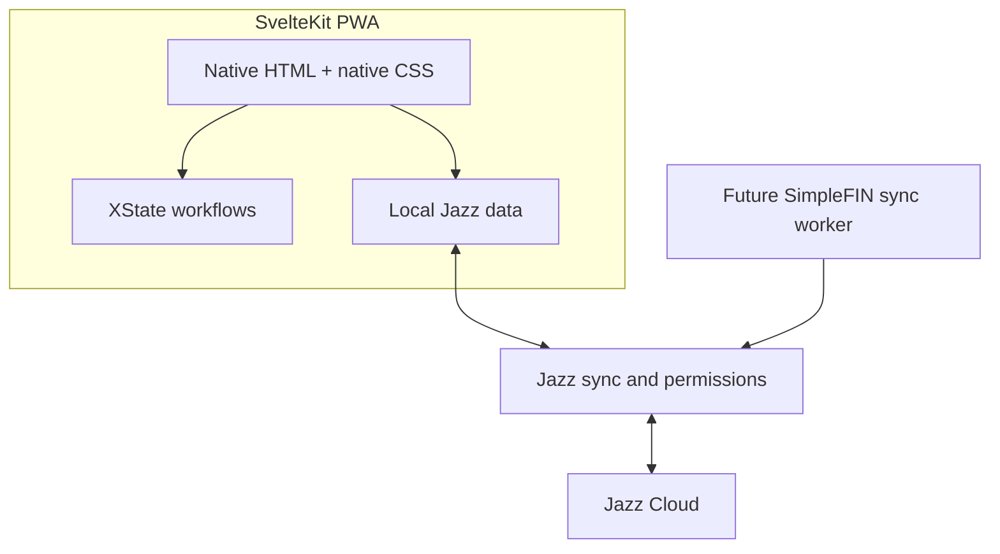

# Implementation Plan: Delightful Finance MVP

**Branch**: `001-finance-mvp` | **Date**: 2026-10-11 | **Spec**: [spec.md](spec.md)

## Summary

Build a local-first personal finance MVP using SvelteKit/Svelte 5 and Jazz v2. Establish a safe organization/account data model and Jazz permissions first, then auth/workspace bootstrapping, account CRUD, transaction/category/tag workflows, and the offline-capable application shell.

## Technical Context

**Language/Version**: TypeScript (strict), Svelte 5
**Primary Dependencies**: SvelteKit 3, `jazz-tools` v2, XState + `@xstate/svelte`, Paraglide JS
**Storage/Sync**: Jazz local-first data and sync; Jazz Cloud initially
**Testing**: Automated unit tests plus Playwright end-to-end tests are required for all application features and production code paths. Unit tests cover domain logic, validators, state machines, and permission boundaries; Playwright covers primary user journeys, authorization outcomes, and supported offline behavior. Tests ship with the implementation and run in CI.
**Target Platform**: Responsive browser/PWA
**Project Type**: Web application
**Performance Goals**: Common reads and writes operate against local Jazz state without waiting for network.
**Constraints**: No `any`; no `as` casts; no floating-point money; no Tailwind; all UI strings through Paraglide; do not expose SimpleFIN Access URLs to ordinary client replicas.
**Scale/Scope**: Personal USD MVP, with forward-compatible org membership, account grants, provider metadata, attachment, and batch schema.

## Constitution Check

- **Local-first**: Jazz is the durable store and sync layer; offline-first reads/writes are required.
- **Type safety**: strict TS, no `any`/`as`, discriminated domain unions.
- **Financial integrity**: integer minor units, ISO currency, explicit transaction kind and references.
- **Access control**: organization tenancy and grant-aware Jazz permissions are part of the initial schema.
- **Accessible/localized UI**: semantic HTML controls, native CSS, Paraglide, responsive design.
- **Secrets**: SimpleFIN claiming/fetching is server-side; setup tokens are transient and Access URLs admin-only.
- **Evolution**: additive Jazz migrations and related tables for check details, attachments, batches, and provider links.
- **Testability**: isolate domain logic and Jazz boundary adapters so they can be unit-tested; provide stable browser flows and fixtures for Playwright coverage.

## Architecture

Keep Jazz queries, XState setup, and workflow logic in their pages or shared integration components. These compose imported props-only presentation components rather than declaring native HTML. Shared helpers exist for genuinely reused behavior, such as the form actor lifecycle; page-specific controller files are not required. Income/expense routes share TransactionEntry and TransactionView integration components to avoid duplicated workflows.



- Jazz owns data, authentication, local persistence, sync, and authorization. Permission checks filter reads and reject illegal writes.
- XState models multi-step transaction composition (including check details) and tag picker flows. Simple toggles and current org selection use Svelte state.
- Paraglide provides all labels, errors, and other visible text.
- Use SvelteKit's native service worker with prerendered public page shells and a web app manifest. Cache only public shells/build assets; do not intercept Jazz data, authentication, or synchronization. Workbox is deferred. Show sync/pending state without blocking local work.
- SimpleFIN claim and fetch are future server-side worker operations. Never broadcast the Access URL through normal user replicas.

## Data Design

### Core records

- `profiles`: Jazz user display name.
- `organizations`: `kind` personal/business, default currency (USD at MVP).
- `organizationMembers`: org/user with role owner/admin/member/viewer.
- `accounts`: organization-linked cash/bank/card ledger, name/currency/archive state.
- `accountMemberships`: org/user/account with read/write access.
- `categories`: org-scoped expense/income categories, including protected system Uncategorized per kind.
- `tags`: org-scoped name, optional category, archive state.
- `transactions`: account and org references; integer `amountMinor`; kind expense/income; ISO currency; category; date `bookedOn`; source; optional memo/externalId/batchId; income payment method.
- `transactionTags`: many-to-many transaction/tag relation with an explicit `organizationId`. Insert permissions require transaction edit access and verify that both referenced rows match that workspace; newly assigned tags must be active. Read/delete checks retain archived-tag history while enforcing transaction access. Link updates are denied; reassignment uses delete/insert. Ten real-server permission checks pass, including same-transaction assignment, archived history, cross-workspace rejection, and role/grant access. The user authorized resetting pre-alpha development data and migration history. No migration files or snapshots are retained during this pre-alpha stage. Future schema changes must either provide migrations or receive explicit authorization for another data reset.
- `checkDetails`: required number/date in a dedicated record selected by transactions.checkDetailsId. Detail rows carry explicit organizationId/accountId references; insertion requires write access to the matching active account. createTransaction inserts the detail before its parent in one database transaction using the same preallocated row ID. Parent insert/update policies require the selected detail to exist and match transaction ID, account ID, and organization ID, closing the initial missing/shared-reference gap without circular authorization. Selection is singular and immutable; detail updates preserve transaction/account/workspace and match the selected parent; detail deletion is denied. Reads follow account grants. Authorized unselected detail candidates may exist through direct writes, but cannot become a second selected detail or be shared by another transaction. App creation writes both together; a server-rejected parent rolls back both records. After explicit reset/test authorization, the development database and app namespace were reset and this schema/policy published successfully. Verification on 2026-10-15: 106 focused unit tests, 10 check-detail integrity/access browser scenarios, 13 transaction form/detail/tag browser scenarios, and application/test/worker static checks pass. Coverage includes absent/shared/wrong-account/wrong-workspace initial references, concurrent selections, required date, edits, reassignment/deletion, atomic rollback, all role/grant cases, and offline tag workflows. Concurrent dependent writes may return cascade_rejected after an authoritative permission rejection; tests assert both rejection and unchanged selection. No migration files are retained.
- `simplefinConnections`: org connection status and Access URL, readable only by owner/admin.
- `simplefinAccountLinks`: org/account to provider account mapping.
- `transactionAttachments`, Jazz file tables, `transactionBatches`, `batchTemplates`: schema/policy stubs for later features.

### Transaction rules

`amountMinor` is a non-negative integer in minor currency units. `kind` identifies expense/income; amount sign is never overloaded. `currency` is copied from the account on creation and stored. `categoryId`, `accountId`, and `organizationId` are required. `bookedOn` is the calendar/business date; Jazz `$createdAt`/`$updatedAt` supply audit timestamps. Income has a payment method; check method requires a `checkDetails` relation. Manual source needs no provider id; SimpleFIN source requires an `externalId` for idempotency. Transfers are deferred.

### Permission rules

- Org owner/admin: all organization accounts and associated data.
- Member/viewer with `accountAccessMode: all`: all org accounts.
- Member/viewer with `accountAccessMode: selected`: only explicitly granted accounts; zero grants means no account access.
- Grants are effective only while the user is an active organization member; viewers remain read-only even if a grant row has write access.
- SimpleFIN credential fields: org owner/admin only, independent of access to normal financial data.
- Writes must validate organization/account/category relationships; unauthorized writes are rejected.

## Project Layout

```text
src/lib/schema.ts
src/lib/permissions.ts
src/lib/domain/money.ts
src/lib/machines/form.ts
src/lib/validation/transactions.ts
src/lib/schema/
src/lib/components/
src/service-worker/
src/routes/
messages/en.json
static/
```

Current routes: `/`, `/accounts`, `/accounts/new`, `/expenses`, `/expenses/new`, `/incomes`, `/incomes/new`, `/login`, `/account` (account recovery), `/settings/workspace`, `/settings/categories`, `/settings/tags`, and `/transactions/[id]`. Account management uses the shared sidebar and existing account list/create forms; history stays in the income/expense views.

Workspace settings use `/settings/workspace` and a reusable `WorkspaceNameForm` component. Read the submitted form with `FormData`, validate a trimmed non-empty name with Zod, and save through Jazz at the local durability tier. Owners/admins may edit; members/viewers get read-only controls. The component, page wiring, and sidebar navigation are implemented; the navigation test confirms the selected workspace and database session survive client navigation. Five shared form-machine unit tests and five workspace browser tests pass after implementation approval. Reactive reads use Jazz’s `QuerySubscriptionOne`; `QueryContent` shares loading/error feedback.

Use a shared XState form machine for validation/save lifecycles, with invoked promise actors for Zod validation and each form's save function. A generic `Form` component collects submitted field data and accepts the schema, save function, fixed operation context, and Svelte snippets for fields/controls/feedback. Workspace naming uses this workflow. `TransactionForm` now uses it too, with a Zod form-data adapter piped into the transaction domain schema; the reviewed migration has 29 passing adapter unit tests and three passing browser regressions, including workspace draft reset and check validation retry. The separate transaction form machine has been removed. See [Reusable forms](../../docs/forms.md).

## Implementation Phases

1. **Scaffold**: create the Jazz SvelteKit app; establish strict TypeScript, semantic HTML controls, XState, Paraglide, and PWA baseline.
2. **Schema and permissions**: implement complete forward-compatible domain schema, checks/invariants, org/account-grant access rules, and admin-only SimpleFIN secret access.
3. **Authentication and workspace**: wire Jazz auth; first login creates profile, personal org, owner membership, and required categories.
4. **Accounts**: create/list/archive UI for USD ledgers; preserve historical data.
5. **Transactions and organization**: implement transaction form, check details, categories/tags, typeahead, XState flows, and org shell.
6. **Offline shell and polish**: configure PWA caching around Jazz, surface sync state, and complete responsive styling with unit and Playwright coverage, including supported offline writes.

## Test Strategy

- Add a unit test for each production module's meaningful behavior, including normal cases, validation failures, permission edge cases, and state-machine transitions. Pure money/date/domain logic should have direct, deterministic tests.
- Add Playwright tests for each primary user journey: sign-in/workspace bootstrap, account create/archive, transaction entry/listing (including check income), category/tag management, organization access boundaries, and offline writes/sync where the app/runtime supports reliable browser simulation.
- Keep test fixtures isolated and avoid relying on external Jazz Cloud or bank-provider availability for routine test runs; use controlled test configuration or adapters where needed.
- Run relevant unit and Playwright suites in CI. A feature is complete only after its related tests pass; tests are part of each implementation task, not a later optional phase.

## Risks and Decisions to Resolve During Implementation

- Keep authorization rules aligned with the explicit `accountAccessMode` field; grants are effective only for active organization members, and viewers remain read-only.
- The chosen SimpleFIN credential storage model is not end-to-end secret against users able to read the record or operate the worker; limit readers and document operational access.
- PWA caching must avoid stale app code conflicting with synchronized local data.
- Confirm exact check-specific fields and any Jazz file-table requirements when implementing those stubs.

## Transaction Attribution and Login Profiles

Use Jazz's built-in `$createdBy`, `$createdAt`, `$updatedBy`, and `$updatedAt` query metadata for creator and latest-editor attribution; do not duplicate these fields in the transaction schema. Resolve author account identities to login profiles. This scope does not require a complete edit-history UI.

Extend the existing identity profile with an optional avatar and provide owner-editable display name and avatar controls. Reuse Jazz storage primitives supported by the installed v2 SDK; confirm the avatar API before implementation rather than assuming classic Jazz profile/image APIs apply. Author display profiles must be readable by authorized workspace members while profile writes remain owner-only. Provide fallbacks for absent profile details. Profile avatar uploads are separate from deferred transaction attachments.

### Avatar storage decision

The installed `jazz-tools@2.0.0-alpha.59` exposes `s.bytes()` / Uint8Array columns and direct database writes. Its typed Db API does not expose the file helper methods shown in older indexed documentation, and Classic FileStream is explicitly unsupported. Use nullable `profiles.avatarData` and `profiles.avatarMimeType` for small avatars, retaining the existing owner-only profile permissions. The current [Jazz column documentation](https://jazz.tools/docs/schemas/column-types) confirms binary columns.

Accept PNG, JPEG, or WebP uploads up to 10 MiB. Use Pica 10 to resize decoded images to at most 256 pixels on their longest edge without upscaling or changing aspect ratio, then encode WebP at quality 0.85. Browser decoding honors image orientation; persisted MIME type comes from the encoded Blob, including browser format fallback. Canonical storage validation keeps processed avatars within 256 KiB. Derive validation from the canonical identity/profile schema and validate the selected File with Zod before processing. Upload/replace writes both fields together; remove clears both. Writes wait for local persistence. Render through a temporary Blob URL that is revoked when the image changes or the component unmounts. Keep workflow logic in /account and presentation in ProfileAvatarForm. The membership self-join type-checked but the installed server rejected publication with JoinNotRefCompatible for profiles.userId. That unsupported policy was replaced with a declared-reference implementation. The revised implementation declares nullable organizationMembers.profileId with a forward profile relation and reverse profiles.memberships relation. Bootstrap links the personal owner membership to the actual profile row and repairs a missing link. Shared reads correlate profile.id to that declared reference, then join requester membership in the same organization; profile writes remain owner-only. Future membership creation must supply the corresponding profileId to expose that member’s display profile. Missing links grant no shared read access. After review and explicit authorization, the development database and app namespace were reset again and the revised schema/permissions published successfully. Seven real-server browser tests pass for shared admin/member/viewer visibility, binary avatar reads, missing profile links, unrelated-user isolation, private-workspace isolation, reciprocal access revocation after membership removal, named transaction attribution, and owner-only writes. All 11 authentication/profile/avatar browser regressions and 43 focused persistence/bootstrap unit tests pass. The user authorized resetting pre-alpha development data for this schema change. The development database was cleared and the app ID rotated to isolate old browser data; no migration files are retained. Unit tests, independent real-browser Pica processing checks, and all 11 authentication browser tests pass, including the four avatar lifecycle scenarios.

## Approved Delightful UI Trial

Integrate the current library through a versioned archive in `vendor/` and a relative package dependency, requiring compatible Svelte 5. Apply the global light theme once in the root layout and migrate applicable native controls across existing components. The user approved a multi-component review cycle for this migration and full theme styling; other constitution requirements remain in effect. Preserve Finance's form machines, data/validation boundaries, permissions, localization and native submission/reset behavior. Exclude uncommitted work in the main checkout.

Document observed reusable component gaps in `docs/delightful-ui-integration.md`, the feature spec and relevant code comments; implement no speculative library APIs. Perform static/build checks before presenting the trial. Add or run focused runtime regressions only after implementation approval. Do not commit, push or publish without authorization.

## Presentation and Integration Boundaries

Keep Jazz queries, XState setup, permissions, and workflow logic in the page or integration component using them. These compose imported pure presentation components rather than declaring native HTML. Pure components receive props/callbacks and may own simple presentation state. Extract shared helpers for genuinely reused behavior, not simply to relocate page scripts into controller files. Default review batches remain small; the user authorized the full boundary correction and its tests together.

Income and expense routes share TransactionView and TransactionEntry integration components. They keep subscription and form workflows in their Svelte scripts, then compose TransactionList/TransactionListItem and TransactionForm/TransactionTagInput respectively. The generic form actor lifecycle remains in forms.svelte.ts. Account, workspace, category, tag, login, recovery, and transaction-detail integrations live directly in their owning routes. WorkspaceBootstrap keeps startup/session and shell queries together and composes pure AppShell/JazzStartup components.

Transaction details scope rows to the active workspace and select Jazz author/timestamp metadata plus related account/category/tag/check records. The query result type is inferred from the shared schema query shape. TransactionDetails receives the loaded record and author names through props. Current profile permissions allow only the user's own display name; other author identities use the stable account-ID fallback until shared-profile access is implemented.

## Delightful UI component adoption, second review batch

Trial the refreshed local package in feat/ui-components-round-two: query status, linked transaction feedback/currency input, account table, responsive inline/overlay navigation, and avatar image input. Keep business logic and schema work isolated in main. Use translated strings, native form contracts, gap-based spacing, and caller-owned responsive/validation state. Package/static/build checks precede implementation review; focused consumer tests follow approval. See docs/delightful-ui-integration.md.
