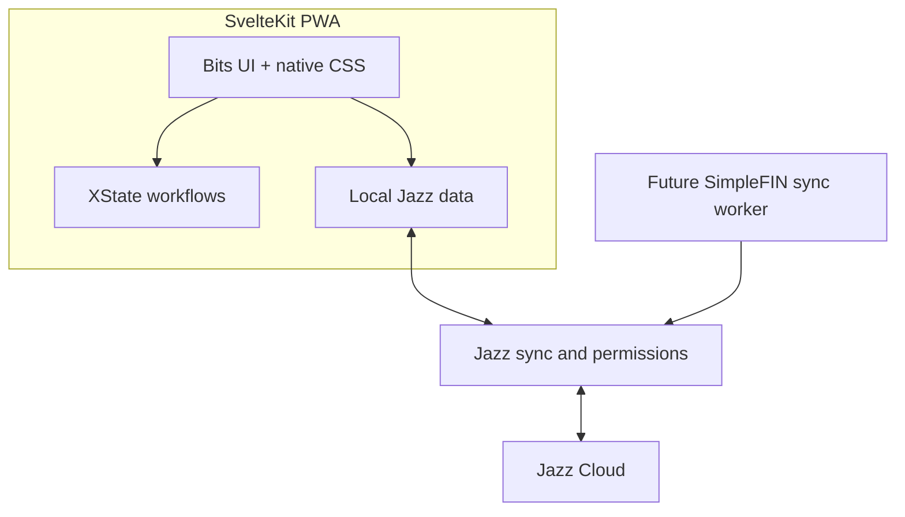

# Implementation Plan: Delightful Finance MVP

**Branch**: `001-finance-mvp` | **Date**: 2026-10-11 | **Spec**: [spec.md](spec.md)

## Summary

Build a local-first personal finance MVP using SvelteKit/Svelte 5 and Jazz v2. Establish a safe organization/account data model and Jazz permissions first, then auth/workspace bootstrapping, account CRUD, transaction/category/tag workflows, and the offline-capable application shell.

## Technical Context

**Language/Version**: TypeScript (strict), Svelte 5
**Primary Dependencies**: SvelteKit, `jazz-tools` v2, Bits UI, XState + `@xstate/svelte`, Paraglide JS, `@vite-pwa/sveltekit`
**Storage/Sync**: Jazz local-first data and sync; Jazz Cloud initially
**Testing**: Automated unit tests plus Playwright end-to-end tests are required for all application features and production code paths. Unit tests cover domain logic, validators, state machines, and permission boundaries; Playwright covers primary user journeys, authorization outcomes, and supported offline behavior. Tests ship with the implementation and run in CI.
**Target Platform**: Responsive browser/PWA
**Project Type**: Web application
**Performance Goals**: Common reads and writes operate against local Jazz state without waiting for network.
**Constraints**: No `any`; no `as` casts; no floating-point money; no Tailwind; all UI strings through Paraglide; do not expose SimpleFIN Access URLs to ordinary client replicas.
**Scale/Scope**: Personal USD MVP, with forward-compatible org membership, account grants, provider metadata, attachment, and batch schema.

## Constitution Check

- **Local-first**: Jazz is the durable store and sync layer; offline-first reads/writes are required.
- **Type safety**: strict TS, no `any`/`as`, discriminated domain unions.
- **Financial integrity**: integer minor units, ISO currency, explicit transaction kind and references.
- **Access control**: organization tenancy and grant-aware Jazz permissions are part of the initial schema.
- **Accessible/localized UI**: Bits UI, native CSS, Paraglide, responsive design.
- **Secrets**: SimpleFIN claiming/fetching is server-side; setup tokens are transient and Access URLs admin-only.
- **Evolution**: additive Jazz migrations and related tables for check details, attachments, batches, and provider links.
- **Testability**: isolate domain logic and Jazz boundary adapters so they can be unit-tested; provide stable browser flows and fixtures for Playwright coverage.

## Architecture



- Jazz owns data, authentication, local persistence, sync, and authorization. Permission checks filter reads and reject illegal writes.
- XState models multi-step transaction composition (including check details) and tag picker flows. Simple toggles and current org selection use Svelte state.
- Paraglide provides all labels, errors, and other visible text.
- The PWA shell must not interfere with Jazz's storage/sync. Show sync/pending state without blocking local work.
- SimpleFIN claim and fetch are future server-side worker operations. Never broadcast the Access URL through normal user replicas.

## Data Design

### Core records

- `profiles`: Jazz user display name.
- `organizations`: `kind` personal/business, default currency (USD at MVP).
- `organizationMembers`: org/user with role owner/admin/member/viewer.
- `accounts`: organization-linked cash/bank/card ledger, name/currency/archive state.
- `accountMemberships`: org/user/account with read/write access.
- `categories`: org-scoped expense/income categories, including protected system Uncategorized per kind.
- `tags`: org-scoped name, optional category, archive state.
- `transactions`: account and org references; integer `amountMinor`; kind expense/income; ISO currency; category; date `bookedOn`; source; optional memo/externalId/batchId; income payment method.
- `transactionTags`: many-to-many transaction/tag relation.
- `checkDetails`: one-to-one transaction relation for check number/date/payer/bank/memo-on-check fields.
- `simplefinConnections`: org connection status and Access URL, readable only by owner/admin.
- `simplefinAccountLinks`: org/account to provider account mapping.
- `transactionAttachments`, Jazz file tables, `transactionBatches`, `batchTemplates`: schema/policy stubs for later features.

### Transaction rules

`amountMinor` is a non-negative integer in minor currency units. `kind` identifies expense/income; amount sign is never overloaded. `currency` is copied from the account on creation and stored. `categoryId`, `accountId`, and `organizationId` are required. `bookedOn` is the calendar/business date; Jazz `$createdAt`/`$updatedAt` supply audit timestamps. Income has a payment method; check method requires a `checkDetails` relation. Manual source needs no provider id; SimpleFIN source requires an `externalId` for idempotency. Transfers are deferred.

### Permission rules

- Org owner/admin: all organization accounts and associated data.
- Member/viewer with zero account grant records for the organization: all org accounts (personal-org default).
- Member/viewer with one or more grant records: only granted accounts and related transactions/tags through membership-aware checks.
- SimpleFIN credential fields: org owner/admin only, independent of access to normal financial data.
- Writes must validate organization/account/category relationships; unauthorized writes are rejected.

## Project Layout

```text
src/lib/schema.ts
src/lib/permissions.ts
src/lib/money.ts
src/lib/machines/transactionForm.ts
src/lib/machines/tagPicker.ts
src/lib/machines/orgSwitch.ts
src/lib/components/ui/
src/routes/
messages/en.json
static/
```

Initial routes: `/`, `/accounts`, `/accounts/[id]`, `/transactions/new`, `/settings/tags`, `/settings/organization`.

## Implementation Phases

1. **Scaffold**: create the Jazz SvelteKit app; establish strict TypeScript, Bits UI, XState, Paraglide, and PWA baseline.
2. **Schema and permissions**: implement complete forward-compatible domain schema, checks/invariants, org/account-grant access rules, and admin-only SimpleFIN secret access.
3. **Authentication and workspace**: wire Jazz auth; first login creates profile, personal org, owner membership, and required categories.
4. **Accounts**: create/list/archive UI for USD ledgers; preserve historical data.
5. **Transactions and organization**: implement transaction form, check details, categories/tags, typeahead, XState flows, and org shell.
6. **Offline shell and polish**: configure PWA caching around Jazz, surface sync state, and complete responsive styling with unit and Playwright coverage, including supported offline writes.

## Test Strategy

- Add a unit test for each production module's meaningful behavior, including normal cases, validation failures, permission edge cases, and state-machine transitions. Pure money/date/domain logic should have direct, deterministic tests.
- Add Playwright tests for each primary user journey: sign-in/workspace bootstrap, account create/archive, transaction entry/listing (including check income), category/tag management, organization access boundaries, and offline writes/sync where the app/runtime supports reliable browser simulation.
- Keep test fixtures isolated and avoid relying on external Jazz Cloud or bank-provider availability for routine test runs; use controlled test configuration or adapters where needed.
- Run relevant unit and Playwright suites in CI. A feature is complete only after its related tests pass; tests are part of each implementation task, not a later optional phase.

## Risks and Decisions to Resolve During Implementation

- Confirm Jazz v2 schema/permission APIs for relational checks and whether the account-grant “no grants means all accounts” condition can be enforced directly in client-visible rules. If not, design an equivalent secure policy before account sharing ships.
- The chosen SimpleFIN credential storage model is not end-to-end secret against users able to read the record or operate the worker; limit readers and document operational access.
- PWA caching must avoid stale app code conflicting with synchronized local data.
- Confirm exact check-specific fields and any Jazz file-table requirements when implementing those stubs.
