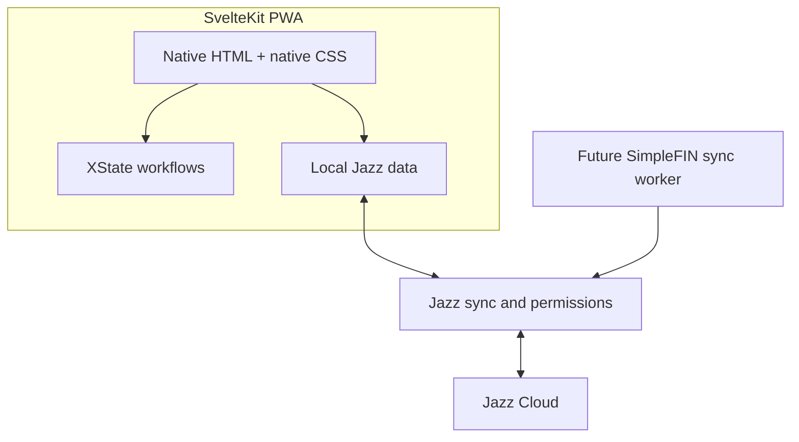

# Implementation Plan: Delightful Finance MVP

**Branch**: `001-finance-mvp` | **Date**: 2026-10-11 | **Spec**: [spec.md](spec.md)

## Summary

Build a local-first personal finance MVP using SvelteKit/Svelte 5 and Jazz v2. Establish a safe organization/account data model and Jazz permissions first, then auth/workspace bootstrapping, account CRUD, transaction/category/tag workflows, and the offline-capable application shell.

## Technical Context

**Language/Version**: TypeScript (strict), Svelte 5
**Primary Dependencies**: SvelteKit 3, `jazz-tools` v2, XState + `@xstate/svelte`, Paraglide JS
**Storage/Sync**: Jazz local-first data and sync; Jazz Cloud initially
**Testing**: Automated unit tests plus Playwright end-to-end tests are required for all application features and production code paths. Unit tests cover domain logic, validators, state machines, and permission boundaries; Playwright covers primary user journeys, authorization outcomes, and supported offline behavior. Tests ship with the implementation and run in CI.
**Target Platform**: Responsive browser/PWA
**Project Type**: Web application
**Performance Goals**: Common reads and writes operate against local Jazz state without waiting for network.
**Constraints**: No `any`; no `as` casts; no floating-point money; no Tailwind; all UI strings through Paraglide; do not expose SimpleFIN Access URLs to ordinary client replicas.
**Scale/Scope**: Personal USD MVP, with forward-compatible org membership, account grants, provider metadata, attachment, and batch schema.

## Constitution Check

- **Local-first**: Jazz is the durable store and sync layer; offline-first reads/writes are required.
- **Type safety**: strict TS, no `any`/`as`, discriminated domain unions.
- **Financial integrity**: integer minor units, ISO currency, explicit transaction kind and references.
- **Access control**: organization tenancy and grant-aware Jazz permissions are part of the initial schema.
- **Accessible/localized UI**: semantic HTML controls, native CSS, Paraglide, responsive design.
- **Secrets**: SimpleFIN claiming/fetching is server-side; setup tokens are transient and Access URLs admin-only.
- **Evolution**: additive Jazz migrations and related tables for check details, attachments, batches, and provider links.
- **Testability**: isolate domain logic and Jazz boundary adapters so they can be unit-tested; provide stable browser flows and fixtures for Playwright coverage.

## Architecture

Keep Jazz queries, XState setup, and workflow logic in their pages or shared integration components. These compose imported props-only presentation components rather than declaring native HTML. Shared helpers exist for genuinely reused behavior, such as the form actor lifecycle; page-specific controller files are not required. Income/expense routes share TransactionEntry and TransactionView integration components to avoid duplicated workflows.



- Jazz owns data, authentication, local persistence, sync, and authorization. Permission checks filter reads and reject illegal writes.
- XState models multi-step transaction composition (including check details) and tag picker flows. Simple toggles and current org selection use Svelte state.
- Paraglide provides all labels, errors, and other visible text.
- Use SvelteKit's native service worker with prerendered public page shells and a web app manifest. Cache only public shells/build assets; do not intercept Jazz data, authentication, or synchronization. Workbox is deferred. Show sync/pending state without blocking local work.
- SimpleFIN claim and fetch are future server-side worker operations. Never broadcast the Access URL through normal user replicas.

## Data Design

### Core records

- `profiles`: Jazz user display name.
- `organizations`: `kind` personal/business, default currency (USD at MVP).
- `organizationMembers`: org/user with role owner/admin/member/viewer.
- `accounts`: organization-linked cash/bank/card ledger, name/currency/archive state.
- `accountMemberships`: org/user/account with read/write access.
- `categories`: org-scoped expense/income categories, including protected system Uncategorized per kind.
- `tags`: org-scoped name, optional category, archive state.
- `transactions`: account and org references; integer `amountMinor`; kind expense/income; ISO currency; category; date `bookedOn`; source; optional memo/externalId/batchId; income payment method.
- `transactionTags`: many-to-many transaction/tag relation with an explicit `organizationId`. Insert permissions require transaction edit access and verify that both referenced rows match that workspace; newly assigned tags must be active. Read/delete checks retain archived-tag history while enforcing transaction access. Link updates are denied; reassignment uses delete/insert. Ten real-server permission checks pass, including same-transaction assignment, archived history, cross-workspace rejection, and role/grant access. The user authorized resetting pre-alpha development data and migration history. No migration files or snapshots are retained during this pre-alpha stage. Future schema changes must either provide migrations or receive explicit authorization for another data reset.
- `checkDetails`: required number/date in a dedicated record selected by transactions.checkDetailsId. Detail rows carry explicit organizationId/accountId references; insertion requires write access to the matching active account. createTransaction inserts the detail before its parent in one database transaction using the same preallocated row ID. Parent insert/update policies require the selected detail to exist and match transaction ID, account ID, and organization ID, closing the initial missing/shared-reference gap without circular authorization. Selection is singular and immutable; detail updates preserve transaction/account/workspace and match the selected parent; detail deletion is denied. Reads follow account grants. Authorized unselected detail candidates may exist through direct writes, but cannot become a second selected detail or be shared by another transaction. App creation writes both together; a server-rejected parent rolls back both records. After explicit reset/test authorization, the development database and app namespace were reset and this schema/policy published successfully. Verification on 2026-10-15: 106 focused unit tests, 10 check-detail integrity/access browser scenarios, 13 transaction form/detail/tag browser scenarios, and application/test/worker static checks pass. Coverage includes absent/shared/wrong-account/wrong-workspace initial references, concurrent selections, required date, edits, reassignment/deletion, atomic rollback, all role/grant cases, and offline tag workflows. Concurrent dependent writes may return cascade_rejected after an authoritative permission rejection; tests assert both rejection and unchanged selection. No migration files are retained.
- `simplefinConnections`: org connection status and Access URL, readable only by owner/admin.
- `simplefinAccountLinks`: org/account to provider account mapping.
- `transactionAttachments`, Jazz file tables, `transactionBatches`, `batchTemplates`: schema/policy stubs for later features.

### Transaction rules

`amountMinor` is a non-negative integer in minor currency units. `kind` identifies expense/income; amount sign is never overloaded. `currency` is copied from the account on creation and stored. `categoryId`, `accountId`, and `organizationId` are required. `bookedOn` is the calendar/business date; Jazz `$createdAt`/`$updatedAt` supply audit timestamps. Income has a payment method; check method requires a `checkDetails` relation. Manual source needs no provider id; SimpleFIN source requires an `externalId` for idempotency. Transfers are deferred.

### Permission rules

- Org owner/admin: all organization accounts and associated data.
- Member/viewer with `accountAccessMode: all`: all org accounts.
- Member/viewer with `accountAccessMode: selected`: only explicitly granted accounts; zero grants means no account access.
- Grants are effective only while the user is an active organization member; viewers remain read-only even if a grant row has write access.
- SimpleFIN credential fields: org owner/admin only, independent of access to normal financial data.
- Writes must validate organization/account/category relationships; unauthorized writes are rejected.

## Project Layout

```text
src/lib/schema.ts
src/lib/permissions.ts
src/lib/domain/money.ts
src/lib/machines/form.ts
src/lib/validation/transactions.ts
src/lib/schema/
src/lib/components/
src/service-worker/
src/routes/
messages/en.json
static/
```

Current routes: `/`, `/accounts`, `/expenses`, `/expenses/new`, `/incomes`, `/incomes/new`, `/login`, `/account` (account recovery), `/settings/workspace`, `/settings/categories`, `/settings/tags`, and `/transactions/[id]`. Account management uses the shared sidebar and existing account list/create forms; history stays in the income/expense views.

Workspace settings use `/settings/workspace` and a reusable `WorkspaceNameForm` component. Read the submitted form with `FormData`, validate a trimmed non-empty name with Zod, and save through Jazz at the local durability tier. Owners/admins may edit; members/viewers get read-only controls. The component, page wiring, and sidebar navigation are implemented; the navigation test confirms the selected workspace and database session survive client navigation. Five shared form-machine unit tests and five workspace browser tests pass after implementation approval. Reactive reads use Jazz’s `QuerySubscriptionOne`; `QueryContent` shares loading/error feedback.

Use a shared XState form machine for validation/save lifecycles, with invoked promise actors for Zod validation and each form's save function. A generic `Form` component collects submitted field data and accepts the schema, save function, fixed operation context, and Svelte snippets for fields/controls/feedback. Workspace naming uses this workflow. `TransactionForm` now uses it too, with a Zod form-data adapter piped into the transaction domain schema; the reviewed migration has 29 passing adapter unit tests and three passing browser regressions, including workspace draft reset and check validation retry. The separate transaction form machine has been removed. See [Reusable forms](../../docs/forms.md).

## Implementation Phases

1. **Scaffold**: create the Jazz SvelteKit app; establish strict TypeScript, semantic HTML controls, XState, Paraglide, and PWA baseline.
2. **Schema and permissions**: implement complete forward-compatible domain schema, checks/invariants, org/account-grant access rules, and admin-only SimpleFIN secret access.
3. **Authentication and workspace**: wire Jazz auth; first login creates profile, personal org, owner membership, and required categories.
4. **Accounts**: create/list/archive UI for USD ledgers; preserve historical data.
5. **Transactions and organization**: implement transaction form, check details, categories/tags, typeahead, XState flows, and org shell.
6. **Offline shell and polish**: configure PWA caching around Jazz, surface sync state, and complete responsive styling with unit and Playwright coverage, including supported offline writes.

## Test Strategy

- Add a unit test for each production module's meaningful behavior, including normal cases, validation failures, permission edge cases, and state-machine transitions. Pure money/date/domain logic should have direct, deterministic tests.
- Add Playwright tests for each primary user journey: sign-in/workspace bootstrap, account create/archive, transaction entry/listing (including check income), category/tag management, organization access boundaries, and offline writes/sync where the app/runtime supports reliable browser simulation.
- Keep test fixtures isolated and avoid relying on external Jazz Cloud or bank-provider availability for routine test runs; use controlled test configuration or adapters where needed.
- Run relevant unit and Playwright suites in CI. A feature is complete only after its related tests pass; tests are part of each implementation task, not a later optional phase.

## Risks and Decisions to Resolve During Implementation

- Keep authorization rules aligned with the explicit `accountAccessMode` field; grants are effective only for active organization members, and viewers remain read-only.
- The chosen SimpleFIN credential storage model is not end-to-end secret against users able to read the record or operate the worker; limit readers and document operational access.
- PWA caching must avoid stale app code conflicting with synchronized local data.
- Confirm exact check-specific fields and any Jazz file-table requirements when implementing those stubs.

## Transaction Attribution and Login Profiles

Use Jazz's built-in `$createdBy`, `$createdAt`, `$updatedBy`, and `$updatedAt` query metadata for creator and latest-editor attribution; do not duplicate these fields in the transaction schema. Resolve author account identities to login profiles. This scope does not require a complete edit-history UI.

Extend the existing identity profile with an optional avatar and provide owner-editable display name and avatar controls. Reuse Jazz storage primitives supported by the installed v2 SDK; confirm the avatar API before implementation rather than assuming classic Jazz profile/image APIs apply. Author display profiles must be readable by authorized workspace members while profile writes remain owner-only. Provide fallbacks for absent profile details. Profile avatar uploads are separate from deferred transaction attachments.

### Avatar storage decision

The installed `jazz-tools@2.0.0-alpha.59` exposes `s.bytes()` / Uint8Array columns and direct database writes. Its typed Db API does not expose the file helper methods shown in older indexed documentation, and Classic FileStream is explicitly unsupported. Use nullable `profiles.avatarData` and `profiles.avatarMimeType` for small avatars, retaining the existing owner-only profile permissions. The current [Jazz column documentation](https://jazz.tools/docs/schemas/column-types) confirms binary columns.

Accept PNG, JPEG, or WebP uploads up to 10 MiB. Use Pica 10 to resize decoded images to at most 256 pixels on their longest edge without upscaling or changing aspect ratio, then encode WebP at quality 0.85. Browser decoding honors image orientation; persisted MIME type comes from the encoded Blob, including browser format fallback. Canonical storage validation keeps processed avatars within 256 KiB. Derive validation from the canonical identity/profile schema and validate the selected File with Zod before processing. Upload/replace writes both fields together; remove clears both. Writes wait for local persistence. Render through a temporary Blob URL that is revoked when the image changes or the component unmounts. Keep workflow logic in /account and presentation in ProfileAvatarForm. The membership self-join type-checked but the installed server rejected publication with JoinNotRefCompatible for profiles.userId. That unsupported policy was replaced with a declared-reference implementation. The revised implementation declares nullable organizationMembers.profileId with a forward profile relation and reverse profiles.memberships relation. Bootstrap links the personal owner membership to the actual profile row and repairs a missing link. Shared reads correlate profile.id to that declared reference, then join requester membership in the same organization; profile writes remain owner-only. Future membership creation must supply the corresponding profileId to expose that member’s display profile. Missing links grant no shared read access. After review and explicit authorization, the development database and app namespace were reset again and the revised schema/permissions published successfully. Seven real-server browser tests pass for shared admin/member/viewer visibility, binary avatar reads, missing profile links, unrelated-user isolation, private-workspace isolation, reciprocal access revocation after membership removal, named transaction attribution, and owner-only writes. All 11 authentication/profile/avatar browser regressions and 43 focused persistence/bootstrap unit tests pass. The user authorized resetting pre-alpha development data for this schema change. The development database was cleared and the app ID rotated to isolate old browser data; no migration files are retained. Unit tests, independent real-browser Pica processing checks, and all 11 authentication browser tests pass, including the four avatar lifecycle scenarios.

## Approved Delightful UI Trial

Integrate the current library through a versioned archive in `vendor/` and a relative package dependency, requiring compatible Svelte 5. Apply the global light theme once in the root layout and migrate applicable native controls across existing components. The user approved a multi-component review cycle for this migration and full theme styling; other constitution requirements remain in effect. Preserve Finance's form machines, data/validation boundaries, permissions, localization and native submission/reset behavior. Exclude uncommitted work in the main checkout.

Document observed reusable component gaps in `docs/delightful-ui-integration.md`, the feature spec and relevant code comments; implement no speculative library APIs. Perform static/build checks before presenting the trial. Add or run focused runtime regressions only after implementation approval. Do not commit, push or publish without authorization.

## Presentation and Integration Boundaries

Keep Jazz queries, XState setup, permissions, and workflow logic in the page or integration component using them. These compose imported pure presentation components rather than declaring native HTML. Pure components receive props/callbacks and may own simple presentation state. Extract shared helpers for genuinely reused behavior, not simply to relocate page scripts into controller files. Default review batches remain small; the user authorized the full boundary correction and its tests together.

Income and expense routes share TransactionView and TransactionEntry integration components. They keep subscription and form workflows in their Svelte scripts, then compose TransactionList/TransactionListItem and TransactionForm/TransactionTagInput respectively. The generic form actor lifecycle remains in forms.svelte.ts. Account, workspace, category, tag, login, recovery, and transaction-detail integrations live directly in their owning routes. WorkspaceBootstrap keeps startup/session and shell queries together and composes pure AppShell/JazzStartup components.

Transaction details scope rows to the active workspace and select Jazz author/timestamp metadata plus related account/category/tag/check records. The query result type is inferred from the shared schema query shape. TransactionDetails receives the loaded record and author names through props. Current profile permissions allow only the user's own display name; other author identities use the stable account-ID fallback until shared-profile access is implemented.

## Delightful UI component adoption, second review batch

Trial the refreshed local package in feat/ui-components-round-two: query status, linked transaction feedback/currency input, account table, responsive inline/overlay navigation, and avatar image input. Keep business logic and schema work isolated in main. Use translated strings, native form contracts, gap-based spacing, and caller-owned responsive/validation state. Package/static/build checks precede implementation review; focused consumer tests follow approval. See docs/delightful-ui-integration.md.

## Deferred Sync Status Observability Findings (2026-10-15)

The compact Delightful UI StatusMessage is integrated at the bottom of the Drawer as deferred sync-status work. It reports configuration and browser connectivity only, using neutral informational styling; it does not claim a connected server, persisted write, or completed synchronization.

The installed `jazz-tools@2.0.0-alpha.59` public declarations provide per-write `WriteHandle.wait({ tier: 'local' | 'global' })`. A global wait confirms Core authorization and durable acceptance of that particular write. A local wait confirms local persistence while synchronization continues independently. See [Durability Tiers](https://jazz.tools/docs/reference/durability-tiers) and [How Sync Works](https://jazz.tools/docs/concepts/how-sync-works).

Inspection of the installed Db, WriteHandle, session, framework exports, and query metadata declarations found no public database-wide pending-write count or sync-completion subscription. Session `pending` describes authentication operations, not data synchronization. RemoteLinkState and its subscriptions are runtime internals and describe transport reachability, not write confirmation. `db.onMutationError` is a fallback for rejections not handled by an active write wait; it cannot provide a complete queue lifecycle. Public audit metadata does not expose confirmed durability. Comparing local and remote query results would also miss writes outside the selected query, deletions, and superseded versions; it cannot prove that all writes were accepted. The [internals documentation](https://jazz.tools/docs/reference/internals) distinguishes read settlement from write confirmation.

An application-owned tracker could observe global waits for writes it explicitly registers, but an in-memory tracker would lose outstanding state on reload and omit writes from other tabs or prior sessions. Providing a reliable whole-device indicator would require durable bookkeeping and reconciliation across those boundaries. Defer full pending/sync-completion status until supported SDK queue observability is available; do not add durable tracker infrastructure or upgrade the SDK without an explicit decision. Existing form saves continue to wait for local persistence and remain usable offline.

## T041 Localization and Formatting Audit (2026-10-15)

Audited the current page and presentation component tree, bootstrap defaults, validation/error rendering, page titles and accessibility labels, manifest metadata, and all money/date display call sites. English is the only configured locale.

- UI labels, feedback, page titles, and accessible names use Paraglide. Technical currency codes (for example USD), user-owned names/memos, IDs, and recovery phrases remain data rather than translated prose. Internal exception/Zod messages are mapped to translated UI feedback rather than rendered directly.
- Bootstrap workspace/category names now come from nested `defaults` messages. Seed keys preserve the previous deterministic UUID inputs independently of translated display names. Existing saved names are not rewritten; translating a starter name must not create another starter row.
- The manifest is now a prerendered endpoint at the same `/manifest.webmanifest` URL, using Paraglide app metadata and language/direction. Its public output remains eligible for the existing service-worker shell cache. Before adding another locale, extend the prerendered manifest entries and locale-specific install URLs; the present build targets the configured English locale only.
- Category counts use Intl.NumberFormat with getLocale; transaction tag summaries use Intl.ListFormat with getLocale. No extra formatting helper or library was introduced.
- All displayed money calls already pass getLocale to formatMoney, preserving integer minor-unit handling. Transaction/check calendar dates already use Intl.DateTimeFormat with the active locale and UTC; audit timestamps use locale-aware date/time formatting in the device timezone. Native date input values and datetime attributes retain machine-readable ISO formats. USD amount entry intentionally retains the MVP dot-decimal input contract described by its translated validation message.

Static application/service-worker checks pass with zero errors/warnings. The manifest output was generated successfully, but the production build fails at `prerender_unseen_routes` for the unchanged `/transactions/[id]` route, which inherits `prerender = true` from the root layout without concrete build entries. Resolve that separately before release verification. After implementation review, 88 focused unit tests pass across bootstrap/persistence, money, calendar-date helpers, transaction grouping, and the manifest endpoint. New coverage checks translated starter labels, original UUID values, seed-key omission from writes, reuse without renaming when defaults change, translated manifest metadata and language/direction, installation URLs, and currency formatting across English/German/French/Arabic and zero/three-decimal currencies. Four focused browser scenarios pass: manifest metadata/link, grouped counts and tag summaries using the English app locale in a German browser, existing category connection/archive behavior, and transaction grouping/history/currency totals. Test TypeScript checks pass. Production service-worker caching of the new manifest still requires successful production-preview verification; retain that verification under T040 rather than claiming it passed.

### Transaction detail build configuration follow-up

The build failure above is resolved by `src/routes/transactions/[id]/+page.ts` overriding inherited prerendering with `prerender = false`. Transaction IDs are local runtime data, not public build entries; SvelteKit retains this route in the dynamic server manifest while Jazz still opens records in the browser. Other public page shells and the localized install manifest remain prerendered. The production build now completes, including manifest prerendering and service-worker generation. No server was started or application tests run for this new configuration change before review. Next verification: direct transaction detail access in production preview and offline manifest retrieval through the service worker. This does not add offline navigation fallback for arbitrary transaction-detail URLs.

### Production preview verification (2026-10-15)

After review of the transaction-detail prerender override, all five production-preview browser checks pass: offline direct navigation/reload of a public shell, public-cache boundaries, worker updates preserving an open draft, direct server access/reload of a saved transaction detail, and offline localized-manifest retrieval. The detail response is HTTP 200, is not served from the worker cache, and contains no transaction memo before browser hydration; the app then loads the persisted record and formats its amount/calendar date. The offline manifest response is explicitly confirmed as service-worker-served, including metadata, language/direction and install URLs. This closes the earlier manifest-cache verification gap, without introducing an offline detail-URL navigation fallback. Install prompts and multi-tab activation remain separate T040 work.

Local preview setup matters: FINANCE_PREVIEW disables the Jazz development plugin, so the build must receive a valid PUBLIC_JAZZ_SERVER_URL and PUBLIC_JAZZ_APP_ID. An empty URL builds but the SDK rejects it at session startup. This verification used the existing healthy local Jazz dev server's public settings as build environment variables, without changing source environment files or resetting data. Following the intervening merge, pnpm install --frozen-lockfile --ignore-scripts synchronized node_modules with the committed vendored UI archive (which includes TopNavigation); no dependency declarations changed. The preview runs at http://127.0.0.1:4173. The PWA config now reuses an existing preview outside CI, and its ready-state assertion follows the merged navigation toggle. The public-cache test includes the already-shipped favicon and settings shells. Test TypeScript and diff checks pass.

### Multi-tab service-worker verification (2026-10-15)

All six current production-preview PWA scenarios pass. The additional update test opens two tabs with separate unsaved account drafts, installs a worker update, and checks unchanged controllers, no main-frame navigations, and retained drafts in both tabs. Closing the first tab leaves the update installed/waiting and the second draft/controller intact. After the second tab closes, the new worker activates; a reopened tab is controlled by the active worker with no waiting update. No production implementation change was needed. As in the existing update test, the fixture changes only generated worker bytes and restores them in finally; it verifies lifecycle behavior rather than a full asset-version deployment or cache-generation replacement. Browser-test TypeScript and diff checks pass. Native installation prompts remain unverified.

## T058 Authentication failure handling (2026-10-15)

Startup and session errors now show a translated retry action. Initial startup and session recovery share an XState machine with waiting, starting, ready, and error states. It ignores duplicate retries while starting and reuses the existing session. Jazz still owns account selection and recovery.

The restore form keeps error feedback when the SDK remounts it and prevents duplicate submissions. Recovery phrases stay within the form and restore operation. Raw SDK errors are not shown to users or stored in the machine.

Retry opens the account selected by the SDK. Failures before selection changes preserve the original account; failures after selection changes recover the selected account.

After implementation review, all 14 focused unit tests and 15 authentication browser tests pass. Coverage includes startup failure and retry, repeated failures, session reuse, malformed phrases, successful restoration, profile/avatar behavior, and offline avatars. Four browser failure cases verify:

- Blocked startup resources can be retried without losing the saved identity or data.
- Repeated shutdown failures show generic feedback and preserve the original identity.
- A storage failure after account selection recovers the selected identity.
- A shared-client shutdown error keeps the existing session usable; restoration succeeds after the extra client is released.

Browser-test TypeScript checks pass. Failure tests also check that recovery phrases are absent from captured diagnostics and request URLs.

### DUI package update (2026-10-15)

The compact StatusMessage type error is resolved. Finance uses a local archive built from DUI’s pushed `main` commit `756bdbb`. Finance and DUI static checks pass with no errors or warnings. DUI’s updated Drawer tests also pass. Package details are in `docs/delightful-ui-integration.md`. CI setup is deferred beyond MVP.

### Responsive drawer policy

Keep this simple disclosure state in AppShell. On mount, use the shared Finance `isMobile()` utility from `src/lib/viewport.ts`, backed by `window.matchMedia('(max-width: 48rem)').matches`, to initialize the drawer closed for compact viewports and open otherwise. The utility is browser-only and returns a boolean for the current viewport. Call it again when sidebar navigation or Sync now is selected; only compact viewports dismiss the drawer. Preserve manual disclosure state across resizing. No responsive policy belongs in Delightful UI; its current Drawer and Navigation already leave these decisions to the caller.

Implement the mobile push layout in AppShell CSS at the shared 48rem breakpoint: remove the workspace gap, keep main at a non-shrinking 100% flex basis including padding, size the drawer to `100% - 3.5rem` of its container, constrain the shell/workspace inline sizes, and clip horizontal overflow on both the shell and workspace. The drawer’s existing flex-basis transition moves the full-width main content. Leave desktop layout and DUI unchanged.

Track the current mobile viewport in AppShell using `isMobile()` on mount and window resize. Derive main inertness from mobile viewport and drawer disclosure. Place a native, translated dismissal button outside inert main over its visible strip; restore toggle focus when activated. Keep this simple presentation state local.

### Sidebar settings navigation

Update the existing AppShell presentation with the shared Details component and existing TDesign icons, keeping navigation behavior and localized labels. Rename the account page title and login labels through Paraglide. No workflow or actor changes are needed. Tests follow implementation review.

Compose the existing account navigation and filters inside an initially closed Accounts Details above Settings. Move the existing workspace selector into Settings with its own Current workspace localization; preserve subscriptions and callbacks.

Keep both disclosures closed initially, including on their destination routes. Match current-page links by exact pathname (ignoring a trailing slash), and style the existing aria-current attribute with the theme accent background, black text, and no underline.

### Transaction account default

TransactionEntry derives the default account ID from its name-ordered active-account query and the shared sidebar account filters. TransactionForm receives the ID as a presentation prop and uses the native select default, without remounting account or category controls when their defaults change while the form is open. Existing form actors and validation remain responsible for submission. No new workflow state is required for this selection default.

### Sidebar account order

WorkspaceBootstrap owns the account-order XState actor and browser storage binding. The machine has viewing/editing states, guarded MOVE transitions, OBSERVE for account changes and RESET for scope changes. AppShell receives presentation props/callbacks. The shared orderAccounts transformation orders sidebar accounts and transaction defaults; A dedicated context getter exposes the same synchronously resolved preference to TransactionEntry. Resolve browser storage on scope changes during derivation, rather than copying order through effects after forms render; this preserves the correct initial select value on direct navigation. Browser storage is scoped to identity/workspace and falls back to session-only ordering. No Jazz schema or permission changes.

### Sidebar icon alignment

Bundle current local DUI source with the Details caretPosition API in a distinct vendored archive. Scope zero drawer padding, zero Details borders, theme-spaced Details child content, and equal link/summary horizontal insets to AppShell. Nested navigation links use the Details content inset without additional link padding, aligning their icons with summaries and account checkboxes. Preserve disclosure and navigation behavior. Package and static checks precede review; browser tests follow implementation approval.

### Responsive categories table

Replace CategoryList’s native table wrapper with the existing DUI Table, following AccountList. Preserve column/row semantics, localized counts, archive callbacks and feedback. DUI owns overflow containment; no workflow changes are needed. Static checks precede review.

### Category creation modal

Keep the disclosure boolean in the pure CategoryForm component and wrap its existing FormContent in DUI Dialog. The page continues to own the form actor and persistence. Keep form content mounted to preserve drafts across dismissal; close on workspace changes. Retain the existing success/add-another flow within the modal. No new business workflow is introduced.

### Page content spacing

Extract the existing AppShell content wrapper into a reusable pure PageContent component. Use a single minmax(0, 1fr) grid column and the 1rem theme gap to space page blocks while allowing DUI table overflow containment. Adopt it once in AppShell for consistent routed content spacing.

### Tags table and creation modal

Adopt DUI Table in TagList with a localized caption. Wrap existing TagForm content in DUI Dialog, matching CategoryForm’s local disclosure, workspace-close effect, draft retention and Cancel/primary Add controls. Both creation modals opt into FormContent’s controlsFill presentation prop so Cancel and Add flex equally across the available row width. Keep page-owned subscriptions, permissions and form actors intact; use the existing shared PageContent gap. Static checks precede review.

### Shared creation modal and transaction account setup

User approved a larger related review cycle. Introduce a generic FormModal presentation combining DUI Dialog and FormContent with shared trigger, Cancel/primary Add controls and equal-width buttons; migrate CategoryForm, TagForm and AccountForm to it. Preserve their existing field/feedback snippets and category/tag add-another behavior. AccountCreation owns Jazz membership subscription and the existing form actor, rendering AccountForm; reuse it in account routes and no-account expense/income list/entry states. Preserve local-first createAccount and existing schema validation.

Model account creation access before effects: OBSERVE stores selected workspace, identity, membership loading/error and membership; checking transitions to waiting when scope is absent/loading, error on query failure, denied on mismatched scope/identity or non-admin membership, and allowed for owner/admin. Subsequent observations reevaluate access. Only allowed enables submission. The form actor retains editing → validating → saving → success/invalid/error, resets on workspace/identity changes and rechecks scope/access at persistence. Modal disclosure stays local, closes on scope change, and dismissal retains mounted draft content. On transaction pages the empty-account branch is replaced by the usable transaction UI when the live account query observes the new account; this also dismisses the empty-state modal. No transaction is submitted automatically. Formatting/static checks precede implementation review; tests remain deferred.

### Sidebar account modal

Remove /accounts/new and render AccountCreation from a sidebar snippet supplied by WorkspaceBootstrap. AppShell supplies a pure button trigger; FormModal owns disclosure and shared controls. Do not dismiss the mobile drawer on modal activation, so the trigger remains available for native focus restoration. Account fields use per-instance IDs because sidebar and page modals may coexist. Tests covering the removed route need migration after implementation approval.

Shared FormModal owns the existing TDesign plus/Save/X icons and gap-based icon/label spacing for creation triggers and modal controls. Custom sidebar triggers retain their existing plus icon.

### Creation modal validation results

After implementation approval, 79 focused units and 17 focused browser scenarios pass, along with application/service-worker and browser-test type checks. Runtime coverage spans the shared modal, category/tag persistence and overflow, workspace resets, account creation from all four expense/income list/entry routes, sidebar modal/focus at four viewport widths, geometry/icon alignment and the finance smoke flow. Corrected equal button sizing using border-box flex bases because DUI primary buttons have no border. Kept the local server at http://127.0.0.1:5173; restart after FINANCE_PREVIEW static sync before browser checks so its generated public Jazz URL is restored. The remaining suite migration and its verification results are recorded below.

### Existing browser suite migration

Update the seven existing browser suites and a small shared interaction helper within the approved modal/navigation scope. Tests must expand Accounts/Settings before interacting with nested navigation, use Current workspace and Login labels, scope account fields/actions to the active modal, dismiss before interacting with background content, and reopen after workspace changes. Preserve drafts in modals for production worker-update scenarios. Keep the old account URL only in its explicit 404 regression. Migrate the permission fixture from a legacy plaintext URL to a non-secret dummy encrypted envelope; preserve the current admin-read and owner-write policy assertions. Run development suites before production build because generated environment files are shared with Vite.

Migration verification exercised all 106 affected development-browser cases, with 104 passing and two existing default-category failures. All six production PWA checks pass, covering offline shells/manifest, direct transaction detail, and single-/multi-tab worker updates with modal drafts. The old cache allowlist now includes the public Banks shell and excludes /accounts/new. One archive replication timeout passed on isolation; geometry assertions wait for drawer animation. Browser-test TypeScript, formatting/whitespace checks and production build pass. Kept the failing workspace-switch category assertions intact and tracked the underlying application issue separately.

### DUI typography and spacing primitives

Adopt the current local DUI snapshot through a distinct vendored archive. Replace presentation headings and prose with semantic Heading/Text components, use InputAvatar for avatar selection, and replace custom spacing values with canonical DUI spacing tokens. Preserve semantic heading levels, accessible feedback roles, localized labels, and page-owned workflows. Start with shared page/form presentation and profile forms (five implementation files); migrate remaining screens in later reviewed batches. Static checks precede review; automated tests require implementation approval.

### Expense and income list presentation migration

Use PageContent in the shared TransactionView and its grouped TransactionList. Replace list headings, totals, metadata, and empty messages with DUI Heading/Text. Share the repeated baseline-aligned, wrapping two-sided layout as SplitRow, used by day headings and transaction entries. Replace list/item margins and hardcoded gaps with grid spacing and canonical DUI tokens. Preserve semantic sections/lists, date labels, links, localization, and integration-owned subscriptions. Review this five-file presentation batch before tests or another screen migration.

### Avatar input composition

Use InputAvatar's own Avatar label without a duplicate section heading. Label its chooser Choose image, and show Save avatar only when a file is selected; retain explicit form submission, existing validation/persistence, and saved-avatar removal. Keep selected-file presentation state local and clear it when the profile changes. Tests follow implementation review.

### App shell component boundaries

Extract AppTopMenu for the logo/toggle and AppDrawer for navigation, account filters/order, workspace selection and sync/status presentation. Each owns its existing styles and receives data/callbacks through props. AppShell retains responsive open-state coordination, header measurement, main-content inertness and dismissal focus restoration. Pass pathname into AppDrawer rather than reading route state there. Preserve existing behavior and styling; review this extraction before automated tests.

Use AppNavigationLink for all top-level and Details-nested drawer links. The shared presentation component owns icon/label rendering, normalized pathname matching, aria-current, navigation callbacks and link styling. Keep list structure and localization at the drawer call sites. Review before navigation tests.

### Transaction pagination

Bundle the local DUI source into a distinct pagination archive and update the dependency and lockfile. Keep pagination as simple URL-backed presentation state, slicing date-group entries to 25 rows while retaining complete filtered daily totals. Clear the page URL parameter on workspace and account selection changes, preserving direct links during initial loading. Clamp displayed pages when results shrink; use compact localized DUI navigation with disabled boundaries and announced status. Jazz subscription ownership stays in TransactionView. Review before adding or running focused unit and browser coverage.

For manual pagination review, wire a development-only sample control in TransactionView. Keep Jazz binding there, pure button/status presentation in SampleTransactionControls, and batch lifecycle in sampleTransactionsMachine. Reuse canonical transaction form validation, writable account selection and createTransaction, stopping on the first failed write.

Pagination range adjustment: derive all page numbers for up to five pages; for larger totals use first/last pages and a shifting interior range, expanded near boundaries, to keep five numbered/ellipsis slots across navigation. Keep this pure presentation calculation in TransactionList.

URL pagination: TransactionView owns reading `page` from SvelteKit page state, constructing real page links, and clearing the parameter on observed account/workspace changes using shallow replacement. Pass the requested page and URL builder into the pure TransactionList, replacing local page state and click interception. Keep derivation and clamping in presentation; preserve direct links while the initial workspace loads. Review before tests.

Developer menu: compose the existing sample controls through a reusable props-driven DeveloperMenuDialog presentation component using DUI Dialog. Keep only simple disclosure state there. Place its visually hidden, focus-revealed semantic opener before the transaction header; use native modal focus handling and localized labels. Keep sample transaction subscription and batch actor ownership in session-scoped SampleTransactions integrations rendered within DeveloperMenu.

Global developer menu: root layout renders the focus-revealed DeveloperMenu before page content, with both sample actions always present. Menu-owned typed context carries each integration's control props; defaults disable actions before session availability. Mount income and expense sample integrations under JazzSessionProvider rather than individual routes, preserving progress across navigation and leaving TransactionView focused on listing/pagination.

Encapsulate global developer functionality in DeveloperMenu: own controls context/defaults and observe application readiness internally, binding sample integrations to the existing session using a non-owning JazzSessionProvider with automatic devtools attachment disabled. Compose the pure DeveloperMenuDialog and existing sample presentation. Layout retains only one DeveloperMenu import/mount.

Pagination/developer-menu validation: 8 focused unit tests and 3 isolated in-memory Jazz Playwright scenarios pass; browser-test TypeScript passes. Coverage includes sequential/partial/cancelled batch outcomes, keyboard modal access and focus restoration, both persisted sample kinds and progress across navigation, URL/history/reload/filter behavior, retained full-day totals and compact desktop/mobile pagination. No production change was required. Startup-disabled controls, offline behavior and in-flight scope/result-shrink races remain outside this focused run.
