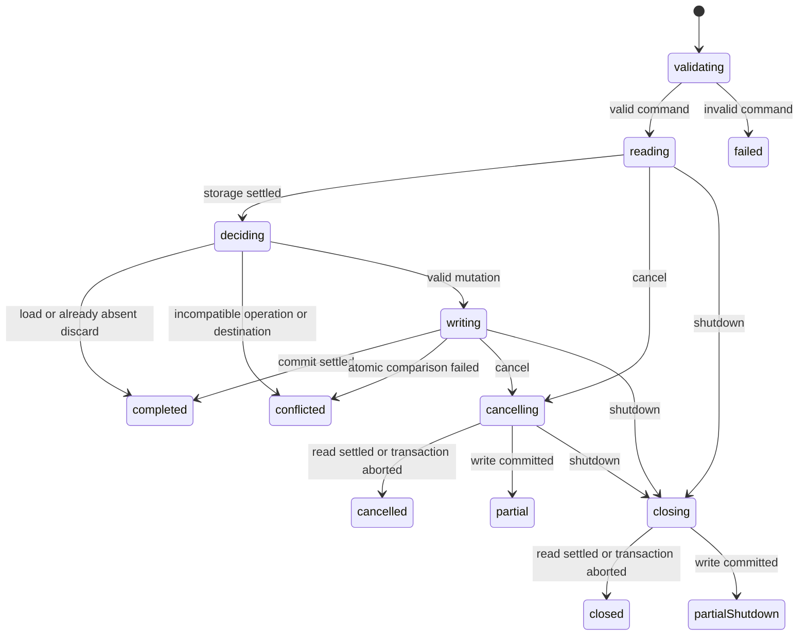
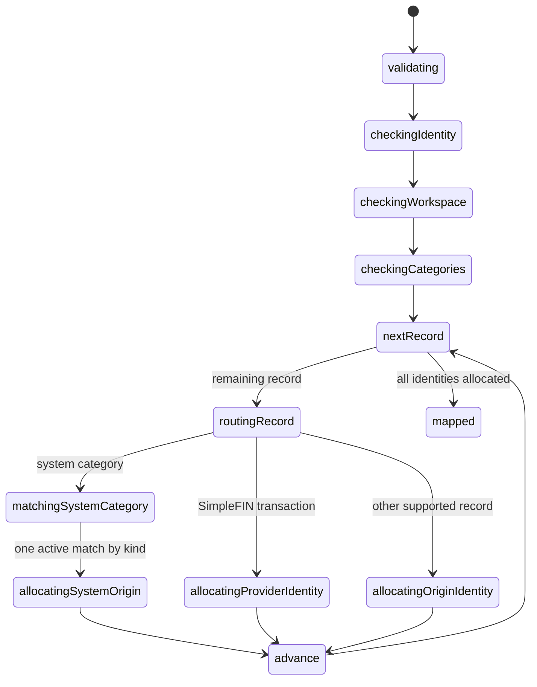
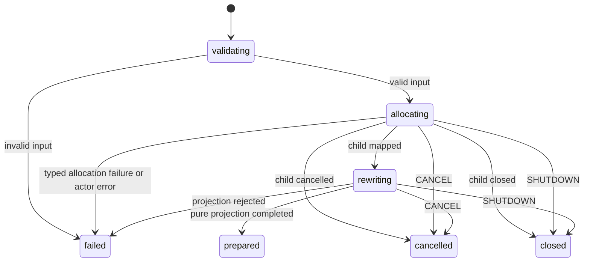

# Merge data model

## Local-only snapshot and journal

The first implementation slice defines the device-local version-1 wire format in
`src/lib/validation/account-merge.ts`, with its derived type in matching
`src/lib/schema/account-merge.ts`. These are not new Jazz tables or a capture API.
All collections and nullable fields are required explicitly; archive timestamps
are ISO date-time strings and booked/check dates remain calendar-date strings.
Validation does not trim, default, deduplicate or otherwise rewrite finance data.
Unknown fields (including connection credentials) are rejected.

Account, category and tag shapes derive from their canonical Zod schemas.
Transaction money, dates, source variants, payment methods, memo and check fields
also reuse existing validation. Snapshot adapters remove defaults, serialize
archives, and validate transformed text without replacing its original value.
Graph relationships and snapshot-only metadata remain merge-specific.

Initial limits are 10,000 total collection records and 8 MiB of UTF-8 JSON for the
validated wire payload. Exceeding either limit rejects the snapshot without
truncation. The limit excludes the organization descriptor and connection count
from the record total. It is a persistence payload limit, not an input-stream or
capture memory guarantee; capture must enforce its own bounded resource use.

The validator checks personal ownership/scope, unique IDs within each table,
account currency/category kind, batch and tag references, reciprocal check
references, transaction source identity, and duplicate transaction-tag pairs.
Archive references are accepted to preserve history. Any attachment blocks the
snapshot. Bank account links contain only source IDs and non-secret provider IDs;
connections are represented only by an excluded count. All workspace templates
are represented because the current schema has no batch-to-template reference.

Successful parsing proves structural and reference validity only. The future
capture adapter must establish authorization and complete scope separately; an
explicit empty attachment collection is not evidence that it was fully read.
After implementation review and explicit authorization to add tests, the validator
passed 53 focused unit cases covering preservation, required values, graph scope
and relationships, unsupported payloads, canonical field validation and record/UTF-8
size boundaries. The existing 50 transaction-validation tests also passed, as did
TypeScript checking. These results do not establish capture completeness or a
user-visible merge workflow. No capture or import effects exist yet.

Versioned snapshot: source identity/organization IDs, complete supported finance graph, source row IDs, validated values, referenced batch data and record counts. Exclude credentials and profiles/memberships. Store no separate createdOn/updatedOn timestamps; preserve user dates and original audit metadata only as provenance where needed.

Journal: operation ID, source and destination IDs when known, snapshot version, stable row mappings, per-record committed receipt references and typed failure details. Store facts needed to reconstruct progress; the machine owns live lifecycle states. Never resume into a different identity/organization implicitly. Retain payload after partial/failure; explicit discard explains that previously committed additions remain.

### Initial journal storage slice (awaiting implementation review)

`validation/account-merge-journal.ts` composes the existing snapshot validator into
a strict version-1 envelope: operation ID, immutable snapshot and nullable exact
destination identity/organization IDs. Its matching schema file exports derived
types. No phrases, credentials, lifecycle flags or raw failure messages are stored.
Import mappings, receipts and typed failure details will extend this envelope in a
later reviewed cycle before an importer uses it.

`machines/account-merge/journal.ts` handles one validated `LOAD`, `CREATE`, `BIND`
or `DISCARD` command per invocation. Guarded transitions reject an existing journal
on creation, stale operation IDs and destination retargeting. The parent merge
coordinator will invoke this child for each explicit storage operation.

Read/write errors also route to explicit failure states. Terminal results distinguish
completion, conflict, failure, cancellation, shutdown and committed partial progress.
Shutdown takes precedence over later cancellation. Invoked actors remain alive
while cancellation/shutdown waits for the active operation to settle; actor
stopping is not used as the domain cleanup handshake.

The coordinator invokes a focused `journal-write` child machine. Its guarded
states check creation constraints, unchanged operation/source snapshot, and
destination compatibility before choosing separate replacing/removing states.
Conflict, failure, cancellation and committed writes are explicit terminal states
with typed results. Cancellation keeps the child's I/O actor alive until the write
settles; the coordinator then reports cancelled versus partial progress and preserves
shutdown priority. Both machines invoke the shared `journal-storage` state machine.

That storage machine owns availability, opening, transaction selection, abort
settlement, connection closing and terminal classification. Reading, replacing and
removing each invoke a focused transaction actor; their nested aborting state keeps
that actor alive until commit/abort. A connection actor outlives the transaction
and acknowledges close before the storage machine returns its typed result.
Cancelled, conflicted, failed and completed are separate final states. No async
`transact` function or manually started actor/promise bridge remains.

`account-merge/journal.ts` contains the native IndexedDB callback actors and dependency
binding. Its connection actor owns the open request and database handle. Transaction
actors register browser handlers and synchronously validate/compare/mutate within
the active transaction. They report success only from `oncomplete`, or failure from
abort; these callbacks do not choose journal workflow policy.
The database is scoped by public app ID and has one pending slot across identity
replacement. The adapter retains one atomic comparison of the entire stored journal
with the actor's previously observed value. The actor's policy checks therefore
apply to the exact value being replaced; a concurrent change produces a conflict
instead of bypassing those checks. This comparison cannot be moved outside the
IndexedDB write transaction. Discard deletes only device-local recovery data, never
Jazz finance records.

Every read validates the envelope and full snapshot. Corrupt or unsupported data
fails explicitly and remains stored; it is never treated as an empty journal or
deleted automatically. A dedicated corrupt-journal recovery action is not part of
this slice. Writes request strict durability and resolve on transaction completion,
not individual request success. Local storage acceptance does not establish remote
sync or protection against browser storage eviction.

The actor tree owns database handles, cancellation messages and transaction cleanup.
Abort before commit cancels the transaction; a completed commit is not rolled back.
Blocked opens fail explicitly and close a connection if it arrives later. Errors
expose fixed codes rather than the rejected finance payload. These are resource
operations and atomic storage invariants. Journal workflow decisions belong to the
child machines above; the application-owned merge coordinator remains responsible
for session authorization, exact-target resume and operation-wide cross-tab locking.
Transaction serialization alone does not prevent a discard during an active import.

TypeScript checking passed. No tests have been added or run for this new slice;
after review, cover reload persistence, concurrent creation, immutable target
binding, stale operations, corruption, unavailable/blocked storage, abort races and
machine cancellation/shutdown settlement (including a commit racing cancellation).

## Additive Jazz provenance

The provenance reference correction is reviewed and verified. Eight tables share
one receipt-column factory: `mergeAccountOrigins`, `mergeCategoryOrigins`,
`mergeTagOrigins`, `mergeTransactionOrigins`, `mergeCheckDetailOrigins`,
`mergeTransactionTagOrigins`, `mergeTransactionBatchOrigins` and
`mergeBatchTemplateOrigins`. The exhaustive `mergeOriginTables` lookup maps each
source entity to its receipt table. Each table declares `destinationRecordId` as a
relationship to exactly its corresponding finance table. Receipt values retain
destination `organizationId`, `sourceOrganizationId`, `sourceEntity`,
`sourceRecordId` and `destinationRecordId`; allocator IDs and canonical validation
remain unchanged. Receipts contain no source payload, credentials or audit copies.

A shared policy loop enforces the table's matching `sourceEntity`, current
owner/admin membership, an owned personal destination organization, and target
existence in that organization. Reads require admin membership without target
existence; updates/deletes are denied so history survives later target deletion.
The original `mergeOrigins` table remains structurally unchanged for additive
compatibility, with all operations denied. It is not an importer destination.

The SDK generated an additive migration from `efb204a86e44` to `3d0e719e1e0d`
creating only these eight tables. Existing table definitions remain unchanged.
After approval, 33 canonical-validator tests pass and eight focused Playwright
scenarios pass against the isolated in-memory Jazz server. The browser coverage
verifies server publication, valid receipts for all eight entities, update/delete
and entity/table mismatch rejection for every receipt table, retained history after
target edits/deletion, missing/wrong-table/cross-scope target rejection, business
workspace rejection, admin/member/viewer/unrelated-user boundaries, denied legacy
table insertion, owned-personal creation by an admin, and read/insert denial after
membership revocation. Every write assertion waits for global acknowledgment;
reads use the remote tier. Browser tests type-check and focused formatting passes.

The original single-table design failed during live permission publication with
`JoinNotRefCompatible`: an untyped UUID could not join eight different target
tables. Local compilation had accepted it. The corrected representation uses
ordinary declared references rather than weakening target checks or adding sparse
per-entity columns. The focused browser runs now establish server compatibility
for these receipt policies, independently of future capture/import behavior.

Future importer writes must select the receipt table through `mergeOriginTables`
and insert new target rows and receipts atomically. These policies do not prove
source capture/ownership, deterministic IDs, snapshot equivalence or absence of
conflicting destination values. Preview/import must enforce those invariants and
honor receipts after target edits/deletion, including canonical/reused targets.

## Mapping rules

- Organization: chosen source owned personal workspace → chosen destination owned personal workspace.
- System categories: map by income/expense kind, independent of translated name.
- User categories/tags/accounts/batches/templates: stable imported IDs; no name-based unification. Restore archives after references.
- Transactions: preserve integer amount, kind, currency, bookedOn, memo, payment method, source/externalId and relationships. Manual IDs derive from full origin. SimpleFIN IDs use the existing provider formula. Existing records remain authoritative; differing source values or ledger mapping become visible conflicts.
- Check details: preallocate detail/transaction IDs and remap both directions; verify one-to-one relation.
- Transaction-tag links: remap both ends and use stable IDs.
- Attachments: detect and stop unsupported graphs before import; current file permissions cannot support lossless copying.
- Credentials/connections/memberships/profile: excluded with explicit connection reconnection notice. Preserve provider account identity as non-secret provenance for later reconnect decisions; do not create active links to absent connections.

## Identity allocation slice (reviewed and unit-verified)

`validation/account-merge-mapping.ts` reuses the complete snapshot and destination
validators and canonical category fields. Destination category observations require
explicit system/archive values; form defaults are removed with `unwrap()`. These
transient observations do not prove complete hydration or destination authority.
The matching schema module defines typed allocation results and fixed error codes.

`machines/account-merge/mapping.ts` owns input/scope checks, record routing,
system-category selection, ID allocation and terminal cleanup. Shared state
configuration handles ordinary/provider allocation without duplicating their
invocation/error transitions. `account-merge/mapping.ts` contains pure projections
and identity-name formatting; it makes no database queries or writes.

Invalid input, same identity/workspace, cross-scope/duplicate destination category
IDs, missing/ambiguous active system categories, and rejected UUID allocation have
explicit failure transitions. Cancel and shutdown terminate allocation, clear source
payloads and discard late digest results. UUID calculation has no persisted effect
requiring a commit/abort handshake. No partial import is reported for allocation.

All hashes use the destination organization as namespace. Ordinary destination IDs
use `account-merge:` followed by the JSON tuple `[sourceOrganizationId, entity,
sourceRecordId]`; origin receipt IDs use the same tuple with `account-merge-origin:`.
SimpleFIN transaction IDs retain the bank importer's exact
`simplefin-transaction:${externalId}` name. System categories reuse exactly one
active destination system category of the same income/expense kind. Ordinary
records are never combined by label, date or amount.

The result contains source/destination IDs and origin receipt IDs for accounts,
categories, tags, transactions, check details, transaction-tag links, batches and
templates. It does not create origin receipts, rewrite references or decide target
row collisions. Multiple source provider transactions can resolve to one canonical
ID; preview/import must still compare their values and account mappings rather than
silently skip differences. Source bank-account links remain snapshot provenance;
this allocator does not plan active links to absent connections.

The typed provenance reference correction is implemented for review; see the
additive provenance section for the original server rejection and verification gate.
Transactional
receipt writes, archive/check sequencing and preview/import effects remain separate
work. Source capture remains
gated by [capture-contract.md](capture-contract.md). After implementation review,
25 focused unit tests pass for supported-graph allocation, source preservation,
manual-record separation, stable retry/order/scope identities, canonical provider
IDs with distinct origin receipts, active system-category selection, empty graphs,
strict required input fields, invalid scope/graphs, missing/ambiguous categories,
allocation rejection and cancellation/shutdown racing late resolution/rejection.
Assertions also verify terminal payload cleanup. TypeScript and focused formatting
checks pass. This verifies allocation independently of capture, authorization,
preview conflict decisions or finance writes.

## Reference preparation (current review slice)

`accountMergeReferencesMachine` invokes the reviewed identity allocator as a child,
then invokes a pure reference projection. It takes the existing strict mapping
input; no new capture API, destination observation contract or validation copy is
introduced. Parent-level cancellation/shutdown terminate the child invocation and
clear transient source/allocation context. Late allocation/projection results are
ignored after terminal transitions. All invoked failures have explicit routes;
allocation domain errors remain typed and projection failures use
`reference-mapping-failed` without raw payloads or exception text.

The result groups candidates by all eight supported entities. Each candidate keeps
its source/destination/origin identity mapping and a projected wire-format value.
Every finance row ID and organization ID is replaced with the allocated destination;
tags reference mapped categories, transactions reference mapped accounts/categories,
checks/batches, check details reference mapped accounts/transactions, and tag links
reference mapped tags/transactions. Nullable references remain null. Labels, integer
money, currencies, dates, notes, archives and provider external IDs are preserved.
No canonical form adapter is applied to captured values. Original bank-link rows
are copied separately as source provenance, never destination insertion requests.

Candidates are not executable writes. Archives remain ISO strings; system-category
reuse retains its allocation kind; multiple source provider transactions resolving
to one canonical ID remain separate candidates. Conflict preview must examine them
rather than collapse them in a destination-ID map. Preview must also honor existing
receipts after target deletion, reject unmatched existing-row collisions, and check
dependency compatibility before any importer consumes a candidate. Destination
hydration/authorization observations and atomic rechecks remain separate work.

The three implementation files type-check and pass focused formatting. They await
review before adding/running focused tests for all references, preservation,
canonical collisions, failures, cancellation/shutdown and terminal cleanup. No
runtime verification, live capture, conflict classification or writes are claimed.

## Invariants

All references stay within the destination organization. Currency and transaction kind match referenced account/category. No implicit authorization transfer, no unrelated destination overwrites. A committed target row and its origin receipt must be consistent atomically. A retry skips already imported origin even after the user edits the target. A canonical provider collision without matching provenance is existing/conflict, never replacement. Import conflicts result in partial completion until explicitly resolved; unsupported graph errors block before any writes.
