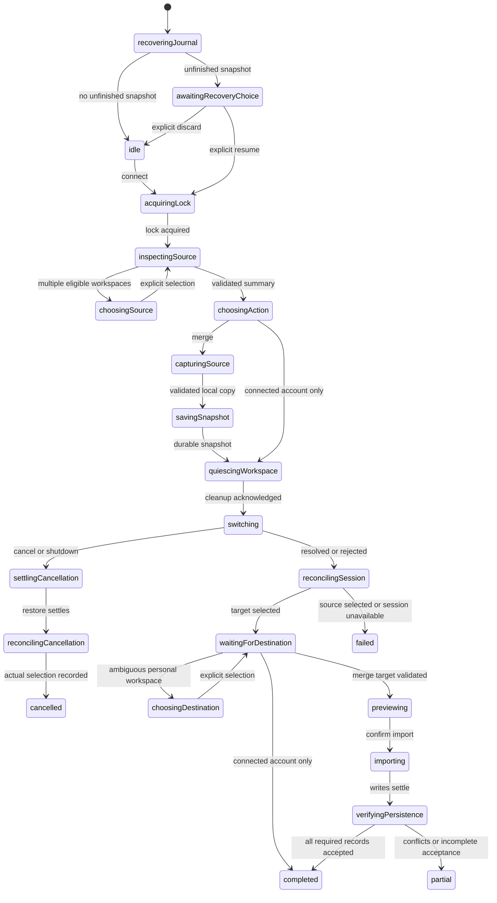

# Merge lifecycle review

First focused delivery cycle: SDK inspection and proposed actor contracts. No runtime
behavior is implemented by this document. Review this model before implementing effects.

## Verified SDK seams

Evidence is the installed `jazz-tools` 2.0.0-alpha.59 package, not assumptions about a
different release.

| Seam                    | Evidence                                              | Required behavior                                                                                                                                                                                                         |
| ----------------------- | ----------------------------------------------------- | ------------------------------------------------------------------------------------------------------------------------------------------------------------------------------------------------------------------------- |
| Session replacement     | `dist/session/state.js`, `perform`                    | Restore detaches framework consumers, shuts down the old client with `waitForSync: true`, changes selection, persists selection and opens a replacement client. Wait for application workspace cleanup before calling it. |
| Cancellation            | `dist/session/state.d.ts`, `JazzSessionActions`       | Restore accepts a secret only. Keep its actor alive through settlement on cancel/shutdown; do not interpret actor disposal as aborting restore.                                                                           |
| Failure after selection | `dist/session/state.js`, `perform`                    | Selection persistence or replacement startup can fail after selection changes. Reconcile `getSnapshot().account`, `status` and `recovery`; promise rejection does not prove the source is still selected.                 |
| Source return           | `dist/accounts/state.d.ts`, `dist/session/state.d.ts` | No public retained-account listing/selection action exists here. Explicit return requires re-entering the source phrase; never read SDK credential storage to build an account chooser.                                   |
| Complete remote reads   | `dist/runtime/client.d.ts`, `ReadTier`                | Remote reads establish current remote query scope but exclude pending local writes and wait offline. LocalFirstUnlessEmpty is insufficient for merge completeness.                                                        |
| Durability              | `dist/runtime/client.d.ts`, `DurabilityTier`          | Local acceptance and global authorization/acceptance are different facts. Track write handles for the new writes and report each guarantee separately.                                                                    |
| Same identity           | `dist/runtime/recovery-phrase.d.ts`                   | Phrase conversion exposes no identity derivation API. Pre-switch same-identity detection needs further supported-API inspection; do not switch merely to discover identity and call that a no-op.                         |

Existing application ownership is suitable: `src/routes/+layout.svelte` owns the
application-readiness actor outside `JazzSessionProvider`. The login route is inside
the identity-bound subtree and cannot own an operation that survives restore.
`application-readiness.ts` already waits for actor-specific `WORKSPACE_CLOSED` events,
but currently provides no merge command or quiescence handshake.

## Proposed ownership and contracts

```text
application-readiness
  workspace-readiness (existing, replaced with the identity)
    bank workflows (existing)
  account-merge (survives identity replacement)
    operation lock
    source inspection / source capture
    journal I/O
    session replacement / reconciliation
    destination preparation
    mapping preview
    dependency-ordered import
```

The application owner supplies the session adapter and identity-scoped bindings.
The merge actor receives observed identity IDs, organization choices, permissions,
journal receipts and typed child results. It never persists a session, database
handle, phrase, signing secret or provider credential.

- `QUIESCE_WORKSPACE(operationId)` asks the application owner to close the existing
  workspace subtree. `WORKSPACE_QUIESCED(operationId)` acknowledges actual cleanup.
  Stale acknowledgements cannot release a different operation.
- `BIND_WORKSPACE(operationId, identityId, binding)` supplies replacement dependencies
  only after workspace initialization. Merge validates the exact identity and chosen
  organization, rather than accepting whichever workspace happens to become ready.
- `CONNECT`, `CANCEL`, `CONFIRM_IMPORT`, `RETRY`, `RESUME`, `RETURN_TO_SOURCE`,
  `DISCARD_SNAPSHOT` and `SHUTDOWN` retain the interaction contract. Authentication
  inputs stay transient and must be excluded from actor logging/inspection and journals.
- Child results distinguish unsupported graph, unreadable scope, permission denial,
  journal failure, lock contention, session failure and record conflict. Presentation
  translates descriptors; errors do not contain raw credentials or finance payloads.

## State model before effects



Every asynchronous state must also route failures and cancellation through cleanup.
The diagram highlights the non-abortable switch boundary rather than enumerating
all cleanup edges. Same-identity input exits without snapshot/import/session change
once supported identity comparison is established.

Before writes, cancellation ends as cancelled. After writes begin, stop scheduling
new records and settle outstanding writes; committed additions produce a partial
result with cancellation as its cause. Never roll them back. Shutdown takes the same
cleanup path and cannot be downgraded by a later completion event. Release locks
only after children and outstanding writes settle. A replacement login page is a
new attachment, not a reason to cancel its parent's in-flight restore.

Completion records local persistence separately from global confirmation. Conflicts
prevent full completion. Retry and resume reuse the immutable snapshot and exact
target; return-to-source is an explicit authenticated action. Source cancellation
before switching leaves the current identity unchanged.

## Open implementation gates

1. **Source copy — revised by user direction:** use ordinary local-first reads,
   validate the records available on this device, show counts and durably save the
   copy. Global synchronization and a cross-table atomic boundary are not required.
   Missing references fail validation before switching. See
   [capture-contract.md](capture-contract.md).
2. **Concurrent editing — simplified:** later edits are outside the saved copy.
   A merge-operation lock serializes merge attempts only; ordinary forms do not
   need to participate. Do not promise a frozen source or coordinated sibling tabs.
3. **Same identity — resolved by inspection:** `jazz-tools` publicly exports
   `exportLocalFirstSecret`, already used in `src/routes/account/+page.svelte`.
   Compare its canonical result with the entered canonical secret entirely in
   transient memory. No identity derivation or session switch is necessary. Never
   place secrets in actor context, outputs, journals or logs. Return only
   same/different/unavailable; failed export must not imply a different identity.
   This supersedes the initial same-identity finding in the table above.
4. **Bounded waiting — resolved by inspection:** public `db.subscribe` returns an
   unsubscribe function. `Db.subscribeDelta` aborts readiness, retires native
   subscriptions and clears buffered delivery on teardown. Use a callback actor
   owning the subscription and timeout, with terminal error handling; unsubscribe
   on cancellation, timeout and shutdown. Do not race an uncancellable `db.all`
   promise against a timer. A timeout is a recoverable failure, never evidence of
   empty scope. Remote delivery still excludes pending local writes.

## Revised next implementation

Implement the source-copy child against normal local-first query subscriptions and
existing validation. Then save its output using the journal before session replacement.
The earlier investigation found no supported global snapshot primitive, but that is
no longer a prerequisite: the user explicitly chose a normal read-and-copy workflow.
Keep session settlement, authorization, cancellation and local/global write outcomes
as real lifecycle concerns. No SDK changes are planned.
