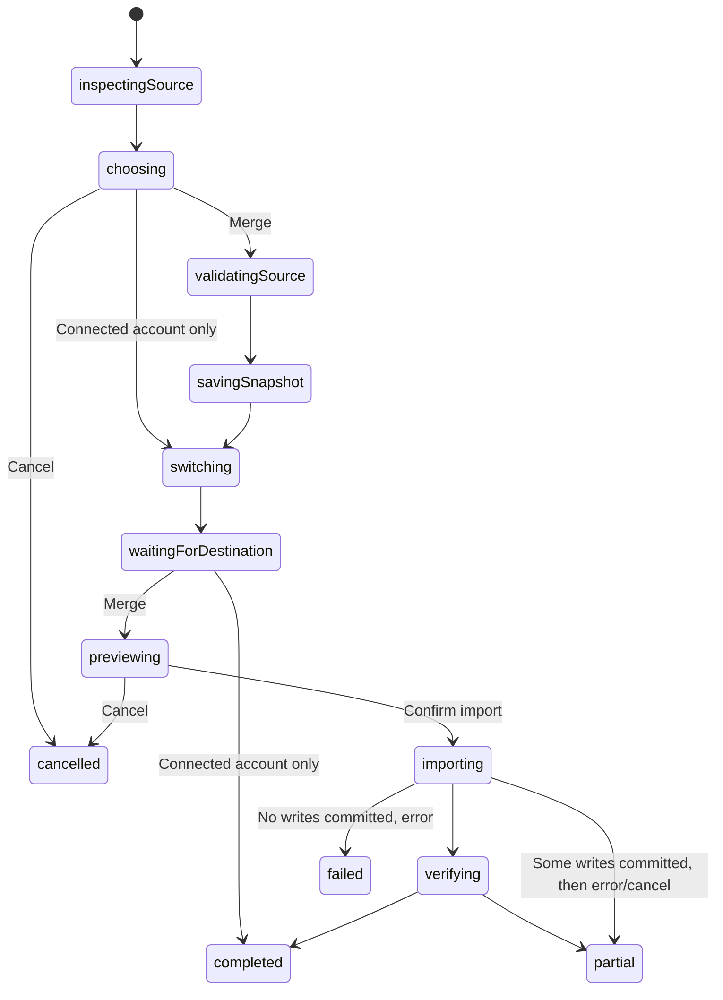

# Implementation Plan: Account connection with optional local-data merge

**Date**: 2026-10-16 | **Spec**: [spec.md](spec.md)
**Feature identifier**: `003-account-data-merge`; planning performed on `main`, no branch created.

## Summary

Build the merge choices and all related presentation on the dedicated `/account-merge` route, leaving the existing `/login` flow and navigation unchanged. For Merge, durably snapshot the source personal workspace, switch with the supported Jazz session API, wait for the replacement workspace dependencies, preview the destination mapping and import additive records with stable identities. Preserve source records and remote edits. This is a proposed design, not implemented behavior.

## Technical context

TypeScript 6, Svelte 5/SvelteKit 3, Jazz 2.0.0-alpha.59, XState 5, Paraglide. Jazz stores finance data; a versioned browser IndexedDB journal stores the source snapshot and import mapping on this device. No new service/API is planned. Existing Vitest and Playwright tooling applies only after implementation review. Target browser/PWA; no guarantee of cross-device recovery for a device-local unfinished snapshot. Bound import batches and report progress; establish practical size limits in the first implementation cycle rather than silently truncating.

## Constitution check

Pre/post-design: local-first reads/writes and integer money preserved; organization authorization rechecked at writes; identity secrets excluded from snapshots/journals; additive schema evolution only. XState owns decisions and lifecycle; integration binds Jazz and composes props-only localized presentation. No new styling, switch clauses, casts or any. One focused implementation cycle at a time, normally 4–6 implementation files. No tests added/run before approval of their exact implementation. No commit or server started by planning.

## Architecture and statechart

Application readiness owns a merge coordinator outside the identity-bound workspace subtree, so restoring a session cannot destroy the workflow. It explicitly asks the existing workspace/bank subtree to shut down before switching and waits for replacement bindings before destination work. Page navigation/detach sends cancellation or shutdown; acknowledge child cleanup before actor stop.

All asynchronous states also handle error/cancel/shutdown explicitly. `switching` reconciles the actual SDK selection after an in-flight call settles; cancellation cannot undo that call. Late events cannot restart imports. Failed/cancelled/partial views offer explicit retry/resume or return-to-source when supported. Never infer phase from context flags.

Child actors: source inspection/validation; journal I/O; session switch; destination authorization/readiness; mapping/preview; dependency-ordered import, composing per-record decision/write children. Context contains observed identities, typed snapshots, mappings, counters and child results. Guards choose source availability, same identity, supported graph, destination eligibility, existing record/conflict, and final outcome. Promises perform bounded I/O, not hidden business branching.

## Import strategy

1. Read the selected source workspace with explicit local-first queries, as normal application screens do. Validate the captured records and relationships using the existing snapshot validator. Show counts and explain that only data available on this device is copied; later edits and unsynchronized remote records are outside the copy. Save it before switching. No SDK changes, global sync barrier or coordinated finance editors are required. See [capture-contract.md](capture-contract.md).
2. Hydrate destination queries and verify target identity, owned personal organization and permissions. Empty local query results alone do not prove remote absence. If SDK cannot establish safe readiness, stop with retry guidance.
3. Build stable destination IDs scoped to destination organization + source organization + entity type + source ID. Use canonical existing bank IDs instead for imported provider transactions; map system categories by kind. Preview additions, known existing records, conflicts and excluded bank connections.
4. Persist mapping/provenance with each corresponding write atomically. Recheck identity, permission, reference invariants and duplicate existence in transactions. Existing target rows are skipped or classified as conflicts, never blindly updated. Deterministic identities protect retries and concurrent devices; lock/journal ownership protects concurrent tabs on this device.
5. Insert dependencies before dependents; check details and transactions need planned IDs and valid ordering. Restore archived flags only after dependent writes. Existing protected-system-category and archived-reference permissions require deliberate sequencing, not blanket policy relaxation.
6. Wait for local persistence before reporting locally saved/pending synchronization. Use write-handle global waits for server acceptance before reporting globally confirmed completion; never use browser online status as proof. Retain an unfinished journal until resume or explicit discard. Completed snapshot cleanup removes local finance payload but retains minimal durable provenance for deduplication.

## Focused delivery/review cycles

Cycle 1 review artifact: [lifecycle.md](lifecycle.md) records installed-SDK evidence,
the proposed actor contracts and cancellation model, and remaining safety gates.
The feature remains unimplemented; snapshot/import effects must wait for those
gates to be resolved and the lifecycle model to be reviewed.

1. Prove SDK seams and model lifecycle: inspect supported restore cancellation/readiness, source recovery and cross-tab constraints; define actor contracts and statechart. Review before effects. Use the user-directed local copy semantics; do not gate implementation on global snapshot capabilities.
2. Add versioned snapshot validation and journal recovery, with explicit unsupported-data detection. Review, then approved coverage.
3. Add additive provenance schema/permissions and pure identity/reference mapping. Resolve archived/check/bank collision handling in this cycle. Review, then approved coverage.
4. Add the dependency-ordered import child machines and transactional adapters. Review, then approved coverage.
5. Bind coordinator to application readiness and login presentation/localization, including previews, cancellation and recovery. Discuss the exact file set first if integration requires more than six implementation files. Review, then approved coverage.
6. After relevant approvals, complete focused cross-device, offline, interruption and authorization validation. No broad unrelated test runs.

This document provides sequencing, not a generated tasks.md. Generate detailed task checklist after design review.

### Current review slice

Snapshot validation and the IndexedDB journal are implemented. The independent
identity-allocation portion of cycle 3 is reviewed and verified; its statechart
and exact identity conventions are recorded in [data-model.md](data-model.md).
It allocates stable ordinary/provider/origin IDs and resolves destination system
categories, using the existing validators and UUID function. It introduces no Jazz
schema changes or capture/import effects. After review, 25 focused unit tests pass
for identity stability, scope/category ambiguity, input validation, failures,
cancellation/shutdown, terminal cleanup and canonical provider compatibility.
TypeScript and focused formatting checks pass.
The initial provenance slice passed 33 strict-validator tests, but live-server
startup rejected its polymorphic destination join with `JoinNotRefCompatible`.
The correction is reviewed and verified: eight target-specific receipt tables
share one column factory and policy loop, each with a declared destination
relationship. The original table remains unchanged with all access denied; an
additive SDK migration creates the eight new tables. Table/entity agreement,
owned-personal/admin gates, scoped target existence, immutable history and reads
after deletion remain enforced. TypeScript and local schema/policy validation pass.
After approval, all 33 canonical-validator tests and eight focused Playwright
scenarios pass. Live publication succeeds; browser coverage verifies all target
tables, immutability, entity/table mismatches, scope/role/ownership boundaries,
retained history after target deletion, legacy insert denial and membership
revocation. Browser TypeScript and focused formatting checks pass. This validates
provenance independently of capture, conflict preview or transactional imports.
Transactional receipt writers
and import remain subsequent cycles;
source capture and transactional insertion remain to be wired using the revised
ordinary read-and-copy contract.

Reference preparation is reviewed and verified in three
files (types, pure projection, and a composing XState machine). It invokes the
identity allocator, remaps all eight entities and their foreign keys, and preserves
source candidates and bank-link attribution for later conflict decisions. Explicit
prepared/failed/cancelled/closed outcomes and terminal payload cleanup are modeled.
After approval, 22 reference-preparation tests and all 25 allocation tests pass,
including reference integrity, preservation, collisions, failure supervision,
cancel/shutdown races and terminal cleanup. TypeScript and focused formatting pass.
Workflow-level browser coverage awaits integration. Conflict classification,
destination observations and import effects are not implemented by
this slice. See the reference-preparation statechart in [data-model.md](data-model.md).

Per-record conflict classification is reviewed and verified in four focused
files: strict observations reusing snapshot/provenance validators, typed outcomes,
pure predicates and a synchronous XState child. Guarded transitions distinguish
recorded origins, reusable system categories, equal provider records, differing
source/provider values, occupied ordinary IDs and malformed observations. Terminal
cleanup removes finance payloads. All 76 classifier/validation tests pass after
approval, covering all entities, precedence, conflicts, invalid observations and
cleanup. TypeScript and formatting pass; the event type was corrected for
`createActor` compatibility without adding effects. Browser workflow coverage awaits
integration. Graph composition is implemented in the next review slice below;
destination observation/readiness adapters, preview UI and import remain separate.

Graph preview is reviewed and verified in five new modules and a classifier
contract comment. The preview owner invokes reference preparation, indexes complete
supplied observations, groups canonical peers, composes per-record classifiers and
runs the dependency child to a stable result. Additions become blocked on missing,
conflicting or incompatible parents; retained destination rows stay authoritative.
New archived rows may be staged later, but existing rows are not altered. Reciprocal
check dependencies and deleted canonical targets receive explicit checks. Outcomes
and counts distinguish clean/partial previews, unique targets and per-origin
receipts. After approval, all 50 graph-preview tests pass, covering composition,
canonical groups, dependency closure/compatibility, check cycles, limits, failures,
cancellation races, counts and cleanup. TypeScript and formatting pass; no
production fixes were needed. Browser workflow coverage awaits integration. This
slice performs no database effects. See the graph statechart and observation limits in
[data-model.md](data-model.md). Capture completeness, destination-read adapters,
transactional writers and UI integration remain subsequent work.

Destination eligibility is reviewed and unit-verified in two focused modules. A
callback-owned XState child observes the bound session, then owned-personal
organization/admin membership facts through integration-supplied remote
subscriptions. Explicit identity/workspace/client checks, missing/ambiguous/scope
rejection, errors, a 30-second budget, cancel/shutdown and cleanup are modeled.
The input reuses the canonical destination validator. All 41 approved unit tests
pass for ownership/role gates, changing observations, errors, timeout,
cancel/shutdown, synchronous callbacks and subscription/context cleanup. TypeScript
and formatting pass; no production fixes were needed. These tests do not establish
actual SDK read-tier behavior. Public SDK inspection supports unsubscribe-based
cancellation, while one-shot query options expose no AbortSignal. Actual Jazz
subscription bindings remain in the future integration component; no finance
queries, provider calls, session switching or writes were added. See the detailed
contract/statechart in [data-model.md](data-model.md).

Concrete destination bindings are now implemented for review in
`AccountMergeDestinationIntegration.svelte`. This task-scoped component owns the
real SDK session observer and scoped organization/membership subscriptions using
`tier: 'remote'`, forwards errors and workspace changes, starts the eligibility
root on mount, and finishes shutdown before stopping on unmount. It exposes the
root for future coordinator commands and delivers typed outcomes. TypeScript,
formatting and svelte-check pass with zero diagnostics; tests await approval.
It remains unmounted in login pending coordinator/capture integration. Actual SDK
browser verification is the next focused test slice; finance/receipt observations
and writes remain separate.

### Isolated presentation route (reviewed and verified)

Per the user's routing decision, all merge-facing presentation now targets
`/account-merge`, independently of `/login`. The first slice implements the route,
a pure `AccountMerge` component, focused presentation machine and translations;
a small integration teardown correction avoids commands to completed actors.
The route displays the capture prerequisite, bank reconnection notice and disabled
import action, plus explicit destination checks using the real integration.
It never collects a phrase, switches identity or writes finance data. No sidebar
or login changes were made. Later source/connection/preview/result panels stay here.

The presentation statechart assesses observed session/client/workspace facts,
then exposes available -> checking -> eligible/denied, with cancellation,
reassessment and shutdown. Identical observations preserve active requests;
changed identity/scope/binding cancels the view's old request. Callback identity
checks reject stale completions. Route cleanup explicitly closes an active
integration child before stopping its presentation owner. The public interface
passes machine-owned views and callbacks to pure presentation.

After approval, all 19 presentation-machine tests and five focused Playwright
scenarios pass. Browser coverage verifies real remote subscriptions and their
cleanup, explicit/repeated eligibility checks, business denial, unchanged login,
read-only behavior and no provider calls, held remote responses despite cached
local records, cancellation/navigation and workspace changes. TypeScript and
focused formatting pass; no production fixes were needed. Earlier Paraglide and
svelte-check diagnostics were clean. The capture gate still prevents actual merging. The existing development server's
review path is `http://localhost:5173/account-merge`.

## Project structure

Documentation: this directory's spec.md, research.md, data-model.md, contracts/merge-ui.md and quickstart.md.
Proposed implementation: `src/lib/machines/account-merge/`, focused `src/lib/schema/` and matching `src/lib/validation/` files, `src/lib/components/AccountMerge.svelte`, `src/routes/account-merge/+page.svelte`, application-readiness integration and `messages/en.json` (confirm actual catalog location when implementing). Extend existing modules only as needed; do not expand data.ts into a generic import controller.

## Complexity tracking

No constitutional exceptions proposed. SDK capability checks and physical cross-device validation remain implementation gates; no runtime feasibility is claimed from planning alone.

### Revised direction: ordinary read and copy

The user rejected the global snapshot prerequisite. The implementation will copy
source records available through normal local-first reads and recreate them with
ordinary destination writes, preserving relationships and using the existing
validation, mapping, preview and journal. No Jazz modification or all-writer
coordination is planned. This supersedes earlier capture-completeness gates.

The next focused implementation is the source-copy machine and scoped Jazz read
binding: read -> validate -> captured, with failure, invalid, cancel and shutdown
outcomes. Present captured counts before switching. Save using the existing journal;
then wire session replacement and dependency-ordered inserts in following review
cycles. Tests follow approval of each implementation under repository rules.
