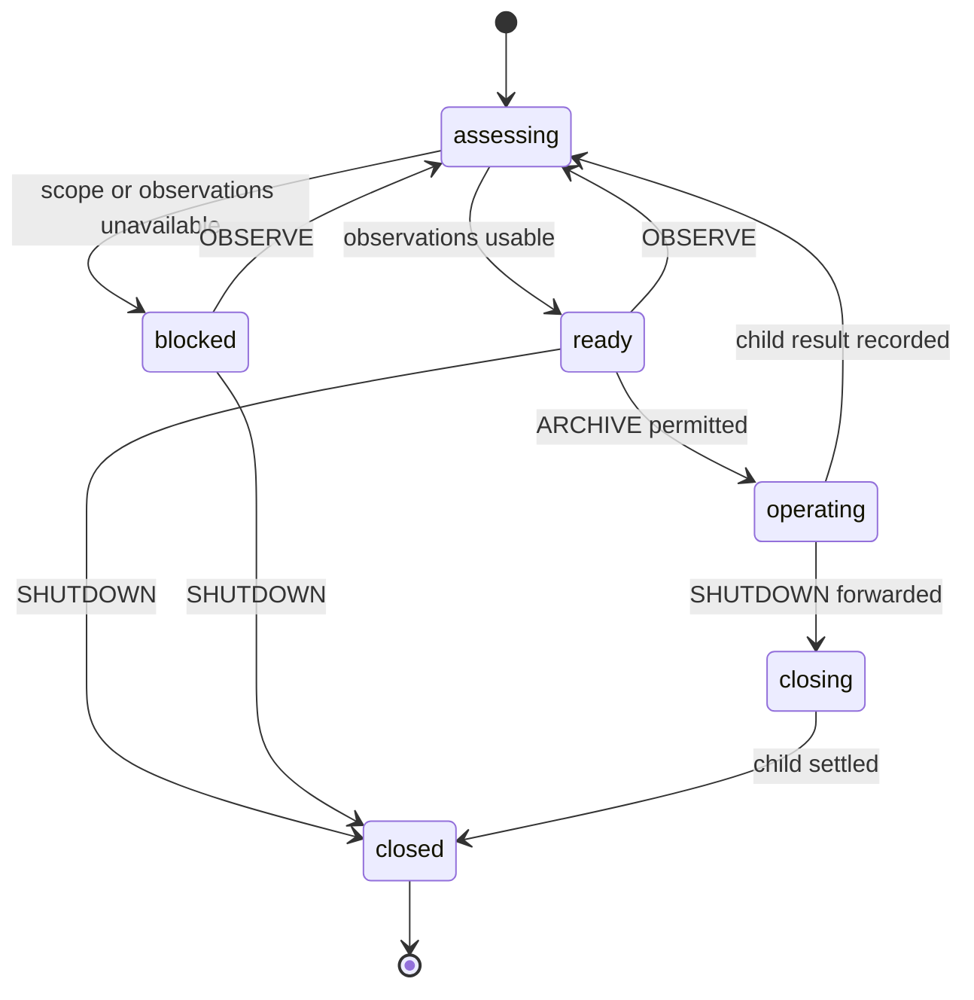
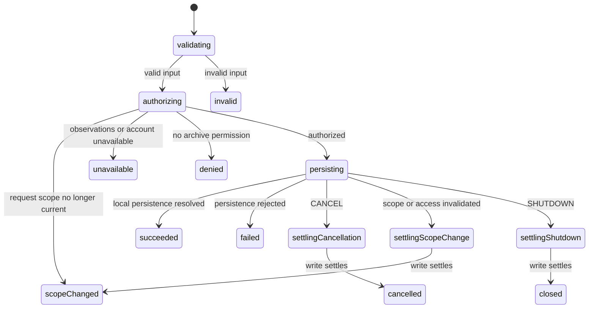

# Account archiving: proposed model

Status: model and implementation approved; focused verification passed. See tasks.md for commands and limits.

## Existing behavior and constraints

The accounts page wraps archiveAccount in the generic form machine. Its callback
checks current workspace, account existence, and canWriteAccount. The page
separately derives archivable IDs and several feedback props.

`archiveAccount` in src/lib/data.ts issues an update and waits with `tier: local`.
It accepts no AbortSignal. Stopping its promise actor would discard notification,
not establish cancellation of the write. Success means locally persisted, not
confirmed remote acceptance. Existing Jazz authorization remains authoritative.

## Ownership and proposed file scope

```text
accounts page (Jazz subscriptions, dependency binding, actor lifecycle)
  account archive owner (observations, capability/view decisions, requests)
    archive operation (validation, authorization, persistence, settlement)
      persist adapter (one archiveAccount call, local persistence wait)
```

Four implementation files proposed: `src/lib/machines/account-archive.ts`,
`src/lib/machines/account-archive-operation.ts`,
`src/routes/accounts/+page.svelte`, and `src/lib/components/AccountList.svelte`.
Add `messages/en.json` as a fifth file for blocked/outcome messages where existing
descriptors are insufficient. Keep schema validation in validation/accounts.ts
and use existing canWriteAccount rather than duplicating policy.

The page owns one actor per exact DB/session binding. Workspace/identity updates
are observations, not implicit form-controller resets. On destruction, detach
view subscription, send SHUTDOWN, and stop the owner only once it has finished
settling its child. Do not use automatic useMachine disposal for that owner if
it stops the actor before this handshake. A closing owner may remain alive only
to await its issued effect and must not retain active Jazz subscriptions.

## Facts and events

Observed facts: session status and identity, organization ID, binding identity,
query loading/error facts, accounts, membership, and account grants. Ensure
membership user/organization and grant scopes match the observed identity and
workspace before capabilities are evaluated; missing observations are not denial.

Owner events: OBSERVE, ARCHIVE(accountId), CANCEL, SHUTDOWN. Child events:
OBSERVE, CANCEL, SHUTDOWN. The child receives an immutable request containing
identity, organization, binding, account ID/name; observation payloads remain
separate. Unexpected child failures route through owner failure handling rather
than leaving the owner busy. Invoked persistence errors route via onError.

Owner context stores observations, request/child reference, and typed result.
Child context stores request, latest observations, validated input, and result.
Lifecycle is represented by states, not cancelling/scopeChanged/busy flags.

## Owner and child states

Owner assessments choose `sessionUnavailable`, `selectWorkspace`, `loading`,
`loadFailed`, or `ready` in that precedence, with query failure before loading
once scope is usable. `ready` supplies per-account capabilities, including
read-only reasons; zero eligible accounts is not an empty account list.
The same pure capability predicate guards ARCHIVE and projects row actions.
Only ready accepts a new request; active/closing states reject duplicates.



Within the child, validation uses accountArchiveSchema. Guarded authorization
checks exact scope/binding, current readiness, matching record, and permission
before invoking persistence. Capture the current observation at request time;
forward changes throughout the operation. Retain write-boundary authorization
and defensive checks where necessary without hiding workflow policy there.



The persist invocation belongs to a compound writing state enclosing persisting
and all settling states. Transitions between them must not exit/restart that
invocation. SHUTDOWN takes precedence over cancellation/scope change; subsequent
observations or cancellations cannot downgrade shutdown. Before writing,
CANCEL/SHUTDOWN terminate without issuing a write. After writing, keep awaiting
resolution/rejection; record its actual settlement in the terminal result.

## Results and presentation

Typed results: succeeded, invalid, denied, unavailable, scopeChanged, cancelled,
failed, closed. Interrupted issued-write results include a discriminated
settlement of locallyPersisted or rejected; interruption before writing has
notStarted. Never say an already persisted archive was undone. A stale-scope
result remains bound to its original request and is not shown as success in a
new workspace. There is no partial outcome for this single-record operation.

Project an explicit page readiness variant, row action variants
unavailable(reason)/available/disabled/archiving, and typed operation feedback.
AccountList receives those choices rather than archiving + account ID + failed

- optional success-name flags. Optional display data and localization remain
  presentation concerns. Existing account creation remains independently owned.

## Review and verification gates

Review the ownership, compound writing state, local-persistence guarantee, typed
interrupted outcomes, and four/five-file scope before implementing effects.
After implementation review, verify transition priority, observer updates during
writes, teardown handshake, row action/event agreement, and actual rendered
feedback. This design has not been tested and claims no abortable write support.

## Implementation review notes

The owner reuses its readiness chart inside the active operation so changed
observations can change the view without disposing the write. Closing takes
precedence over an already-queued child result. Interrupted write settlement is
recorded explicitly; an unexpected child failure reports unknown settlement
rather than inventing a rejection. The persistence invocation stays under the
compound writing state, outside its cancellation/scope/shutdown substates.

An account disappearing from the active-account query after the archive update
is expected optimistic behavior, so disappearance alone after issuing the write
does not classify it as cancelled. Scope/access invalidation still enters
settlement. The integration rejects a session whose DB differs from its bound DB
and refreshes observations before submission.

Implementation uses the proposed five application files. `pnpm check` passes;
unit and Playwright coverage was subsequently added and passed after implementation approval. See tasks.md for evidence.
