# Account creation: scoped create-form adoption (slice 3a)

Status: implemented and focused verification passed. Included in the user-authorized
combined review. Account presentation now shares FormFeedback and integration uses
row snapshots; see remaining-work.md and tasks.md for those completion refinements.
Maps FR-001–007 and FR-009–012. No new account policy or visual direction.

## Audit findings

- AccountCreation already owns a useful accountCreationAccessMachine. It checks
  session/workspace/membership readiness and matching membership identity, and
  permits only owners/admins. Preserve and compose this actor rather than copying
  its authorization rules into another machine or save callback.
- Creation still uses createFormController. Its save callback reads the separately
  owned access snapshot and performs additional scope checks; disabled is outside
  the legacy form machine. Replacing its key stops the actor immediately.
- QueryContent hides/remounts AccountForm on loading/error without giving the form
  a typed readiness/result contract. AccountForm imports the controller/machine
  types and interprets legacy snapshots and raw failure states.
- createAccount validates through appAccountSchema, inserts one account, and waits
  for local persistence. It has no abort argument. Preserve trimmed names, cash/
  bank/card kinds, USD/default currency and unarchived initial state.
- SDK account-insert permissions require organization owner/admin access and an
  unarchived new account. Keep that authoritative write boundary unchanged.
- AccountCreation is reused in account management, sidebar, transaction entry
  and transaction views. Empty-account consumers may unmount it as soon as the
  optimistic insert makes an account visible, before its local wait resolves.
  Its owner must finish issued-write settlement even through that unmount.
- Several instances can exist together. They remain independent forms; this slice
  does not introduce a global creation lock, name uniqueness or cross-tab deduplication.

## Proposed six-file implementation scope

1. `src/lib/account-creation-contract.ts`: typed scope/observations, blocked reasons
   and props-only `ScopedFormView<Account, AccountCreationReason>` alias.
2. `src/lib/machines/account-creation-access.ts`: retain the existing policy actor;
   add the scoped readiness adapter and thin create-form composition options.
   Reuse the shared single-write base and supply the existing createAccount effect.
3. `src/lib/components/AccountCreation.svelte`: retain Jazz/context subscriptions,
   exact binding and raw observations; replace the separate access/controller/save
   ownership with one shared scoped create-form controller.
4. `src/lib/components/AccountForm.svelte`: props-only view, scope and callbacks;
   render typed outcomes, model capabilities and localized blocked explanations.
5. `src/lib/components/FormModal.svelte`: allow an opaque scope key (including an
   object identity) rather than only string/null. Preserve its existing behavior.
6. `messages/en.json`: only required account creation blocked/interruption/result
   explanations. Reuse existing labels and validation/success messages.

No shared owner/submission/write lifecycle is copied or changed. No other route,
entity form, schema, permission or persistence helper is changed in this batch.
Existing tests are inspected but not edited/run until implementation approval.

## Actor ownership and reuse

```text
AccountCreation integration (subscriptions and bound database)
  shared scoped form owner, mode: create
    account-creation readiness adapter
      existing accountCreationAccessMachine (invoked, not manually started)
    shared submission (validation, duplicate/reset/lifecycle policy)
      shared single-write operation
        fresh observation adapter
        same account-creation readiness adapter
          existing accountCreationAccessMachine
        createAccount effect (one existing local insert)
  AccountForm -> shared FormModal/FormContent (pure props)
```

Only readiness adaptation, account-specific messages/input schema and the create
effect are domain-specific. Reuse shared validation, direct-event submission
protection, reset/reopen, scope handling, supervision, single-write settlement and
cleanup exactly as verified in slice 2. Select `mode: 'create'` explicitly: creation
has no saved baseline and no dirty-state prerequisite. Keep the submit label stable.

## Scope, observations and freshness

Scope binds the current user identity, organization and exact database object.
Observe session readiness, live binding, membership loading/error and membership.
The bound effect closure never changes databases beneath an active request.
Membership must match the selected organization and current identity. No extra
workspace query is proposed; the existing membership policy and SDK authorization
remain the account-create eligibility source.

The adapter reports exact scope/revision through the shared FormCapability
contract. Add an optional observed revision to the legacy actor's source/context
for the adapter to echo; keep its existing export/event behavior compatible.
Ignore startup snapshots without an assessed revision and obsolete results from
replaced policy children, including when scope changes away and back.

While awaiting the policy child, retain an older assessment with its older revision;
do not label it as the current observation. The shared owner then stays observing
until a matching result arrives. This prevents a transient child startup/waiting
snapshot from invalidating an already-issued write as though loading were observed.
Real loading/error observations still block/invalidate according to the chart.
The same adapter runs in shared pre-write authorization after fresh observation.

Use a stable, derived identity key for modal scope. Its dependencies are only
identity, selected organization and database identity, not every session snapshot,
query update or draft revision. Object scope support avoids inventing string IDs
for database objects. Reset/reopen must not accidentally close the modal simply
because a draft revision advances.

## Readiness adapter statechart

```mermaid
stateDiagram-v2
    [*] --> assessing
    assessing --> sessionUnavailable: identity/session/bound database unavailable
    assessing --> selectWorkspace: no organization selected
    assessing --> loadFailed: membership subscription error
    assessing --> loading: membership subscription loading
    assessing --> authorizing: observed prerequisites available
    authorizing --> ready: existing access child permits this exact scope/revision
    authorizing --> readOnly: existing access child denies this exact scope/revision
    authorizing --> loadFailed: access child fails
    sessionUnavailable --> assessing: OBSERVE
    selectWorkspace --> assessing: OBSERVE
    loadFailed --> assessing: OBSERVE
    loading --> assessing: OBSERVE
    readOnly --> assessing: OBSERVE
    ready --> assessing: OBSERVE
    authorizing --> assessing: newer OBSERVE; discard obsolete policy child
```



The adapter owns the readiness explanations that the old actor's combined waiting
state could not distinguish. Owner/admin decisions stay in the existing policy
actor. Every invocation has an unexpected-error path; stale child notifications
must not downgrade a replacement scope or allow a write.

## Shared operation and outcomes

The existing shared write chart refreshes observations, checks captured scope,
invokes readiness, chooses denied/unavailable, and issues the one insert only when
ready. After issue it keeps the same write invocation through cancellation,
invalidation and shutdown. Do not add an account-specific settlement machine.

Success returns the created Account with locallyPersisted settlement. Invalid
name/kind stays shared invalid input with field issues. Denial remains readOnly,
and unavailability retains its specific reason. Before-issue interruption is
notStarted; an issued wait that resolves is locallyPersisted. Rejected or failed
issued waits remain conservatively unknown, without claiming rollback. Never
retry an insert automatically or fabricate a partial result for this single write.

Keep shutdown > scope/access invalidation > cancellation priority. Clear request
values/observations and detach children after settlement. A replaced scope cannot
display an old result. A successful insert may itself cause a first-account view
to unmount; explicit shutdown must still settle that insert under the shared owner.
It is acceptable for that removed view not to render a success panel.

## Presentation and modal behavior

AccountForm receives typed view/scope/callbacks, without actor/controller/Jazz
imports. Field editing and submit acceptance use shared capabilities. Render
loading, missing workspace, session/binding unavailability, query failure and
read-only explanations, including outside a closed dialog when creation is blocked.
Render the account name from the typed success payload and typed invalid/denied/
unavailable/interrupted/failed feedback without interpreting raw errors.

Use the shared canOpen capability rather than the legacy disabled prop derived
from busy/permission. Opening a blocked form can show its disabled fields and
explanation; it does not authorize creation. This makes inspecting a blocked form
possible, while actual creation still requires matching owner/admin readiness.
This differs from the legacy disabled trigger and is an explicit presentation
choice for this model review. Shared pending canOpen also permits reopening an
issued operation without starting a duplicate.

Dismissal by Close, Escape or backdrop is local presentation only. Preserve draft
and active work; reopening busy shows the same operation. Scope replacement closes
and key-resets the old draft. After successful completion, reopen clears feedback
and creates a fresh draft via the shared revision. Idle Cancel remains dismissal,
not a claim that an issued insert was undone. Submit labels remain stable.

Preserve sidebar custom triggers and all existing AccountCreation placements.
Keep the integration mounted through subscription loading/error rather than
letting a query wrapper dispose of its workflow. Its domain view explains readiness.

## Review and verification gates

Review this model/file scope before effects. Then implement one focused batch and
obtain approval of that exact implementation before adding/running tests.

After approval, retain existing access-policy coverage and add adapter/composition
coverage for readiness reasons, stale revisions/children, direct-event protection,
create-mode behavior, duplicate requests, scope/identity/binding changes, permission
loss during validation and issued writes, unexpected child failures and teardown.
Verify modal close/reopen, success reset, typed feedback and blocked inspection.
Browser checks must include actual creation, cash/bank/card and whitespace
correction, local/offline persistence/reload, first-account consumers/unmount,
custom triggers and owner/admin versus member/viewer SDK permissions. Use controlled
machine tests for races that cannot reliably be delayed in the real browser.

This model cycle changes documentation only. It adds/runs no tests, starts no
server, changes no application behavior and creates no commit.

## Implementation review

The approved six-file batch is implemented. The invoked policy accepts optional
revisioned initial observations rather than receiving a separate startup OBSERVE;
legacy no-input/OBSERVE use remains supported. This avoids an intermediate startup
snapshot being mistaken for a current assessment. All operation lifecycle behavior
is delegated to the shared bases. `pnpm check` passes; no tests added/run yet.
