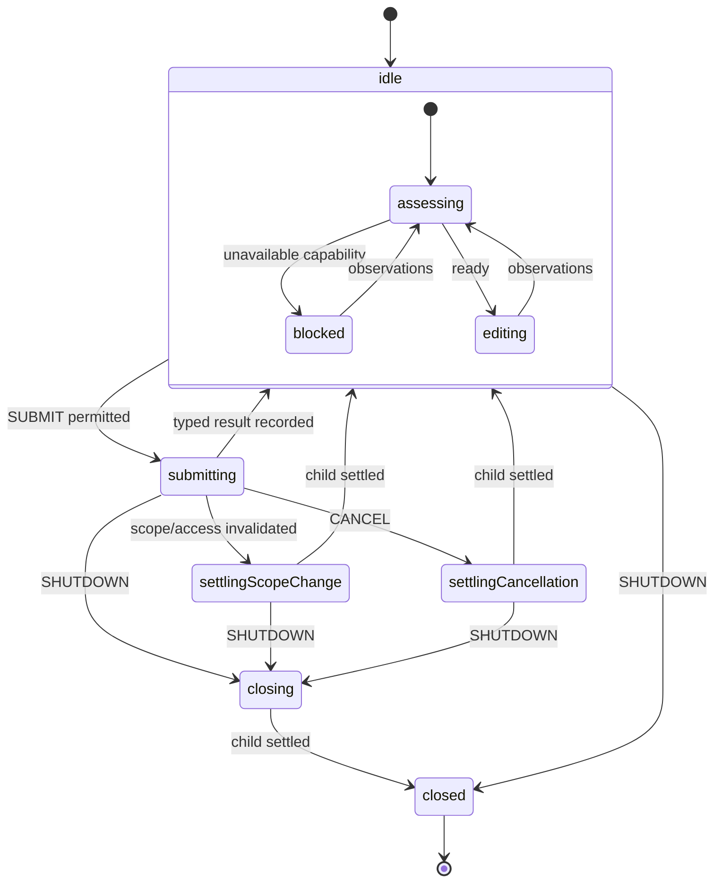

# Shared forms: proposed contract (slice 2a)

Status: model approved by user continuation; slice 2b implemented for review. No production consumers migrated; runtime verification awaits implementation approval.

## Inventory and concrete gaps

| Surface                       | Current responsibility                                                                    | Gap to address                                                                                                       |
| ----------------------------- | ----------------------------------------------------------------------------------------- | -------------------------------------------------------------------------------------------------------------------- |
| `machines/form.ts`            | Validate, call a save callback, retain result/error, ignore duplicate requests while busy | No access/scope observations or explicit cancellation/shutdown; arbitrary domain branching remains in save callbacks |
| `forms.svelte.ts`             | Construct/replace actors, subscribe, adapt FormData, reject disabled/busy submissions     | Submission policy lives outside the machine; key changes and teardown call stop without settling issued effects      |
| `FormContent.svelte`          | Render native form, fields, controls, feedback                                            | Snippets receive the raw actor snapshot through FormView                                                             |
| `FormModal.svelte`            | Local open state, scope-keyed content, success view                                       | Separate disabled prop and snapshot checks; closing is labelled Cancel even while a save continues                   |
| Account/category/tag creation | Modal fields, domain callbacks and result-name feedback                                   | Repeated snapshot/error interpretation and independent permission props                                              |
| Category/tag archiving        | Generic controller with programmatic submit                                               | Shared contract must also work without a native form or dialog                                                       |
| Workspace/profile editing     | Inline forms and domain scope checks                                                      | Scope/ownership decisions hidden in callbacks; void success must remain representable                                |
| Transaction entry             | Reference-dependent validation, field issues, Add another                                 | Some fields stay enabled while busy; dependency readiness and input validation are different concerns                |
| Avatar editing                | File selection and display URL lifecycle                                                  | Retain File/FormData support and field feedback; image display resources remain presentation-owned                   |

Static inspection confirms workspace/profile updates and category/tag creates
wait for local persistence and accept no abort parameter. The shared layer must
not interpret an AbortSignal or actor stop as evidence those writes were undone.
Domain operation adapters must establish their own effect guarantees.

## Ownership and migration strategy

```text
page / integration (Jazz subscriptions and bound dependencies)
  scoped form owner
    domain availability machine (readiness, scope, permission)
    submission child (one immutable request, validation and outcome routing)
      validation actor (schema only)
      domain operation machine (authorization, preparation, write, cleanup)
        focused I/O / platform actors
  pure form components (typed view and callbacks)
```

The owner composes a supplied domain availability machine and operation machine.
It does not accept an arbitrary branching save promise as the new domain contract.
Each operation rechecks current scope and authorization before issuing effects;
share pure policy predicates with availability rather than duplicating rules.
Do not wrap manually started machines in promise bridges.

Introduce this path additively beside the existing form API. Keep legacy consumers
working until their scheduled migration; do not claim their disabled callbacks
are now machine-enforced. Compatibility may project new views for shared rendering,
but must not fabricate domain outcomes or cancellation guarantees for old actors.
Remove legacy exports only after an inventory confirms no remaining consumers.

Proposed machine/controller names are `createScopedFormMachine` and
`createScopedFormController`; exact TypeScript generics are settled in slice 2b.
New presentation contracts carry no SnapshotFrom or XState actor references.
Pure components must not need to import machine implementations to render.

## Observations, scope and request identity

- Integration forwards raw domain observations: identity/session, workspace/record,
  exact DB binding, query readiness/errors, membership/grants, and needed references.
  It does not combine these into its own `canSubmit` boolean.
- Availability reports `ready` or `blocked(reason)` for the exact scope. Reasons
  distinguish loading, session unavailable, select workspace, read-only, missing
  prerequisites, and read failure where applicable. Domain variants refine reasons.
- Scope is immutable and typed by the domain: it includes identity, exact binding,
  target workspace/record, and form variant where applicable. A pure equality
  predicate compares scope identity only; it must not hide authorization decisions.
- Every submission captures that scope, a request identifier, raw submitted input,
  then validated values. Validation may use a captured reference-data snapshot;
  the domain operation must still check current references before writing.
- The owner forwards observation changes to live children. Scope changes invalidate
  an old submission even if the user later returns to that scope. Results and
  disposal acknowledgements are matched to their exact request/child.
- Context stores observations, payloads, identifiers, references, issues, and typed
  outcomes. Active state is not duplicated in phase, busy, or cancelling flags.

## Events and behavior

| Event             | Contract                                                                                                                                                 |
| ----------------- | -------------------------------------------------------------------------------------------------------------------------------------------------------- |
| `OBSERVE`         | Feed raw facts to availability and the live submission; reevaluate the view without restarting issued work                                               |
| `SUBMIT(values)`  | Accepted only in an editable, ready scope with no active submission; direct sends and UI submission use the same guard                                   |
| `RESET`           | Clear feedback/validation and return to editing when no submission is active; ignored while validating, operating, or settling                           |
| `OPEN`            | Clear a completed success for a new draft; preserve existing edit/invalid drafts; while busy reveal the existing operation without starting/resetting it |
| `RETRY_READINESS` | Restart a failed availability child after active cleanup settles; never resubmit a previous operation or retry a write automatically                     |
| `CANCEL`          | Explicitly cancel workflow work; before effects, no write starts; after effects, request cleanup and await actual settlement                             |
| `SHUTDOWN`        | Stop new work and await child cleanup/settlement; cannot be downgraded by completion, retry, observations, reset, or cancellation                        |

`CLOSE` is intentionally a presentation action, not a workflow cancellation event.
Closing a dialog by button, Escape, or backdrop preserves its draft and lets an
accepted operation settle under its owner. Use Close while busy so the label
does not imply write cancellation. If no operation is active, existing Cancel
labelling may remain for dismissing an unsaved draft. Reopening while busy shows
progress and does not create a second operation. Explicit workflow cancellation
is a separate action where a domain exposes it; no new Cancel operation button
is required just to exercise the shared API.

Scope replacement closes/key-resets visible draft controls, forwards invalidation
to active work, and suppresses old feedback. The same owner blocks new submissions
until the old submission settles; then it assesses the latest scope. This keeps
at most one active submission per owner. Independent forms remain independent;
this is not a cross-form or cross-tab write lock.

DOM reset handling is an adapter boundary: always prevent the native reset,
send RESET, and reset native fields only after machine acceptance (for example,
a machine-owned draft revision changes). Avoid resetting controls after a guard
rejected RESET. File selection and payment-method disclosures reset with that
revision/scope in presentation; the owner does not store every keystroke.

## State model



This is a behavior outline, not literal nesting: submitting and its settling/
closing states must share a compound parent that owns the invoked submission.
Entering settlement must not stop/restart the child. Readiness remains observed
during active work, so loading/read-only feedback can change independently of
write settlement. Preserve the priority shutdown > scope invalidation > cancellation.

The submission child owns `validating -> operating -> terminal result`.
Schema rejection produces invalid input with field issues; unexpected validation
actor rejection produces failure, not user-invalid input. The domain operation
owns authorization/preparation and effect settlement as visible guarded states.
An issued non-abortable write stays invoked through its settlement states. Keep
terminal outcomes flat unless they acquire shared behavior, consistent with the
reviewed account-archive model.

Validation is not assumed to be pure merely because it uses a schema. The current
avatar schema asynchronously resizes images. Its later migration must expose
resourceful preparation as a domain actor or explicitly await its native cleanup
on cancellation; discarded promise output alone is insufficient. No validation
completion after invalidation may start the domain operation. Ordinary schema
parsing, issue normalization, and pure transformations remain functions.

## Typed results and view

Results are discriminated unions. Relevant variants include succeeded with a
result payload (including void), invalid with field issues, denied with a reason,
unavailable, scopeChanged, cancelled, and failed with sanitized classification.
Interrupted outcomes carry notStarted or actual effect settlement; unexpected
failure may carry unknown settlement. Only a domain supporting multiple writes
may report partial completion. Validation issues contain paths/codes needed for
field feedback, not arbitrary raw thrown errors; localization stays reactive in UI.

The view projects separate, explicit dimensions:

- Readiness: ready or blocked(reason).
- Content: fields or success(result). Inline profile editing may keep fields
  visible after success; the form configuration selects that presentation policy.
- Activity: idle, validating, operating, or settling(reason).
- Feedback: none, invalid(issues), success(result), denied(reason), interrupted
  with settlement, or failure(code). Independent historical results remain separate.
- Capabilities: canSubmit, canReset, canOpen, canCancel, and fieldsEditable, all
  projected from the same guards/states that handle their events.
- Draft revision: advances only on accepted reset, successful reopen requesting
  a new draft, or scope replacement. It does not advance on a rejected reset.

These dimensions are projections of the chart, not independently assigned context
flags. Components branch on typed choices, translate domain descriptors, and render
model capabilities. They do not interpret raw errors, classify outcomes from
counters, or add permission checks. A success with void data must not disappear
because the result payload is falsy.

## Resource ownership and failure boundaries

- Controller adapters extract FormData (including Files and repeated fields),
  forward events/observations, subscribe to the owner, and deliver accepted native
  reset effects. They contain no domain permission branches.
- Before SUBMIT, refresh raw observations synchronously to cover reactive-effect
  timing. Use invoked adapters for fallible asynchronous preparation; do not move
  fallible work into unhandled entry actions.
- Domain availability and operation invocations each have onError handling.
  Availability failure while work is active invalidates capability, requests
  operation cleanup, and waits; do not fail the owner and abandon active resources.
- Forward events only to live children. A failed/done child cannot acknowledge
  shutdown; reconcile its failure/result directly. Check shutdown priority before
  consuming even an already-queued child completion.
- On unmount/binding replacement, unsubscribe view and Jazz observers, send explicit
  shutdown, and retain the old owner only until cleanup/issued effects settle.
  Stop it on completion. Never retarget its dependency closure to the replacement.
- Verify nested actor subscriptions deliver activity/view changes without relying
  on root snapshot identity changing. Files/transient payloads are released after
  validation/operation cleanup; object URL disposal remains with presentation.

## Focused follow-on cycles and acceptance gates

| Cycle | Proposed files/scope                                                                                                            | Review evidence                                                                                                                                                     |
| ----- | ------------------------------------------------------------------------------------------------------------------------------- | ------------------------------------------------------------------------------------------------------------------------------------------------------------------- |
| 2b    | New scoped owner and submission machine modules, props-only form contract module, additive controller in forms.svelte.ts        | Guarded submission, live capability updates, direct-event protection, reset/reopen, scope replacement and shutdown settlement; no production consumer migration yet |
| 2c    | FormContent.svelte, FormModal.svelte, presentation adapter/contract, controller reset integration if needed                     | Typed presentation and explicit close semantics; retain legacy consumers through a narrow compatibility path without changing their domain policy                   |
| 2d    | Workspace rename machine, settings/workspace page, WorkspaceNameForm.svelte, messages/en.json, controller wiring only if needed | One complete domain composition using the new owner; remove page canRename/save branching and demonstrate void success and live permission changes                  |

Workspace rename is the representative adoption because its single local update,
owner/admin policy, scoped query readiness, and inline feedback exercise the
contract without introducing account-creation or transaction dependencies. It
fulfills the rename portion of slice 5; later slice 5 still covers profile editing.
A modal consumer is still required during the subsequent account-creation slice
to verify actual close/reopen behavior, not just the shared component contract.

Show each concrete file set before effects; normally at most 4–6 implementation
files. Add/run tests only after approval of that implementation. Required coverage
includes blocked direct SUBMIT, duplicate/reset races, readiness changes during
validation, scope/permission loss before and after effects, rejected and successful
write settlement, nested view updates, void success, Files/repeated fields,
accepted versus rejected native reset, and dialog dismissal/reopen while busy.
Do not treat compatibility-only consumers as migrated or tested under the new
domain contract. No shared form behavior is implemented by this document.

## Slice 2b implementation notes

The reviewed four-file batch is now present: form-contract.ts (props-only data),
scoped-form-submission.ts, scoped-form.ts, and additive integration in
forms.svelte.ts. The existing createFormMachine/createFormController behavior is
unchanged. Availability logic and operation logic are supplied typed actors;
the new API has no generic branching save callback or external disabled predicate.

The owner uses parallel availability and workflow regions. Awaiting/current
availability states control readiness projection; observation revision/scope
checks guard capability acceptance. A small invoked availability supervisor owns
projection so a thrown projection fails at the owner's invocation boundary and
routes active work through invalidation/settlement. Availability machines receive
facts only and must own no asynchronous external resources: subscription binding
remains in integration. Retrying readiness restarts its child only after active
work settles and never retries a write.

The submission retains its validation invocation through interruption and its
operation invocation through settlement. Interruption states override queued
completion/error without inventing effect reversal; unknown child settlement
stays unknown. Top-level final entries clear raw/validated request payloads and
observations. The owner releases completed child snapshots and clears its scoped
data on shutdown. Pure scopeOf/sameScope callbacks must be total identity
projections/comparisons, not fallible I/O or authorization workflows.

The controller is bound for its component lifetime. Remount the integration when
its DB/session dependency binding is replaced; scope observation updates do not
retarget the operation machine's bound dependencies. It forwards raw observations
before SUBMIT, serializes FormData including Files/repeated fields, prevents
native reset, and exposes machine-owned draftRevision for keyed field rebuilding.
On unmount it detaches view subscription and waits for explicit owner completion
before stopping. Slice 2c still needs to adopt the view/revision in presentation.

`pnpm check` passed with zero Svelte errors/warnings. No tests were added/run
before implementation review; no production behavior is claimed verified yet.
