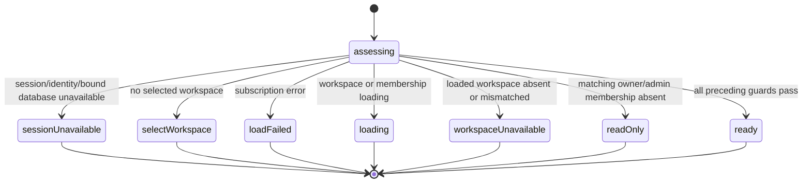
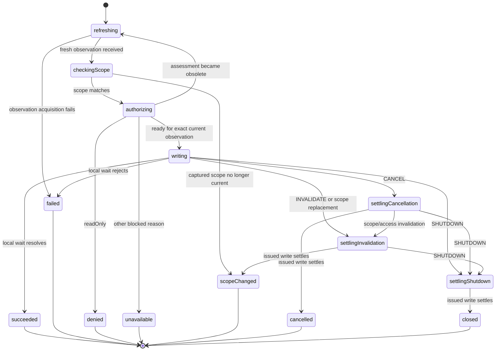

# Workspace rename: first scoped domain adoption (slice 2d)

Status: revised shared-lifecycle model approved by user continuation; the six-file
implementation is prepared for review. Runtime verification awaits approval of
the exact implementation.
Maps FR-001–007 and FR-009–012 and the rename portion of delivery slice 5.

## Inspected behavior and guarantees

- `src/routes/settings/workspace/+page.svelte` owns the workspace and current-user
  membership subscriptions and a legacy form controller. Its `canRename` derivation
  and save callback check owner/admin access and current workspace identity.
- `workspaceNameFormSchema` trims input and rejects an empty name. Preserve it.
- `renameWorkspace` issues `db.update(app.organizations, id, { name })` and waits
  for `{ tier: 'local' }`. It accepts no AbortSignal. A completed wait establishes
  local persistence, not remote acceptance or cross-device delivery.
- `src/lib/permissions.ts` restricts organization updates to owners/admins on both
  old and new records. Preserve these authoritative SDK permissions unchanged.
  The machine also checks membership user and organization identity explicitly.
- The page currently delegates loading/error display to QueryContent, which can
  remove presentation while the page-owned controller continues. The scoped owner
  will likewise outlive presentation changes, with explicit shutdown settlement.
- JazzSessionProvider keys its client-provider subtree by session owner. The new
  controller additionally checks the exact observed database binding against its
  captured binding; a changed binding cannot silently retarget an old operation.

## Focused implementation scope

Six implementation files, shown before effects:

1. `src/lib/workspace-rename-contract.ts`: domain observation/scope/reason types
   and props-only view aliases. No actor or framework dependencies.
2. `src/lib/machines/scoped-form-write.ts`: reusable single-write operation
   lifecycle, composing supplied domain assessment and write actors. Own freshness,
   interruption, issued-write settlement and sanitized effect-failure handling here.
3. `src/lib/machines/workspace-rename.ts`: workspace-specific readiness/
   authorization assessment and thin composition options using the shared owner
   and shared single-write lifecycle. Supply the rename action through integration;
   do not add a workspace-specific operation lifecycle machine.
4. `src/routes/settings/workspace/+page.svelte`: keep Jazz subscriptions, exact
   binding, current observations, and createScopedFormController integration here.
5. `src/lib/components/WorkspaceNameForm.svelte`: typed props and callbacks;
   localize/render readiness, activity, feedback and capabilities.
6. `messages/en.json`: only required blocked/interruption/result explanations.

No change to schema, permissions, the persistence helper, other form consumers,
or the shared controller is currently needed. If inspection during implementation proves
another file necessary, discuss that scope change before expanding the batch.

## Shared versus form-specific responsibilities

The user clarified: forms share base form machines and add special actors only
for actions unique to the form. Apply that structurally, not just through similar
names or copied statecharts.

| Shared base                                                                         | Workspace-specific input/actor                                         |
| ----------------------------------------------------------------------------------- | ---------------------------------------------------------------------- |
| Submission acceptance, duplicate protection, schema invocation and invalid feedback | Existing workspace-name schema                                         |
| Observation revisions, scope replacement and capability/view projection             | Workspace identity/scope facts and readiness/authorization assessment  |
| Reset/reopen/draft revision, cancellation and shutdown priority                     | Initial name and localized domain explanations                         |
| Common prepare/authorize/single-write/settlement lifecycle                          | Owner/admin policy and the rename update actor                         |
| Generic error boundary, cleanup and issued-effect outcomes                          | Domain result payload (void here) and supported persistence guarantees |

Keep page integration limited to subscriptions, fixed dependency binding, raw
observations and callbacks. Keep display components limited to typed props,
localization and presentation. A new ordinary form should not copy interruption,
write settlement, duplicate handling or generic failure states. It supplies its
schema, domain assessment, effect actor and view messages to the shared bases.

Do not add an arbitrary branching save callback to hide domain preparation.
Meaningful business decisions still belong in domain assessment/preparation
actors. A genuinely multi-step domain workflow can compose additional actors,
but it should reuse shared mechanics rather than reimplement the form owner.
The shared single-write path must not replace or broaden the existing richer
operation composition contract merely to accommodate this first adoption.

## Ownership and observations

```text
workspace page (subscriptions, fixed database dependency, observation function)
  scoped form owner (already reviewed)
    domain availability wrapper
      finite readiness assessment
    scoped submission (already reviewed: validate, interrupt, await settlement)
      shared scoped single-write operation
        fresh observation adapter
        workspace-specific readiness/authorization assessment
        supplied rename write actor
  WorkspaceNameForm (props-only presentation)
```

Observed facts include current identity, selected organization, exact live database
binding, session status, separate workspace/membership loading and error facts,
and the loaded workspace and current-user membership. The page forwards facts;
it does not derive canRename or reconstruct readiness from several conditions.

Scope captures identity, selected organization, and the exact database object.
The loaded workspace must match the selected organization. Membership must match
both current identity and organization. The captured operation dependencies never
change to a replacement database while a request is active.

Raw observation revisions are assigned by the shared owner. Availability echoes
that revision and scope; stale reports cannot authorize a submission. The domain
operation takes a fresh observation before writing and ignores/reassesses obsolete
assessment results when a newer observation arrives during preparation. A scope
change invalidates the request even if the user switches away and back.

## Readiness statechart

The same finite assessment is composed by availability and operation preparation,
so their authorization decisions share one chart rather than divergent predicates.



This precedence distinguishes missing observations from denial: loading does not
become readOnly simply because membership has not arrived. Missing membership
after loading is readOnly. A stale workspace record is never an editable target.

The wrapper reevaluates on observations and reports a typed readiness result for
the exact observed revision/scope. The assessment owns no external resources.
Unexpected actor failures remain supervised by the shared owner, which invalidates
active work and waits for its settlement before enabling readiness recovery.
A query error is not evidence that retrying the availability actor would reload
Jazz data; do not add a misleading query-retry action without a supported adapter.

## Shared single-write operation statechart

Validation remains in the shared submission child. The following is a reusable
base operation, not a workspace-specific machine. It owns scope/freshness checks,
invokes the supplied domain authorization assessment, issues the supplied write,
and waits for settlement. Ordinary single-write forms reuse it. Domain actors
supply business policy and I/O, not a second generic form lifecycle.



The writing/settling states share the same compound parent and invocation. A
transition into settlement must not stop, restart or retry the write. Before the
write starts, interruption finishes with notStarted and releases preparation.
During writing, observation forwarding and the shared owner's capability
invalidation keep permission/scope loss visible. No further domain effects are
scheduled; the already-issued update remains owned until its actual wait settles.

Preserve priority shutdown > scope/access invalidation > cancellation across
queued completion/error events. All invocations have unexpected-error paths.
A failed child cannot later acknowledge shutdown; the parent uses its actual
failure/output rather than awaiting an impossible acknowledgement.

The freshness/scope/authorization guards precede the write with no asynchronous
preparation gap after acceptance. Jazz permissions remain the authoritative
write boundary; do not replace them with client snapshots or claim a new atomic
permission guarantee from those snapshots.

## Results, cleanup and presentation

- Success: `succeeded`, void payload, locallyPersisted. Use retained inline fields;
  success is recognized by the discriminant, not payload truthiness.
- Invalid input: shared schema issues, notStarted; show the existing required-name
  explanation and allow correction.
- Denial: readOnly, notStarted; distinguish it from persistence failure.
- Unavailable: exact blocked reason, notStarted; preserve its readiness explanation.
- Scope change/cancellation/shutdown: typed interruption plus actual settlement.
  An already-resolved local wait is locallyPersisted, not an undone write. A rejected
  wait is reported conservatively according to the actual SDK guarantee; do not
  infer rollback of an optimistic update merely from promise rejection.
- Unexpected pre-write failure: sanitized failure, notStarted. Failure after issue
  retains unknown settlement unless a narrower SDK guarantee is established.

Classify the result once. Terminal cleanup clears submitted/validated name payloads,
request observations and child references after owned work settles. Scope replacement
suppresses feedback belonging to an old request. Navigation sends explicit shutdown;
actor.stop alone is not a write-cancellation mechanism.

WorkspaceNameForm receives only the scoped view, display name, and callbacks.
It imports no actor/controller/machine types and makes no owner/admin or query
policy decisions. Render readiness reasons even when editing is blocked, and keep
activity/issued-write settlement distinct from the current capability explanation.
Use fieldsEditable/canSubmit; remove canRename and raw snapshot/error interpretation.
Use the shared draft revision to reset the workspace-bound fields. Preserve the
existing name-field initialization/update behavior; concurrent draft merging is
outside this slice. No decorative styling or new modal is proposed.

## Review and later verification

Review this concrete domain model and six-file scope before implementation effects.
After implementing, present that exact implementation and wait for approval before
adding/running tests. Keep those as separate review records in tasks.md.

After implementation approval, verify owner/admin/member/viewer and mismatched
membership, loading/error/missing workspace, whitespace rejection and correction,
direct SUBMIT protection, scope and identity/binding changes, fresh authorization
before issue, observations during preparation, duplicate/reset races, void success,
local persistence offline and after reload, issued-write settlement during
permission loss/navigation, child failures and late results. Reuse relevant existing
workspace scenarios where they match the new contract, and add focused machine
coverage for races that cannot be controlled reliably through the browser.

Existing shared-layer tests do not establish this production domain composition.
No application changes, tests, commit or new server are part of this model cycle.

## Implementation review notes

The six proposed files are implemented. The shared single-write base owns the
prepare/scope/authorize/write lifecycle and explicit denial, unavailability,
success, failure and interruption states. It supervises policy projection in an
invoked child, so a thrown projection reaches an invocation error boundary before
effects. Observation revisions prevent older refresh/assessment reports from
replacing newer facts. Issued writes remain invoked throughout settlement.

The domain policy is a resource-free persistent readiness chart with transient
assessment and observable ready/blocked states, reused directly by both the
shared owner's availability observer and the shared write base. This avoids a
separate finite assessment plus domain wrapper while retaining the reviewed
policy precedence. It contains only workspace/session/binding/readiness and
owner/admin membership decisions. The rename adapter performs one existing local
update; no domain operation lifecycle is copied into workspace-specific code.

A rejected issued wait is conservatively unknown, including after interruption;
locallyPersisted is reported only after the existing local wait resolves. Pure
scope/classification callbacks must be total and contain no I/O or hidden workflow.
The shared base supports resource-free readiness and a single non-abortable write;
resourceful preparation or multi-step effects continue to need focused child actors
through the richer existing scoped operation contract.

Type/format checks are recorded separately in tasks.md. No new unit/browser tests
are authorized until the user reviews and approves this exact implementation.

## Requested implementation review refinements

The user clarified that change tracking must be a general shared-machine option.
Workspace rename now selects `mode: 'edit'`, supplies the observed saved name and
a pure trimmed-name equality comparison, and forwards raw input through the shared
controller. The shared owner enforces change-sensitive canSubmit and direct-event
acceptance while keeping pristine fields editable; no workspace-only dirty flag
or workflow is introduced. Create remains the default mode for existing callers.

The user also requested stable submit action labels across forms. The corresponding
presentation changes are recorded with their expanded related file scope in
forms.md/tasks.md. These refinements remain part of the pending implementation
review; no tests for the revised implementation have been added or run.
