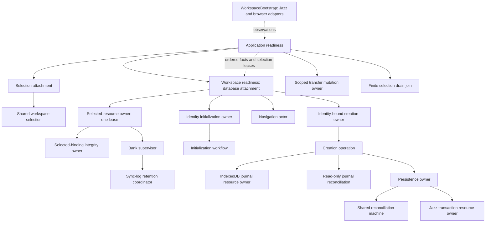
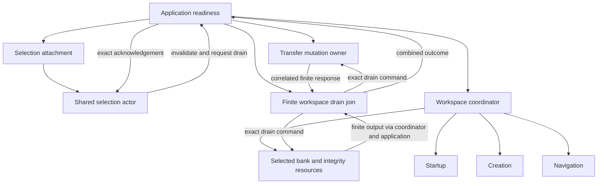

# Multiple workspaces: implemented architecture

Status: create-and-switch complete. [spec.md](spec.md) is the product reference, including approved
future sharing decisions. [data-model.md](data-model.md) and the
[operation contract](contracts/workspace-creation.md) describe durable data and public behavior.
[research.md](research.md) records SDK constraints; [quickstart.md](quickstart.md) covers validation.
The completed implementation task list and superseded actor proposal have been removed.

## URL and presentation

Native SvelteKit file-based routes use `?workspace=<uuid>`; `/settings/workspace` is the single
chooser, rename and creation page. The URL is the only persisted selection, independently per tab.
`AppLink` and generic query utilities preserve configured parameters without custom route rewriting.
The drawer and settings page share `WorkspaceSelector` and the same selection command.
Switching preserves the page except transaction details/new-entry routes, which return to their
list and discard unfinished input. Account filters and pagination reset; submitted writes retain
their original scope. Account/login pages and workspace management require identity readiness but
remain available during workspace-catalog loading or failure.

Creation uses the shared form modal. While submitting, it keeps Close and a persistent screen-reader
progress region, without an extra visible preparation message or Cancel button. Status/alert nodes
survive feedback and success transitions. Creation does not select its result automatically. Equivalent editing-view observations preserve
the local name draft; entering a new editing session resets it.

## Actor ownership

Integration binds subscriptions, browser effects and actor attachments. Pure presentation receives
data and callbacks. Shared selection consumes exact local membership facts independently from directory availability;
the coordinator and navigation consume its lease/status alongside Finance-specific permissions. Initialization, integrity and navigation reports carry request/generation correlation.
Creation exposes an identity-bound public view. Stale reports cannot enable a replacement selection,
including A → B → A. Exact database attachment identity prevents obsolete detach events from closing
a replacement owner.

Startup, creation, and navigation remain fixed identity-bound children. Each selected scope gets a
distinct resource owner that invokes bank/retention and integrity through work and drain. The
coordinator waits for its finite result before replacement, retains unresolved evidence, and never
restarts automatically after an unsolicited resource stop. Selection changes do not shut down
creation. Whole-coordinator shutdown drains the resource owner alongside the identity-bound children.
Public actor liveness only avoids dead-child sends; queued finite completion/error still determines
release. The application now supplies shared selection leases; the former native directory-based
selection verdict and temporary host lease issuance are removed. This handoff awaits runtime verification.
The [incremental adoption notes](../../docs/local-first-workspace-selection-plan.md) record the reviewed
boundaries and focused verification.
The [orchestration spec](../008-actor-orchestration/spec.md) defines these responsibilities.

## Initialization

The following describes the historical initialization implementation. [013](../013-local-first-startup/spec.md), FR-004–006, supersedes remote provenance discovery as a prerequisite for unrelated local usability. Available local data and known permissions must permit ordinary work while provenance discovery waits. Empty replicas must not authorize replacement bootstrap. Offline bootstrap for a genuinely new identity requires supported provenance and a reviewed concurrency protocol (013 T010); that protocol is not implemented or verified here.

Local discovery accepts a profile's existing `initialWorkspaceId` marker without requiring access
to its original workspace. Otherwise, authoritative discovery is required before bootstrap.
Only no profiles plus no accessible workspaces permits first-use creation. An existing profile
without its marker reports `initializationMissing`; workspaces without a profile report
`profileMissing`. Duplicate profiles and unavailable authority are separate outcomes.
There is no legacy marker backfill, arbitrary workspace adoption, membership resurrection, or
category replenishment. The initialization marker remains provenance, never active selection.

## Creation and recovery

The operation validates the name, freezes IDs/defaults and records the attempt before Jazz writes.
Loading a journal invokes read-only reconciliation and never automatically replays creation.
Explicit creation/retry invokes persistence directly: validate payload → shared reconciliation →
matching/conflict/profile-unavailable result or transaction. This is one preflight read pass;
there is no separate duplicate hydration pass.

The transaction owns open → read → guarded eligibility → staging → commit → local settlement,
with rollback, cancellation and shutdown draining. Transaction-time reads remain necessary because
preflight data can change. Matching attempts return their existing workspace; inconsistent records
are not upserted over user changes. Bootstrap also creates its profile/initialization marker atomically.

`CreationResult` is a discriminated union: complete requires record/workspace and local settlement;
recovered requires its record; invalid/editing have no record; failures require diagnostics;
unresolved results require unresolved settlement. Interrupted outcomes preserve the available record
and actual settlement. UI reads a workspace only from a complete result.

## Selected-workspace integrity

Integrity checks profile/membership consistency, not categories. A suspected profile-link repair
requires authoritative confirmation and current owner/admin authority, then uses its own transaction
with reassessment and settlement. Attribution-only partial results remain finance-usable. Category
repair, blocked-partial branches and legacy backfill are absent. Required categories are created at
workspace creation; transaction forms retain their normal category validation.

## Shared selection application handoff

The application owns the selection attachment and transfer mutation owner as siblings for the
whole application lifetime. The existing coordinator continues to own startup, creation,
navigation, and selected bank/integrity resources. A finite drain join is an application child
for one library drain request; it never owns or recreates the two resource owners it waits for.

### Binding and observation protocol

Each coordinator attachment receives a fresh selection attachment token and increasing revision,
even if the SDK retains the same database client after recovery. The application waits for the
selection attachment's release and coordinator closure before installing another attachment.
The selection wrapper stays invoked across SDK retry/recovery; detach closes its current fixed
selection child, without stopping a child that is still requesting cleanup.

Bootstrap sends one typed readiness observation with its exact attachment identity to the
application. The application rejects old attachments, forwards accepted observations to the
coordinator, and supplies target-specific facts to shared selection. It is the single ordering
boundary; two unrelated Svelte effects must not independently drive old and new selection policy.
Use a fresh selection attempt on target changes and a monotonically increasing observation
generation within the attachment. Overflow fails closed; counters must not wrap.

The explicit URL target determines selection intent. Malformed or conflicting scope cannot select
another workspace. An unscoped management/identity route suspends selection and drains any old
lease without ending creation, startup, or navigation. No automatic first-workspace selection is
added. Available local membership for the exact user/workspace supplies target access independently
of directory loading, absence, or failure. Missing/loading membership is unknown, failed membership
observation is failed, mismatched membership is denied, and an unavailable session is unavailable.
Directory records remain chooser facts and never establish or revoke target authorization.

### Lease and transfer request protocol

On a current selected report, the application binds transfer scope using
`transferScopeForWorkspaceLease` for binding/workspace and an application-lifetime monotonic
generation, then publishes that exact lease to the coordinator. The generation cannot reset with
a new attachment: the long-lived transfer owner rejects generations older than its last binding. Equivalent
selected reports retain existing owners; they do not rebind/reset transfer outcome evidence.
The coordinator creates bank/integrity resources with the supplied lease after their existing
initialization prerequisites. It stops issuing temporary host leases. Its native directory-based
selection verdict is replaced by shared selection status, while membership and bank credential
permissions retain their existing domain checks.

Transfer eligibility must not depend on bank resource acquisition, profile initialization, or a
nonempty workspace directory. Both transfer integrations provide a scope-capture capability bound
to their original database dependency. The request actor captures the current lease when it is
created, before submitting or waiting. Creation and link/unlink/delete callers currently invoke
that request actor immediately from the operation transition; retain this ordering. If preparation
is later moved ahead of that invocation, capture must move to the original operation transition.
Validate the captured database, identity, and requested workspace against the published lease.
Copy the scope fields into the immutable request; do not look up scope again in the submit action.

The application accepts a request only while that exact lease remains published and its binding,
workspace, epoch, original database and identity are current. It rejects requests while invalidated,
draining, recovering, closing, or failed with an existing not-started operation result. Export/reuse
the transfer owner's rejection classification rather than duplicating its result union. Do not
attach the latest scope to an old request. Cancellation continues to reach the original owner.
Remove production `TRANSFER_SCOPE_CHANGED` forwarding only when both callers use scoped requests.

### Drain, recovery, and failure protocol

`WORKSPACE_SCOPE_INVALIDATED` immediately clears published capabilities and the coordinator lease.
This precedes the separately delivered drain request, so new transfer requests must already be
rejected in that interval. On `WORKSPACE_DRAIN_REQUESTED`, capture the old resource actor and start
one drain join. If it already completed independently, forward its actual saved finite output for
the same lease. No acquired resource means the join's resource leg is released; public actor status
alone never supplies that evidence. The coordinator forwards actual completion or a correlated
crash while retaining its own existing cleanup classification. Never stop the join to replace it.

The application acknowledges released evidence with `DRAINED`, known released failure with
`DRAIN_FAILED: released`, and uncertainty with `DRAIN_FAILED: unresolved`. A known released failure
requires explicit retry and fresh observations. An unresolved result enters an explicit cleanup
failure state; it cannot install another attachment, certify clean shutdown, retry the SDK, or
restore identity. Unexpected join/selection/transfer-owner errors take that same conservative path
and continue cleanup of surviving owners. Stale child errors and drain responses cannot affect a
replacement. Selection failure must be visible through existing readiness error presentation.

Retry and identity restoration wait for coordinator closure, selection attachment release, and
the finite join result before issuing their SDK operation. Whole-application shutdown drains
selection before terminating the transfer owner, so the owner remains available for its scoped
acknowledgement. Retain existing startup/observer cleanup and recovery/shutdown priority. These
barriers must be explicit machine states/guards, not a pair of mirrored completion booleans.

### Implementation and review sequence

The coordinated implementation batch touches application readiness, workspace readiness, Bootstrap,
the transfer request actor, both transfer integration components, and the owner's shared rejection
classification. A small typed observation adapter may be separate if needed; it must only map facts,
not become another owner or hide orchestration. No schema, localized string, CSS, or UI redesign is
part of this batch. Show the implementation before updating or running its tests.

After implementation review, update application/coordinator fixtures to speak the public
selection/lease/resource protocols. Verify local access with an empty/loading/failed directory,
transfers before bank initialization, equivalent observations, A -> B -> A stale requests, access
revocation between invalidation and drain request, both cleanup orders, independent completion,
unresolved outcomes, recovery with a retained client, attachment replacement, stale errors, and
shutdown while draining. Browser coverage must include workspace switching with held bank/transfer
work, ordinary transfer operations, creation surviving selection changes, and identity recovery.
The original 39 drain-join unit cases have been extended to 47 cases covering captured transfer
scope, absent/preclosed owners, and retained finite evidence. Application and caller verification
also covers the integrated handoff; the current results and qualification limits are recorded below.

## Completion status

Shared-selection adoption is wired into the application, coordinator, and both transfer integrations.
The application owns attachment replacement and exact drain acknowledgement; the coordinator consumes
shared leases and forwards actual finite resource outputs. Request actors capture scope at creation.
SDK retry/recovery waits for both coordinator closure and shared selection release. Unknown cleanup
enters an explicit failure state and cannot certify clean shutdown or issue another identity change.
A selected library lease that was invalidated before publication has no acquired transfer scope;
the join accepts that absence explicitly. Already-closed/crashed transfer owners contribute finite
release/unresolved evidence rather than receiving a command they can no longer acknowledge.

After implementation review, the shared selection handoff passes 191 focused unit cases across six
files, including 73 application cases. Coordinator fixtures run real shared selection and its public
lease/drain protocol; request and transaction fixtures capture the original scope. The application
now waits for the coordinator's actual finite onDone output, treating its terminal-entry closing
notice as informational. A closing notice alone cannot release an SDK retry/recovery barrier.
The join consumes preclosed resource evidence as input, avoiding a late send to an immediately
completed join. Full source/service-worker and browser-test types pass. The corrected final browser
run passes all 16 focused scenarios: identity recovery/sign-in, bank cancellation/retention,
workspace selector/filter/revocation/creation-survival, readiness/reload, transfer link/unlink/delete,
and offline/cross-currency transfer creation. The final server log has no stopped-actor warnings.
Five production cold-start/remote-boundary checks now pass: cold offline and unanswered remote
reads/saves, an already negotiated connection ceasing to answer, later authority rejection, and bank
history across cold restarts without provider fetches. Real held-write switching passes for bank
imports and transfers; held bank-write recovery passes. A cancellation after settled bank imports
now reports clean release, while unresolved settlement remains unresolved; two regressions cover it.
The focused bank/application/coordinator/join rerun passes 216 cases and source/browser types pass.

The transfer-recovery blocker is corrected locally by the user-approved acyclic insertion policy.
New manual transactions derive insertion authority from existing account/workspace facts, while
transfer insertion still validates both endpoints and both account grants. The factored account
predicate avoids the original stalled global wait. Marker updates and other read/update/delete
restrictions remain enforced. Authorized new manual orphan markers are explicitly an application
integrity boundary; provider inserts do not receive that exception. No schema migration or transaction
splitting is introduced. The real held-write recovery regression now passes with the rows retained,
alongside cross-currency creation, linking/unlinking and both deletion choices.

See the [adoption design](../../docs/local-first-workspace-selection-plan.md) and
[permission investigation](../../docs/transfer-creation-permission-investigation.md) for the approved
boundary and qualification. The 102-case full-policy suite, all 21 focused browser scenarios,
and source/service-worker/browser types pass. The stronger error-free recovery assertion also
passes with records retained. Refreshed green CI remains a merge gate.

Reviewed focused checks cover creation, recovery, offline behavior, isolation, URL/history scope,
authorization, stale reports, input/filter reset, accessible announcements and resource cleanup.
Latest cleanup increments passed their relevant unit/browser and static checks; this is not a claim
that a final full application/PWA suite was rerun after every increment. See validation commands in
[quickstart.md](quickstart.md).

Sharing/capability administration, invitations, ownership changes, departure, archive and account
merge are future work. Keep their approved decisions in the specification. Bank, generic-form, application/session and diagnostics follow-through are recorded in
[008 tasks](../008-actor-orchestration/tasks.md) and the [final ownership map](../008-actor-orchestration/architecture.md).
They were separately resumed by the user; completing the workspace feature alone did not authorize them.

## Workspace session recovery and automatic selection

Unscoped sign-in and finance entry no longer require a choice before navigation works.
The navigation chart keeps explicit scopes and legacy transaction ownership intact.
For multiple accessible workspaces it follows `resolvingDefault` (one local profile
read) -> `choosingDefault` (guarded preference/fallback) -> `navigating`. A sole
workspace needs no profile read. The fallback sorts stable workspace IDs; labels and
personal/business kind do not determine selection. Empty-catalog route intent survives
late arrival of one or several workspaces. Identity/route changes cancel preference
resolution, and navigation failure retains the existing retry path. Directory rows
choose a requested scope; the coordinator still establishes its authorization.

Extend the existing alpha.60 package patch so a joining browser tab supplies its fresh
self-signed proof to native peer admission. Match the retained runtime’s application,
claimed author and replica identity, and keep native signature/expiry verification.
Do not change persistence encodings, clear browser data, or bypass permissions. Patch
both the module and the shipped broker bundle used in production.

Implementation review precedes automated tests under AGENTS.md. Affected coverage:
`workspace-navigation.test.ts`, readiness/application-readiness navigation fixtures,
`tests/authentication.e2e.ts` (multiple-workspace sign-in), and navigation browser flows.
SDK regression coverage must retain a worker beyond its opening proof expiry, attach
with a fresh same-identity proof, and reject expired, mismatched-author and wrong-app
proofs. Run browser checks with disposable storage after approval; production reads
identified the failure but do not prove the patch correct.

Review checklist:
- [x] Prepare the credential-admission patch and automatic selection machine.
- [x] Preserve explicit scopes and existing authorization checks.
- [x] Review implementation before adding/running tests (user approved).
- [x] Update affected fixtures and add fresh/expired/mismatched-proof regressions.
- [x] Verify multi-workspace sign-in, partial discovery, linking/remapping and idempotent sync in disposable browser storage; verify expiry recovery against real native proof admission.
- [ ] Deploy and verify production recovery.

The same production recovery review also includes the reported missing SimpleFIN
discovery list after reconnection. `checkingDiscovery` rejects only an errors-only
response; `discovering` returns usable account summaries through the existing
`partial` result when provider errors accompany them. The parent already retains
partial discovery results and rebuilds mapping controls. Existing localized partial
status is reused; discovery does not import transactions or persist sync history.
Review impact: `bank-sync/operation.test.ts`, the parent `index.test.ts`, and
`tests/bank-sync.e2e.ts` need mixed accounts/errors and errors-only coverage after
implementation approval. The passkey-enabled user's live failure remains unverified;
the connected diagnostic browser lacks that passkey.

Validation on the current production base (`2cfba58`): 187 focused unit tests
passed, including real WASM signature/expiry admission and mismatched proof rejection.
Four Playwright flows passed: multi-workspace sign-in, partial discovery, normal
account creation/idempotent import, and existing-account linking/remapping.
Application/test type checks and focused formatting checks passed. No real bank
credential was decrypted or provider request initiated by the agent. The live
passkey-enabled browser still requires user verification after release.

The local production bundle also builds successfully. The Vercel deployment manifest
excludes local build/test artifacts and environment files via `.vercelignore`.
Production deployment and verification remain pending review.
