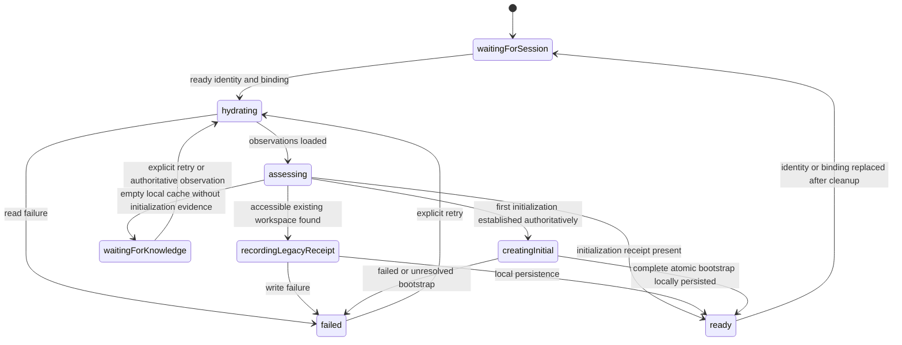
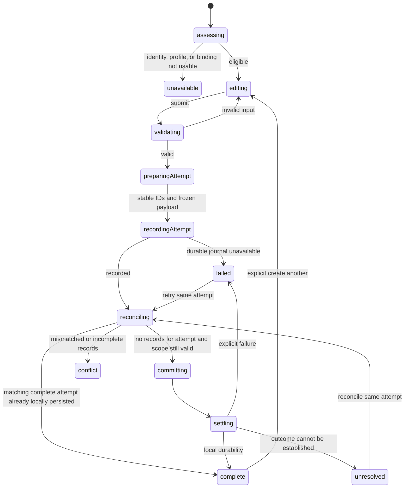
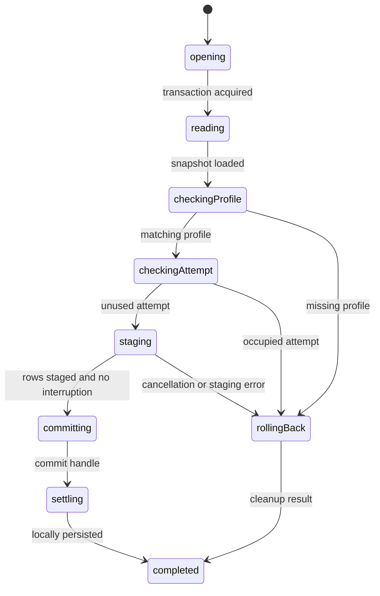
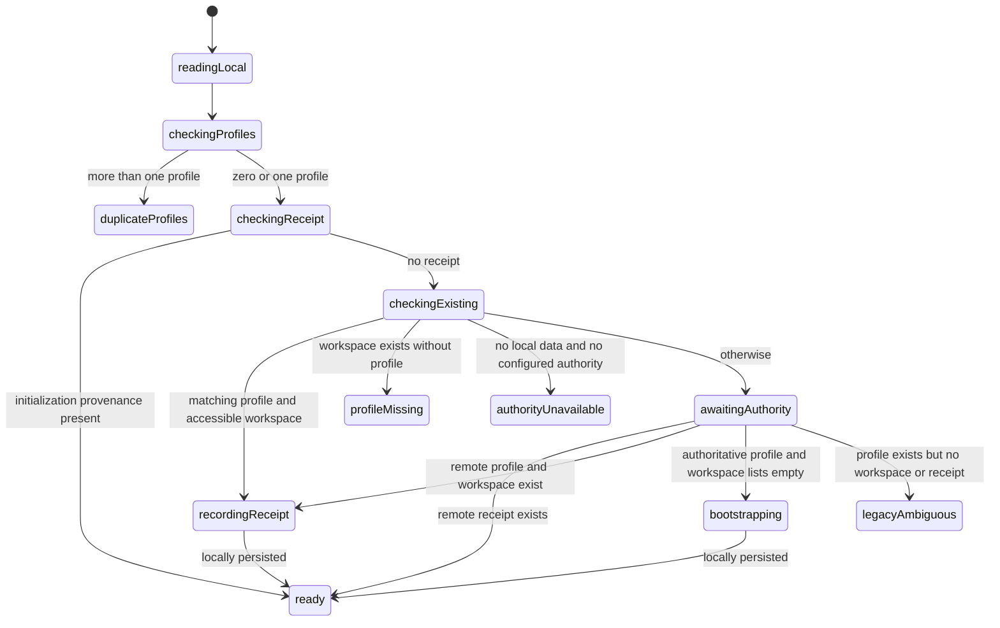
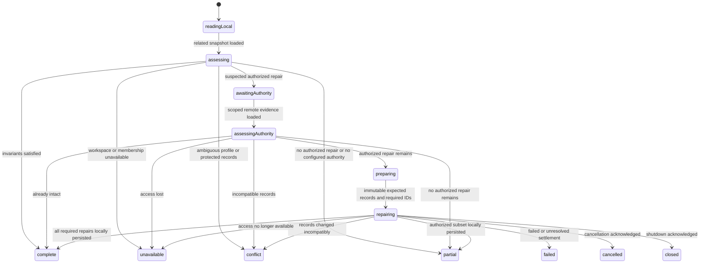

# Implementation Plan: Workspace creation and startup

**Branch**: `feature/multiple-workspaces` | **Date**: 2026-10-21 | **Spec**: [spec.md](spec.md)

## Summary

Prepare the first create-and-switch slice for review: create an additional owned workspace with its own owner membership and categories, reuse the login profile, and expose it in the existing selector. Separate startup identity initialization from workspace creation. Existing workspaces must not be treated as a unique personal home or reseeded with optional defaults on every startup.

The user reviewed and approved this creation/startup design and selected route-based workspace persistence. Implementation still proceeds in focused review cycles, not one large batch. Creation does not automatically switch the active workspace; the existing selector provides explicit selection. A lost selection among multiple available workspaces enters an unselected state instead of silently choosing a different ledger. For workspace-scoped URLs, the route is authoritative; missing access never silently redirects a detail/edit operation into another workspace.

## Technical Context

**Language/Version**: TypeScript 6, Svelte 5, SvelteKit 3 (repository package declarations).
**Primary Dependencies**: Installed Jazz 2.0.0-alpha.59, XState 5, existing scoped-form actors, Zod 4, Paraglide.
**Storage**: Jazz organization/member/profile/category tables; proposed optional initialization receipt on profile; device-local, identity/environment-scoped creation-attempt journal persisted before finance writes.
**Testing**: Vitest and Playwright only after review/approval of the exact implementation; no tests added or run for planning.
**Target Platform**: Current browser application and supported local-first environments.
**Project Type**: SvelteKit application.
**Performance Goals**: No network wait for warm local reads or additional workspace creation with a usable locally persisted identity/profile; one local atomic creation transaction per accepted attempt. No invented latency target.
**Constraints**: No provider requests, secrets, cloned finance data, role-management UI, custom styling, or synchronized global workspace selection. Route-based workspace navigation is approved and will be implemented in its own focused cycle. Local durability is not server approval.
**Scale/Scope**: One creation workflow plus startup correctness, delivered in separate reviewed increments.

## Constitution Check

- Local-first: warm startup and additional creation use local data/durability. A cold, ambiguous empty cache is unavailable until authoritative initialization knowledge exists; it is not treated as proof of a new user.
- Financial integrity: no money or existing transactions are changed. USD default retained.
- Tenancy/access: existing Jazz insert policies enforce owner bootstrap. Keep owner membership as the access source; ownerId is a compatibility/creator field, not the future sole-owner authority.
- Capability design: creation eligibility depends on session identity/binding, not current workspace role. New-workspace creation is not delegated administration of another workspace. No generic capability framework or changes to existing shared access in this slice.
- Future capability, viewer, privacy, and multiple-owner policies conflict with existing constitution/MVP details when implemented fully. They are deferred, not silently overridden here. Align affected source-of-truth artifacts before dependent implementation.
- State ownership: model startup and creation before effects; decisions live in machines; I/O actors do one operation. Reuse scoped-form infrastructure where applicable.
- Presentation: settings route owns subscriptions and form wiring; pure form uses existing controls/localization.
- Review/testing: each implementation increment shown for review before the next; no tests before implementation approval; no commit without authorization.

**Gate result**: Creation/startup design reviewed and approved. D3 now selects route-based workspace persistence. Data-foundation implementation can proceed as the first focused cycle. Routing integration needs its own concrete route mapping and scope-change model before edits; future sharing policies remain outside this slice.

## Project Structure

```text
specs/006-multiple-workspaces/
  spec.md, research.md, plan.md
  data-model.md
  contracts/workspace-creation.md
  quickstart.md
src/lib/
  data.ts                           # existing bootstrap, to narrow after extraction
  schema/identity.ts                # optional bootstrap provenance receipt proposal
  validation/identity.ts            # canonical workspace/name/attempt validation
  domain/workspace-defaults.ts      # proposed shared starter definitions
  domain/workspace-creation.ts      # proposed reusable transactional persistence
  machines/workspace-initialization.ts # proposed initialization decisions
  machines/workspace-creation.ts    # proposed scoped creation decisions
  machines/readiness.ts             # existing application-owned workspace subtree
  components/WorkspaceNameForm.svelte # existing presentation to reuse if suitable
src/routes/settings/workspace/+page.svelte # proposed creation integration
```

Names are proposals; no files above have been implemented. Do not create helpers merely to move page logic. Reuse the existing form presenter if it can distinguish create/rename accessibly; otherwise add one genuinely reusable props-only form, not a copy of the page.

## Phase 0: Research conclusions

See [research.md](research.md), especially the creation/startup planning addendum. Read installed executable SDK code rather than assume Classic APIs. `Db.transaction` supports an atomic set of local writes but does not guarantee global serializable ownership checks. `WriteResult.wait(local)` is a durability boundary, not permission confirmation. Stable IDs prevent retries from generating new logical workspaces; they do not authorize blind upserts or prove cross-device commit acceptance.

Current `ensurePersonalWorkspace` performs profile lookup/repair, owned-personal selection, and seed replenishment together. The revised initialization machine must own those decisions rather than wrap the existing branching function in another promise actor.

## Phase 1: Ownership and statecharts

```text
application-readiness (existing owner)
  workspace-readiness (existing)
    workspace-initialization (new child)
      hydrate/read profile, receipt, accessible organizations
      bootstrap creation operation only when authorized by initialization facts
    bank subtree (existing cleanup ownership preserved)
  creation operation owner (identity/db lifetime; may be composed under workspace owner)
    scoped form validation/readiness (reuse existing)
    creation preparation child
    attempt journal adapter
    atomic Jazz write + local settlement
settings/workspace integration
  observes session/profile; attaches creation form to operation owner
  renders props-only name form and localized feedback
```

Do not let route destruction stop an issued write's settlement tracking. Reuse the scoped form owner’s existing draining/shutdown behavior; identity replacement must wait for owned local write cleanup before releasing its database binding.

### Startup



Receipt is provenance that initialization happened, never an active workspace/default-home selection. A receipt whose original workspace is no longer accessible must not cause membership recreation. Existing accessible workspaces prevent another automatic starter, regardless of kind or creator. Initial deterministic IDs retain compatibility with the legacy starter. Authoritative empty checks must use current identity and exact scope; ordinary empty local subscriptions are insufficient. For legacy identities with no receipt and no accessible data, expose a recoverable initialization state rather than resurrect membership to an inaccessible deterministic starter.

The route is the source of active workspace identity, using a stable ID; for example, `/workspace/[workspaceId]/expenses` is the proposed shape. Each tab retains its own scope through reload, history, and direct links. Authorization still checks membership/capabilities independently. Do not derive selection from an initialization receipt, personal/business kind, or a synchronized global preference. With no workspace in the URL, entry/default behavior must be defined in the routing cycle; with an explicit unavailable workspace, expose an unavailable outcome rather than switching ledgers. No device-local default preference is assumed approved.

### Additional creation



Add `cancelling` and `closing` interruption branches to the operation owner: before issue, cancel prevents creation; after issue, drain settlement then return cancelled/closed with actual settlement. No new attempt ID on retry. No new selection after completion if identity/binding/route attachment no longer matches. Settlement continues under the original binding. Scope observations and child failures must be supervised in every active state. Complete, cancelled, failed, unresolved, and conflict are distinct outcomes; partial/unexpected record sets are conflict, never success or blind repair. A single atomic transaction should not intentionally produce partial bootstrap records.

Use the existing scoped-form validation/lifecycle infrastructure, with a composed multi-step operation actor rather than hiding preparation, reconciliation, and decisions in `write: async`. Canonical name validation remains in validation/identity.ts alongside schema-matched adapters. Context stores facts, immutable attempt payload, IDs, and typed results; states own lifecycle.

## Proposed implementation review cycles

1. **Creation data foundation**: central starter definitions, canonical creation payload validation, stable transactional persistence, optional initialization receipt schema. Approximately 4–6 related files; present exact boundaries before edits. No UI or readiness rewrite in this cycle. Verify schema deployment compatibility before any deployment; no data reset is implied.
2. **Startup model**: initialization child, readiness composition, narrow data.ts bootstrap, related MVP documentation alignment. No personal-kind preference or optional seed replenishment. Review separately.
3. **Creation workflow and settings UI**: composed machine, durable attempt adapter, existing settings integration/presenter, messages. Discuss any batch exceeding 6 implementation files before editing. Additional creation remains in current settings route; success exposes the result in existing selector without auto-switch.
4. **Route-based workspace navigation**: plan the concrete scoped route map, layout-owned binding, link generation, selector navigation, workspace-less entry and legacy links, history/back-forward behavior, and unavailable scope. Separate reviewed implementation batches; discuss route moves exceeding the small-file limit before editing. Keep active scope derived from the route rather than mirrored mutable selection.
5. **Verification after approval of each covered implementation**: focused unit/statechart and isolated browser coverage. Not a separate excuse to postpone required tests indefinitely; approved increments receive their relevant coverage before proceeding.

No tasks.md is generated in this planning cycle. Proposed increments are review boundaries, not authorization to start subsequent tasks.

## Post-design gates and limits

This plan does not implement full capability-based policies, sharing, ownership administration, archive, account merge, in its creation foundation; route navigation follows a separate reviewed cycle. It reserves compatibility by retaining organization IDs/membership relationships and avoiding ownerId/kind assumptions in new reusable creation code. Receipt/journal serialization and real-server schema/policy acceptance need implementation verification. No runtime claim is established by formatting these artifacts.

## First implementation review: creation data foundation

Implemented the six-file foundation: centralized starter definitions, extracted/re-exported stable UUID utility, canonical workspace/attempt validation beside identity validation, an additional-workspace preparation/atomic local-write adapter, and optional profile initialization provenance. Existing bootstrap now consumes the shared defaults; its selection/repair behavior is intentionally left for the startup-machine cycle. The persistence adapter refuses occupied attempts rather than replaying/upserting; future machine reconciliation and durable journaling remain required before UI use. No schema deployment, data reset, startup receipt writes, route changes, or new UI were performed. No tests were added/run before review. Static application/Svelte/service-worker checks passed with zero diagnostics; focused follow-up TypeScript verification covers final validation-adapter changes. Review this increment before tests or the next implementation cycle.

### Persistence and transaction statechart refinement

Review identified that both the initial promise wrapper and its commit promise still hid multi-step decisions. `persistWorkspaceCreation` now validates and hydrates, then invokes `workspaceCreationTransaction` as its resource-owning child. The child opens a single explicit Jazz transaction, reads its snapshot, uses guarded profile/occupied-attempt checks, stages rows, commits, and waits for local settlement. Each invoked I/O actor performs only its focused operation. No business branching remains inside a commit promise.



The child has a parallel interruption region (active/cancelling/closing) so cancellation/shutdown never loses an acquiring/open transaction or interrupts rollback/commit settlement. It checks interruption at pre-commit boundaries, rolls back before issue, and drains committed writes afterward. Shutdown takes precedence over cancellation. The parent forwards interruption without exiting the invoked child. Profile-unavailable, conflict, failure and interrupted results carry truthful notStarted/locallyPersisted/unresolved evidence; an unconfirmed rollback is unresolved. Occupied attempts return to the future creation parent for reconciliation rather than repair/replay.

The parent must send cancellation/shutdown and await completion rather than directly stop the owner. Installed Jazz `beginTransaction`, transaction `commit`, `rollback`, and local write-handle wait were inspected for this resource model. Only type narrowing remains conditional outside guarded transitions. TypeScript passes; no tests added/run before implementation approval.

### Approved foundation verification

After the user requested continuation following machine review, added 22 focused unit cases across workspace creation payload, persistence composition, and transaction ownership. All pass. The existing 54 `data.test.ts` persistence regressions also passed. Coverage includes stable identities across retries/localized label changes, duplicate-name isolation, canonical validation, hydration failures/cancellation, profile/occupied-attempt guards, staged-write rollback, acquisition failure, cancellation before commit, shutdown precedence, parent/child forwarding, local settlement waits, and unresolved cleanup/write outcomes.

The transaction fixture uses an SDK Transaction object with mocked I/O methods/commit handle; these tests verify machine decisions and resource calls, not native Jazz atomicity or real-server policy acceptance. One test initially waited on parent snapshots for child progress; it now waits directly on the child persistence boundary. No production code changes were needed for these tests. Browser and server acceptance verification remain for integration slices; no development server was started or persistent data changed. Final TypeScript validation and whitespace checks cover the test additions.

### Startup child implementation review (before live integration)

Implemented `workspace-initialization.ts` and extended the existing transaction child with explicit bootstrap/receipt request variants. This is a focused machine review; the live `readiness.ts`/legacy `ensurePersonalWorkspace` path has not been replaced yet. The previously added tests remain in the working tree; no tests were added or run for these newly changed implementations before review.

Machine-first classification: discovery is a related read leaf; preparing IDs/payload is a preparation leaf; initialization is a workflow because receipt, accessible-workspace, identity ambiguity, and authoritative-first-use decisions govern different writes. Transaction resource ownership remains in the existing child; new profile/receipt writes are individual staging actors selected by guards.



The actual chart separates preparation and authoritative-result checks into named states. Reads, preparation, child failure, conflict, unavailable, cancellation and shutdown have explicit outcomes. Cancellation/shutdown before transaction acquisition cannot start creation; during a transaction the parent forwards events and waits for rollback/settlement. A pending remote read remains awaitingAuthority rather than interpreting an offline empty cache as first use. The machine is fixed to one identity/database binding; live integration must shut it down and await completion before replacing that binding.

Bootstrap atomically stages the profile with its initialization receipt plus organization, owner membership, and seeds. It preserves legacy deterministic initial IDs only for compatibility. Legacy receipt recording updates only the user profile, does not prepare or insert seed categories, and never selects an active workspace. An already-existing receipt found transactionally is conflict/retry, never overwritten. Ordinary additional creation still requires an existing profile and does not update initialization provenance.

Known integration work: replace live legacy bootstrap; compose explicit identity/shutdown/retry ownership under readiness; remove personal-kind selection preference; provide recoverable presentation for ambiguous/authority-waiting cases; preserve required system-category/profile-link repair as a separate reviewed invariant workflow. No missing-access membership repair or optional-default reseeding is permitted in the new initialization child. No schema deployment, data reset, route moves, or UI changes in this review. TypeScript and whitespace checks pass; new behavior is not runtime-verified yet.

### Approved startup child verification

Following user continuation after startup-child review, added 14 initialization/transaction tests and extended the shared fixture to exercise bootstrap and receipt requests. All 36 focused cases pass across initialization, creation transaction/persistence, and creation payload. New coverage includes warm receipts with lost workspace access, legacy business/shared provenance without seeding, remote evidence before bootstrap, unconfigured/ambiguous identities, missing/duplicate profiles, late reads after cancellation, receipt shutdown draining, concurrent receipt/profile changes, and rollback of an initial profile when staging fails. TypeScript and whitespace checks pass. No production fixes were necessary. Tests mock Jazz I/O and do not establish real-server schema/policy acceptance. Live readiness integration, localized recovery, and identity/shutdown composition remain the next implementation review cycle.

### Live readiness integration review

The live readiness owner now invokes the tested initialization child through a long-lived `workspace-startup` session owner. Startup is waitingForSession -> initializing -> ready/failed. Identity/session replacement enters initializing.replacing, sends explicit shutdown to the old child, and waits for completion before rechecking the latest session facts. Explicit shutdown enters initializing.closing and has precedence over replacement. Retry after a typed initialization failure re-enters checking; observing the same identity does not auto-retry. Promise actors remain leaf operations; session replacement and cleanup decisions are states/guards.

Readiness keeps bank and startup children at the owner’s root so leaving its active state cannot stop either resource subtree prematurely. The closing barrier has independent bank/startup stopping states and a failed/shutdown intent region. It records observed child references, checks liveness, requests shutdown only from active children, and waits for both acknowledgements before failing or notifying application teardown. Already-done/error children do not receive cleanup commands they cannot acknowledge. Startup snapshots project ready/loading/error into the existing workspace region. Ordinary observations cannot escape closing or restart initialization.

The shell’s existing workspace-error view now exposes Retry for recoverable startup errors. Existing localized loading/error wording no longer assumes a private personal home. Selection retains a valid observed selection, selects a sole unambiguous workspace, and stays unselected with multiple choices; an unavailable explicit selection is not silently replaced. Bank commands additionally require selected-workspace readiness. URL identity remains approved for the later scoped-routing slice; this increment does not move routes or add a device-default preference.

The live path no longer calls ensurePersonalWorkspace. The old helper and unused legacy workspace-bootstrap machine remain for compatibility until a focused removal/migration cycle; they do not power the new readiness owner. Startup no longer replenishes optional starter categories. Required system-category/profile-link repair remains a separately tracked invariant workflow. No provider fetching, schema deployment, data reset, or server startup was performed. A migration file appeared independently in the worktree and was left untouched. This integration needs implementation review before test changes or runtime checks.

Integration review checks: `pnpm check` passes with zero Svelte errors/warnings, including application and service-worker TypeScript checks. Retry availability is projected as the machine-owned workspace-retryable tag rather than reconstructed in presentation from child state. Whitespace checks pass. No tests were added/run for this integration before review; no development server was started and the independently present migration was not modified or deployed.

### Approved live integration verification

Following user approval, updated readiness supervision tests and added startup-owner tests using the real initialization child with mocked Jazz I/O. All 52 focused tests pass across startup, readiness, application readiness, initialization, and creation transactions. Coverage includes draining writes before identity replacement, using the latest replacement identity, shutdown precedence, explicit retry, late-read cancellation, both-child cleanup barriers, and workspace selection without a personal-kind preference or silent fallback from an unavailable explicit selection.

`pnpm check` passes with zero Svelte errors/warnings. Two existing Playwright workspace checks pass against the isolated `pnpm dev:agent` environment: rename/validation/reload persistence and selected-workspace navigation/session continuity. The first sandboxed attempt could not bind the Jazz listener; the permitted rerun passed. Browser output includes an XState warning about calling assign from a custom action; its origin remains unconfirmed and needs a focused follow-up. Browser coverage here does not establish all lost-access, offline, or replacement-race behavior; those cases currently have machine-level coverage. No production changes, persistent-environment changes, migration deployment, or commits were made in this verification cycle.

### Scoped-form warning follow-up review

A disposable-browser reload diagnostic preserved the warning stack across document teardown. The stack identifies scoped-form availability forwarding: a custom action calls child.send synchronously, and the receiving availability machine initializes an invoked actor while XState's custom-action flag remains set. The warning originates in XState's internal initial-context assign, not in workspace machine construction. Installed XState 5.33.2 source confirms that its built-in sendTo defers delivery until the sender snapshot is updated.

This focused change replaces direct availability child.send with enqueueActions/enqueue.sendTo and retains the active-child check. The existing watching -> failed lifecycle, observation assignment, capability projection, and parent error handling remain unchanged. This is event forwarding with no new async workflow or resource acquisition; no new statechart is needed. Reviewed the changed wrapper and its forwarding callback for hidden orchestration. Browser diagnostics ran before the edit to locate the source; implementation verification tests remain gated on review. No legacy-bootstrap removal or invariant-repair work is included in this change.

### Approved scoped-form forwarding verification

Following review and user continuation, all 74 focused tests pass across scoped form ownership, submission, write, completion, and workspace rename. Browser-test TypeScript checks pass. Extended the existing workspace rename/reload Playwright check to preserve custom-action warnings in disposable browser session storage, because document teardown can discard console events. Both targeted workspace browser checks pass against pnpm dev:agent; no XState custom-action warnings were emitted and the new regression assertion passes. Formatting and whitespace checks pass. No further production changes or commits were made during verification.

### Legacy bootstrap removal review

Repository reference inspection found no live caller of ensurePersonalWorkspace or createWorkspaceBootstrapMachine. Removed the obsolete helper from data.ts, its unused machine wrapper, and tests/fixture code that exercised only those removed APIs. Remaining finance/profile persistence helpers and the stableUuid re-export are retained. No new tests were added or run before this review. This deletion introduces no workflow or actor; the live initialization/startup transaction statecharts remain authoritative.

The removed helper combined first creation, personal-kind selection, missing-membership recreation, profile-link repair, and optional starter replenishment. Its removal does not implement the still-outstanding required-integrity workflow. That workflow must check current authorization, preserve memberships/roles, repair only existing eligible profile links and required system categories, and supervise transaction cancellation/settlement explicitly. Installed application policies restrict membership updates to owners/admins and system-category inserts to owners/admins/members; a general self-membership repair cannot be assumed authorized. No permission changes are included here.

After approval, run the remaining data and workspace foundation/startup suites and preserve the removed golden legacy category-UUID regression under the new preparation API. Existing creation tests already cover translated-label-independent IDs and system categories, but do not pin those historical UUID literals. Do not restore tests that require personal-home preference, missing-access membership recreation, or optional-category reseeding. Required integrity remains the next focused design/review cycle.

### Approved legacy removal verification

At the user's explicit request, ran the remaining data and workspace suites: all 130 tests pass across nine files covering finance persistence, creation preparation/persistence/transaction, initialization, startup, readiness, application readiness, and rename. Preserved the historical starter-category UUID literals as a regression check under prepareWorkspaceCreation. Both targeted Playwright workspace checks pass against the disposable pnpm dev:agent environment, covering rename/reload and workspace switching/navigation; the custom-action warning regression remains clear. Whitespace checks pass. No production changes, schema deployment, persistent-data changes, or commits were made during verification. Required integrity repair remains outstanding.

### Required integrity statechart design for review

This is a workflow, not a promise leaf: discover current profile/membership/categories -> assess integrity and authority -> prepare missing required identities -> open/re-read/check -> stage -> commit -> settle, with explicit interruption and resource release. Implement it in focused cycles after model review: (1) one-workspace assessment and transaction children; (2) composition under readiness with selection/identity replacement and presentation of partial outcomes; (3) approved unit/browser verification. Keep each implementation cycle within the agreed small related file set. No implementation or tests are included in this design review.

Scope is the selected workspace, never an arbitrarily chosen personal workspace or every readable tenant at login. An intact warm workspace remains locally usable offline. The owner binds database, identity, workspace and the unique existing login profile; neither initialization provenance nor creator/kind supplies authorization. Missing attribution alone cannot block finance views. Missing/unrepairable system categories remain explicit integrity issues for dependent transaction entry/import; ordinary readable data remains available. Startup identity initialization stays distinct from this selected-workspace integrity workflow.

Policy evidence: permissions.ts currently admits category inserts for owner/admin/member and membership updates only for owner/admin. Repair may update only the current user's existing membership profileId to their unique existing profile, with no membership insertion, role/access changes, or another user's profile changes. An unauthorized repair is partial/unavailable, never an optimistic unauthorized write. No permissions or capability framework changes belong in this slice.

Required categories are expense/income system Uncategorized definitions from the central defaults source, excluding every optional starter. An existing active system category of the correct workspace/kind satisfies the invariant even with a different ID or label. Do not rename it or replace its transaction references. Multiple matching system categories, an archived protected system category, or an occupied deterministic target ID with incompatible contents is conflict; do not delete, overwrite, or insert a second replacement. A missing category in an incomplete local cache is not sufficient evidence for insertion. A suspected repair first refreshes scoped evidence remotely; while authority is unavailable, report partial/unavailable and retain viewing/offline behavior, rather than infer absence or block unrelated workspaces. Retry is explicit.



The repairing child owns a single Jazz transaction with work states opening -> reading -> checkingScope -> checkingRecords -> choosingWrites -> stagingProfileLink/stagingCategories -> checkingBeforeCommit -> committing -> settling -> finishing. A no-op or rejected check enters rollingBack before its terminal result. Independent control states active/cancelling/closing preserve the acquired resource through outstanding reads/staging; interruption before commit rolls back, while interruption after issue drains settlement. Shutdown has precedence. Every invocation has onError and acquired-resource cleanup. Context holds observed records, immutable repair payload, resource handles and typed outcomes, not lifecycle flags. Pure helpers may compute candidate sets but must not perform I/O or hide authorization/outcome classification.

Read both hydrated and transaction snapshots. Transactional checks repeat current identity/profile/membership scope, role authority, category kind/system status, and deterministic-ID occupancy before staging only still-needed writes. SDK evidence: runtime/db.js Transaction.commit prevents further transaction operations while committing; rollback is documented as local, and beginTransaction creates a mergeable transaction. Do not attempt rollback while commit is in progress or claim local settlement proves server acceptance/global uniqueness. If commit/settlement becomes unknown, retain unresolved evidence and reconcile on explicit retry. Stable category IDs make cooperating repair attempts converge; current mergeable policies do not establish global uniqueness for arbitrary competing category IDs. Existing server permissions remain the enforcement boundary.

The selected-workspace owner must forward cancellation/shutdown and await this child before replacing its binding. Late reads cannot start repairs after shutdown. Complete, partial, unavailable, conflict, cancelled, closed, failed and unresolved settlement must be represented explicitly; presentation consumes descriptors instead of reconstructing decisions. Wire this ownership separately from the foundation review rather than expanding the current change across routes/components.

### Required integrity foundation implementation review

Implemented four focused files, without wiring them into live readiness: domain/workspace-system-categories.ts prepares only the two required system definitions and validates them through canonical creation-category validation; machines/workspace-integrity-assessment.ts owns definition/profile/membership/category checks, current-policy authority, and complete/partial/repair/unavailable/conflict outcomes; workspace-integrity-transaction.ts owns one transaction and repeats assessment inside it; workspace-integrity.ts composes local reads, suspected-repair authority confirmation, and transaction cleanup.

The coordinator validates scope IDs, prepares deterministic required IDs, reads scoped LocalFirst snapshots, and accepts intact local data without a server wait. Only an authorized suspected repair enters Remote discovery; an unconfigured authority returns partial with the outstanding issues. Unavailable/ambiguous local identity or access remains non-writing. The transaction's recomputed plan may shrink after a concurrent repair but cannot expand beyond the remotely assessed category IDs and profile-link target. Its states expose opening, reading, assessment, plan checks, separately guarded profile/category staging, pre-commit interruption checks, committing, settlement, rollback, and terminal classification. Commit settlement failure is unresolved; it does not request rollback while a commit is in progress. Rollback failure is also unresolved. Resource handles are released on finishing.

Both owners preserve active/cancelling/closing control, forward interruption without exiting the transaction, and preserve shutdown precedence. Success, partial, unavailable, conflict, failure, unresolved, cancellation, and shutdown have explicit terminal states. Existing system records with alternate IDs/labels satisfy integrity; duplicates, archived protected records, and occupied required IDs conflict. Membership absence never creates membership; profile links modify only the existing scoped membership when current owner/admin policy permits it. Member-authorized category repair may finish partial if that user's profile link still needs an administrator. No optional defaults, roles, account grants, workspace metadata, or existing finance references are changed.

Reviewed every new actor and its helpers: queries are related-snapshot leaf operations, UUID/category preparation and validation are data transformations, staging leaves only apply the chosen update or insertion list, commit/wait/rollback are separate leaves, and authorization/outcome branches remain in statecharts. Current role names occur only in the focused assessment policy adapter, pending the deferred capabilities design. No provider requests, UI/route changes, permissions changes, migration deployment, tests, or commits are included. Readiness/selection ownership and partial-outcome presentation still require their own reviewed integration. After review, verify alternate IDs, missing/duplicate/archived records, role-specific partial repair, stale snapshots, lost access, cancellation during acquisition/staging/settlement, rollback failure, no-server behavior, and late authority reads.

### Approved required-integrity foundation verification

At the user's request, added a shared SDK-I/O fixture and three focused suites; all 39 tests pass. Coverage includes required-only deterministic preparation, alternate existing system IDs/names, missing/duplicate/archived/occupied records, malformed scope/definitions, owner/admin/member/viewer decisions, profile-link partial outcomes, local completeness without a remote read, authoritative repair confirmation, incomplete caches, unconfigured authority, remote access/role loss, no plan expansion from a stale transaction snapshot, no-op concurrent repair, cancellation during acquisition, draining pending reads/staging, shutdown precedence, settlement draining, insertion/open/read failures, unresolved settlement/rollback, and late remote reads after shutdown. Full application TypeScript checking via tsc --noEmit --project tsconfig.json passes. Formatting and whitespace checks pass.

The first run exposed a missing brace in the new test fixture, corrected before the clean 39-test run. No production implementation changes were needed. These tests run the real assessment/coordinator/transaction machines with mocked Jazz I/O and do not establish real-server policy acceptance. No Playwright tests were added/run because the new foundation is not yet live; scoped readiness/selection integration and browser verification remain outstanding. No commits or persistent-environment changes were made.

### Selected-workspace integrity lifecycle integration review

Implemented a focused two-file lifecycle increment: workspace-integrity-owner.ts and readiness.ts. The new long-lived owner uses checking -> waiting/running -> complete/partial/unavailable/conflict/failed/unresolved states. Running owns one existing workspaceIntegrity coordinator and has active/replacing/closing control substates. Identity, workspace, profile, membership ID, role or account-access-mode changes update desired binding, request shutdown, and await the old child before starting the latest binding. Repeated observations of identical facts do not restart an operation or auto-retry an error; retries are explicit. Profile-link updates alone do not change the authority key, so the repair's own subscription update does not restart it.

Readiness invokes integrity alongside startup and bank. Integrity receives a selected, loaded, membership-authorized scope only after initialization supplies a profile ID for that same user. Raised observation events run after readiness reevaluation, and unavailable/loading/unselected/failed scopes clear the desired binding. Initial profile identity is taken from the startup result, never inferred from a possibly missing/wrong membership profile link or a workspace receipt. The observation payload is current data; guards/statecharts own eligibility. No queries or lifecycle wiring moved out of integration components.

The root closing barrier now has independent bank/startup/integrity drain regions, skips already-dead children, handles unexpected owner completion/failure, and ignores late scope/retry/startup events during shutdown. The integrity owner forwards shutdown without leaving its invoked coordinator; scope replacement waits for its acknowledgement and uses the latest pending scope. Its invocations and each changed forwarding callback were reviewed recursively; no async orchestration or manual actor.send/start/stop was introduced. The existing coordinator/transaction children continue to own read/check/write/commit/rollback decisions.

This increment activates selected-workspace integrity work but does not add partial/error notices, retry controls, or new dependent-action gating. Those remain a separate presentation/authorization integration review; normal workspace viewing is not globally gated by integrity. Existing bank command eligibility is unchanged. No routes, schema/policies, provider requests, tests, or commits were changed in this lifecycle review. After approval, readiness test doubles must provide startup profile/user results and cover the third shutdown child, with owner tests for replacement, authorization changes, identical observations, explicit retry, and shutdown precedence. Browser coverage follows the user-facing integration.

### Authorized completion batch

The user authorized the entire remaining create-and-switch release in one batch, including its previously listed verification tasks. This replaces the per-cycle review pauses for this batch. Work remains isolated from main with no commit/deploy authorization. tasks.md tracks the remainder.

Canonical scoped URLs are /workspace/[workspaceId] plus the existing finance/settings suffixes. SvelteKit reroute maps those to existing public page shells, preserving a single implementation per page; URL scope remains authoritative. /workspaces is the explicit chooser/create entry; root/legacy lists open the sole workspace or show the chooser. Legacy detail IDs resolve through a readable transaction before navigation. Explicit inaccessible/malformed workspace scope never falls back. Sidebar login/profile/chooser routes retain the workspace prefix; login/profile remain identity operations. Unscoped entry routes remain available without a chosen workspace. Switching from a detail/new-entry URL goes to the corresponding list to discard unfinished input. Components are keyed by workspace so UI inputs reset; submitted writes drain through existing owners. No synchronized/default selected-workspace storage is added.

Navigation chart: waiting -> assessing -> scoped/directory/global, or resolvingLegacy -> navigating -> settled; failed/unavailable remain explicit with retry. Late identity/path changes invalidate a legacy read.

Creation chart: unavailable -> loadingJournal -> assessingJournal -> editing/recovered -> validating -> preparing -> recording -> reconciling -> absent/matching/conflict -> persisting -> complete/failed/unresolved. Reload only reconciles; Retry explicitly reuses the frozen attempt; Create another explicitly clears the matching journal record before generating fresh IDs. Journal metadata is keyed by app/server/user and stored before Jazz writes. Eligibility uses ready identity/profile/database, independent of current workspace membership. Cancellation/closing drains issued journal/Jazz operations under the original binding.

Journal resource chart: open database -> acquire transaction -> read -> guarded record checks -> insert/delete/no-op -> await transaction complete/abort -> close database -> success/conflict/cancelled/failed. Native IndexedDB request callbacks report observations synchronously; guarded staging executes while the transaction is active. Callback commands are leaf I/O, not policy decisions; compare/write happens in one readwrite transaction. Scope owners serialize local work and stop/release only after acknowledgement.

### Completion review

Creation, integrity and navigation are integrated under the application owner. The root drains bank/startup/integrity/creation independently before release. Creation operation terminal success, invalid, recovered, editing, conflict, failed, unresolved, cancellation and shutdown are explicit states. Local journal open/acquire/read/check/write/settle/close and Jazz transaction read/check/stage/commit/settle/rollback remain visible statecharts; leaf actors contain related reads, validated payload preparation, or individual resource operations. Native IndexedDB request adapters retain only command dispatch and transaction-lifetime error handling.

Navigation validates current membership as well as workspace rows: a retained local workspace row does not establish current access. It waits for the correct user/workspace membership observation, distinguishes loading/error/unavailable, and never silently retargets explicit scope. Losing membership does not erase cached data or authorize recreation. Completed creation reconciliation tolerates renamed records/deleted optional starters; journal conflicts reread the shared slot on explicit retry, and interrupted journal loads reload before allowing creation.

The concrete route/recovery contract supersedes the historical proposed cycles above. Final check results are recorded in tasks.md. Sharing/capabilities, ownership administration, archive and merge remain deferred.

Production preview verification exposed relative asset URLs in reused prerendered shells: scoped direct/reload URLs requested JavaScript and the worker beneath /workspaces/. The installed SvelteKit paths.relative option documents root-relative build references when false; the configuration now sets that option. Scoped offline shell tests exercise the actual production output. PWA tests require a fresh preview process and a disposable Jazz server URL at build time; compilation without public runtime settings is not runtime evidence.

### Approved query-parameter migration

Workspace identity now belongs in `?workspace=<uuid>` on native file-based page routes. The root reads scope only in the browser; shared prerendered shells contain no workspace-specific content. A generic pure query reader/updater handles arbitrary parameter names, replacement/removal, encoding and preservation of unrelated parameters/hash. Workspace UUID validation, duplicate/empty rejection and switch policy remain domain decisions.

The existing navigation statechart retains waiting/assessing/directory/global/checkingScope/legacy lookup/navigating/unavailable/failure. Explicit query scope never falls back; missing scope retains sole-workspace/chooser behavior. Legacy lookup results are invalidated by any URL or identity change. Navigation captures the complete source URL and waits for the full destination URL, including query/hash; stale operations cannot act on another query-only scope. Manual switches record history, discard transaction-specific input/page state and retain unrelated query parameters. Scope-keyed presentation still resets forms; issued writes retain original ownership. No new async workflow or resource actor is introduced.

Remove workspace prefix rewriting and prefix-to-shell service-worker mapping. Sidebar current-state comparison uses only localized-normalized pathnames; query values do not make unrelated destinations current. Transaction links compose paths before query parameters and share generic query helpers with pagination. Route changes and reusable helpers will be reviewed before new/updated tests, following the repository gate. Prior verification counts in tasks.md describe the earlier route-prefix implementation, not this migration.

### Shared query-aware links

AppLink owns navigation integration and composes a pure Anchor primitive; no Jazz subscriptions or actor workflows enter either component. A root-provided generic query context supplies the current browser URL and inherited key names (initially workspace). Pure query transformation inherits only missing configured keys for same-origin HTTP(S) links; explicit destination values win, per-link query updates can override/remove, repeated values remain intact, and downloads/external URLs do not inherit. This is synchronous URL transformation, not an async workflow. Native anchor attributes/events and DOM structure remain available for browser navigation, preloading, copying and new tabs. Pagination uses the same resolver through an adapter to the existing UI-library item rather than changing its styling/semantics. Existing presentation styles are retargeted to the unchanged emitted anchors. Programmatic completion retains original operation scope and continues to use URL helpers. Review implementation before adding/running tests.
