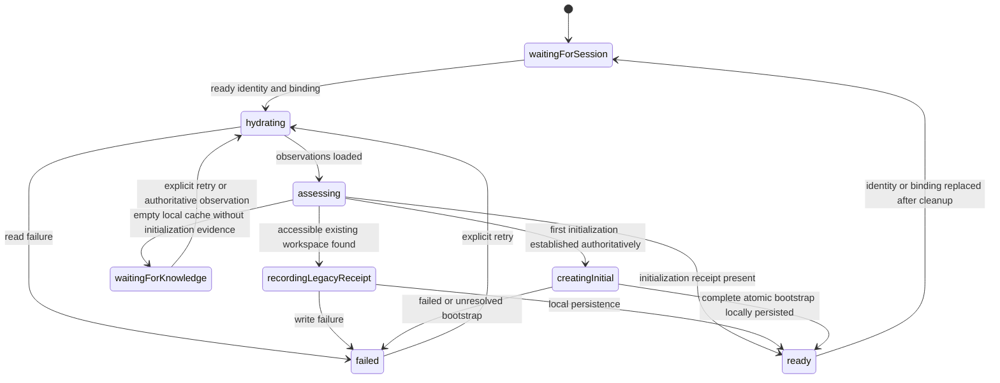
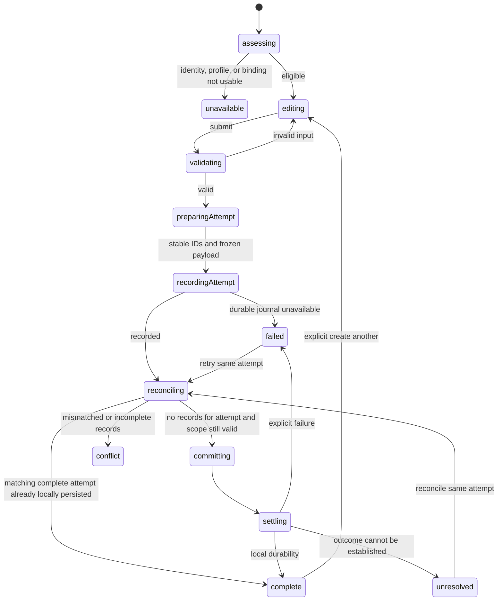
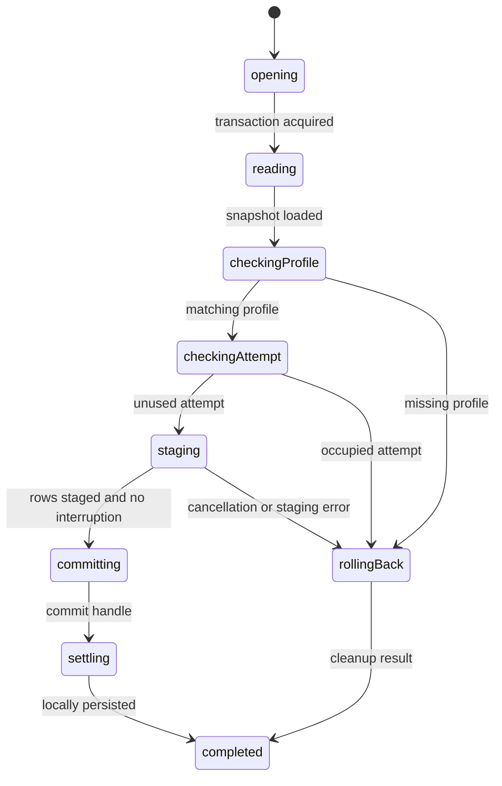
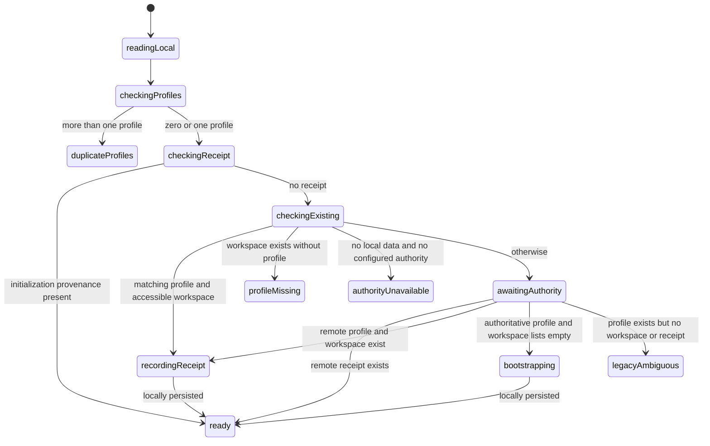

# Implementation Plan: Workspace creation and startup

**Branch**: `main` (actual checkout; no branch created) | **Date**: 2026-10-21 | **Spec**: [spec.md](spec.md)

## Summary

Prepare the first create-and-switch slice for review: create an additional owned workspace with its own owner membership and categories, reuse the login profile, and expose it in the existing selector. Separate startup identity initialization from workspace creation. Existing workspaces must not be treated as a unique personal home or reseeded with optional defaults on every startup.

The user reviewed and approved this creation/startup design and selected route-based workspace persistence. Implementation still proceeds in focused review cycles, not one large batch. Creation does not automatically switch the active workspace; the existing selector provides explicit selection. A lost selection among multiple available workspaces enters an unselected state instead of silently choosing a different ledger. For workspace-scoped URLs, the route is authoritative; missing access never silently redirects a detail/edit operation into another workspace.

## Technical Context

**Language/Version**: TypeScript 6, Svelte 5, SvelteKit 3 (repository package declarations).
**Primary Dependencies**: Installed Jazz 2.0.0-alpha.59, XState 5, existing scoped-form actors, Zod 4, Paraglide.
**Storage**: Jazz organization/member/profile/category tables; proposed optional initialization receipt on profile; device-local, identity/environment-scoped creation-attempt journal persisted before finance writes.
**Testing**: Vitest and Playwright only after review/approval of the exact implementation; no tests added or run for planning.
**Target Platform**: Current browser application and supported local-first environments.
**Project Type**: SvelteKit application.
**Performance Goals**: No network wait for warm local reads or additional workspace creation with a usable locally persisted identity/profile; one local atomic creation transaction per accepted attempt. No invented latency target.
**Constraints**: No provider requests, secrets, cloned finance data, role-management UI, custom styling, or synchronized global workspace selection. Route-based workspace navigation is approved and will be implemented in its own focused cycle. Local durability is not server approval.
**Scale/Scope**: One creation workflow plus startup correctness, delivered in separate reviewed increments.

## Constitution Check

- Local-first: warm startup and additional creation use local data/durability. A cold, ambiguous empty cache is unavailable until authoritative initialization knowledge exists; it is not treated as proof of a new user.
- Financial integrity: no money or existing transactions are changed. USD default retained.
- Tenancy/access: existing Jazz insert policies enforce owner bootstrap. Keep owner membership as the access source; ownerId is a compatibility/creator field, not the future sole-owner authority.
- Capability design: creation eligibility depends on session identity/binding, not current workspace role. New-workspace creation is not delegated administration of another workspace. No generic capability framework or changes to existing shared access in this slice.
- Future capability, viewer, privacy, and multiple-owner policies conflict with existing constitution/MVP details when implemented fully. They are deferred, not silently overridden here. Align affected source-of-truth artifacts before dependent implementation.
- State ownership: model startup and creation before effects; decisions live in machines; I/O actors do one operation. Reuse scoped-form infrastructure where applicable.
- Presentation: settings route owns subscriptions and form wiring; pure form uses existing controls/localization.
- Review/testing: each implementation increment shown for review before the next; no tests before implementation approval; no commit without authorization.

**Gate result**: Creation/startup design reviewed and approved. D3 now selects route-based workspace persistence. Data-foundation implementation can proceed as the first focused cycle. Routing integration needs its own concrete route mapping and scope-change model before edits; future sharing policies remain outside this slice.

## Project Structure

```text
specs/006-multiple-workspaces/
  spec.md, research.md, plan.md
  data-model.md
  contracts/workspace-creation.md
  quickstart.md
src/lib/
  data.ts                           # existing bootstrap, to narrow after extraction
  schema/identity.ts                # optional bootstrap provenance receipt proposal
  validation/identity.ts            # canonical workspace/name/attempt validation
  domain/workspace-defaults.ts      # proposed shared starter definitions
  domain/workspace-creation.ts      # proposed reusable transactional persistence
  machines/workspace-initialization.ts # proposed initialization decisions
  machines/workspace-creation.ts    # proposed scoped creation decisions
  machines/readiness.ts             # existing application-owned workspace subtree
  components/WorkspaceNameForm.svelte # existing presentation to reuse if suitable
src/routes/settings/workspace/+page.svelte # proposed creation integration
```

Names are proposals; no files above have been implemented. Do not create helpers merely to move page logic. Reuse the existing form presenter if it can distinguish create/rename accessibly; otherwise add one genuinely reusable props-only form, not a copy of the page.

## Phase 0: Research conclusions

See [research.md](research.md), especially the creation/startup planning addendum. Read installed executable SDK code rather than assume Classic APIs. `Db.transaction` supports an atomic set of local writes but does not guarantee global serializable ownership checks. `WriteResult.wait(local)` is a durability boundary, not permission confirmation. Stable IDs prevent retries from generating new logical workspaces; they do not authorize blind upserts or prove cross-device commit acceptance.

Current `ensurePersonalWorkspace` performs profile lookup/repair, owned-personal selection, and seed replenishment together. The revised initialization machine must own those decisions rather than wrap the existing branching function in another promise actor.

## Phase 1: Ownership and statecharts

```text
application-readiness (existing owner)
  workspace-readiness (existing)
    workspace-initialization (new child)
      hydrate/read profile, receipt, accessible organizations
      bootstrap creation operation only when authorized by initialization facts
    bank subtree (existing cleanup ownership preserved)
  creation operation owner (identity/db lifetime; may be composed under workspace owner)
    scoped form validation/readiness (reuse existing)
    creation preparation child
    attempt journal adapter
    atomic Jazz write + local settlement
settings/workspace integration
  observes session/profile; attaches creation form to operation owner
  renders props-only name form and localized feedback
```

Do not let route destruction stop an issued write's settlement tracking. Reuse the scoped form owner’s existing draining/shutdown behavior; identity replacement must wait for owned local write cleanup before releasing its database binding.

### Startup



Receipt is provenance that initialization happened, never an active workspace/default-home selection. A receipt whose original workspace is no longer accessible must not cause membership recreation. Existing accessible workspaces prevent another automatic starter, regardless of kind or creator. Initial deterministic IDs retain compatibility with the legacy starter. Authoritative empty checks must use current identity and exact scope; ordinary empty local subscriptions are insufficient. For legacy identities with no receipt and no accessible data, expose a recoverable initialization state rather than resurrect membership to an inaccessible deterministic starter.

The route is the source of active workspace identity, using a stable ID; for example, `/workspaces/[workspaceId]/expenses` is the proposed shape. Each tab retains its own scope through reload, history, and direct links. Authorization still checks membership/capabilities independently. Do not derive selection from an initialization receipt, personal/business kind, or a synchronized global preference. With no workspace in the URL, entry/default behavior must be defined in the routing cycle; with an explicit unavailable workspace, expose an unavailable outcome rather than switching ledgers. No device-local default preference is assumed approved.

### Additional creation



Add `cancelling` and `closing` interruption branches to the operation owner: before issue, cancel prevents creation; after issue, drain settlement then return cancelled/closed with actual settlement. No new attempt ID on retry. No new selection after completion if identity/binding/route attachment no longer matches. Settlement continues under the original binding. Scope observations and child failures must be supervised in every active state. Complete, cancelled, failed, unresolved, and conflict are distinct outcomes; partial/unexpected record sets are conflict, never success or blind repair. A single atomic transaction should not intentionally produce partial bootstrap records.

Use the existing scoped-form validation/lifecycle infrastructure, with a composed multi-step operation actor rather than hiding preparation, reconciliation, and decisions in `write: async`. Canonical name validation remains in validation/identity.ts alongside schema-matched adapters. Context stores facts, immutable attempt payload, IDs, and typed results; states own lifecycle.

## Proposed implementation review cycles

1. **Creation data foundation**: central starter definitions, canonical creation payload validation, stable transactional persistence, optional initialization receipt schema. Approximately 4–6 related files; present exact boundaries before edits. No UI or readiness rewrite in this cycle. Verify schema deployment compatibility before any deployment; no data reset is implied.
2. **Startup model**: initialization child, readiness composition, narrow data.ts bootstrap, related MVP documentation alignment. No personal-kind preference or optional seed replenishment. Review separately.
3. **Creation workflow and settings UI**: composed machine, durable attempt adapter, existing settings integration/presenter, messages. Discuss any batch exceeding 6 implementation files before editing. Additional creation remains in current settings route; success exposes the result in existing selector without auto-switch.
4. **Route-based workspace navigation**: plan the concrete scoped route map, layout-owned binding, link generation, selector navigation, workspace-less entry and legacy links, history/back-forward behavior, and unavailable scope. Separate reviewed implementation batches; discuss route moves exceeding the small-file limit before editing. Keep active scope derived from the route rather than mirrored mutable selection.
5. **Verification after approval of each covered implementation**: focused unit/statechart and isolated browser coverage. Not a separate excuse to postpone required tests indefinitely; approved increments receive their relevant coverage before proceeding.

No tasks.md is generated in this planning cycle. Proposed increments are review boundaries, not authorization to start subsequent tasks.

## Post-design gates and limits

This plan does not implement full capability-based policies, sharing, ownership administration, archive, account merge, in its creation foundation; route navigation follows a separate reviewed cycle. It reserves compatibility by retaining organization IDs/membership relationships and avoiding ownerId/kind assumptions in new reusable creation code. Receipt/journal serialization and real-server schema/policy acceptance need implementation verification. No runtime claim is established by formatting these artifacts.

## First implementation review: creation data foundation

Implemented the six-file foundation: centralized starter definitions, extracted/re-exported stable UUID utility, canonical workspace/attempt validation beside identity validation, an additional-workspace preparation/atomic local-write adapter, and optional profile initialization provenance. Existing bootstrap now consumes the shared defaults; its selection/repair behavior is intentionally left for the startup-machine cycle. The persistence adapter refuses occupied attempts rather than replaying/upserting; future machine reconciliation and durable journaling remain required before UI use. No schema deployment, data reset, startup receipt writes, route changes, or new UI were performed. No tests were added/run before review. Static application/Svelte/service-worker checks passed with zero diagnostics; focused follow-up TypeScript verification covers final validation-adapter changes. Review this increment before tests or the next implementation cycle.

### Persistence and transaction statechart refinement

Review identified that both the initial promise wrapper and its commit promise still hid multi-step decisions. `persistWorkspaceCreation` now validates and hydrates, then invokes `workspaceCreationTransaction` as its resource-owning child. The child opens a single explicit Jazz transaction, reads its snapshot, uses guarded profile/occupied-attempt checks, stages rows, commits, and waits for local settlement. Each invoked I/O actor performs only its focused operation. No business branching remains inside a commit promise.



The child has a parallel interruption region (active/cancelling/closing) so cancellation/shutdown never loses an acquiring/open transaction or interrupts rollback/commit settlement. It checks interruption at pre-commit boundaries, rolls back before issue, and drains committed writes afterward. Shutdown takes precedence over cancellation. The parent forwards interruption without exiting the invoked child. Profile-unavailable, conflict, failure and interrupted results carry truthful notStarted/locallyPersisted/unresolved evidence; an unconfirmed rollback is unresolved. Occupied attempts return to the future creation parent for reconciliation rather than repair/replay.

The parent must send cancellation/shutdown and await completion rather than directly stop the owner. Installed Jazz `beginTransaction`, transaction `commit`, `rollback`, and local write-handle wait were inspected for this resource model. Only type narrowing remains conditional outside guarded transitions. TypeScript passes; no tests added/run before implementation approval.

### Approved foundation verification

After the user requested continuation following machine review, added 22 focused unit cases across workspace creation payload, persistence composition, and transaction ownership. All pass. The existing 54 `data.test.ts` persistence regressions also passed. Coverage includes stable identities across retries/localized label changes, duplicate-name isolation, canonical validation, hydration failures/cancellation, profile/occupied-attempt guards, staged-write rollback, acquisition failure, cancellation before commit, shutdown precedence, parent/child forwarding, local settlement waits, and unresolved cleanup/write outcomes.

The transaction fixture uses an SDK Transaction object with mocked I/O methods/commit handle; these tests verify machine decisions and resource calls, not native Jazz atomicity or real-server policy acceptance. One test initially waited on parent snapshots for child progress; it now waits directly on the child persistence boundary. No production code changes were needed for these tests. Browser and server acceptance verification remain for integration slices; no development server was started or persistent data changed. Final TypeScript validation and whitespace checks cover the test additions.

### Startup child implementation review (before live integration)

Implemented `workspace-initialization.ts` and extended the existing transaction child with explicit bootstrap/receipt request variants. This is a focused machine review; the live `readiness.ts`/legacy `ensurePersonalWorkspace` path has not been replaced yet. The previously added tests remain in the working tree; no tests were added or run for these newly changed implementations before review.

Machine-first classification: discovery is a related read leaf; preparing IDs/payload is a preparation leaf; initialization is a workflow because receipt, accessible-workspace, identity ambiguity, and authoritative-first-use decisions govern different writes. Transaction resource ownership remains in the existing child; new profile/receipt writes are individual staging actors selected by guards.



The actual chart separates preparation and authoritative-result checks into named states. Reads, preparation, child failure, conflict, unavailable, cancellation and shutdown have explicit outcomes. Cancellation/shutdown before transaction acquisition cannot start creation; during a transaction the parent forwards events and waits for rollback/settlement. A pending remote read remains awaitingAuthority rather than interpreting an offline empty cache as first use. The machine is fixed to one identity/database binding; live integration must shut it down and await completion before replacing that binding.

Bootstrap atomically stages the profile with its initialization receipt plus organization, owner membership, and seeds. It preserves legacy deterministic initial IDs only for compatibility. Legacy receipt recording updates only the user profile, does not prepare or insert seed categories, and never selects an active workspace. An already-existing receipt found transactionally is conflict/retry, never overwritten. Ordinary additional creation still requires an existing profile and does not update initialization provenance.

Known integration work: replace live legacy bootstrap; compose explicit identity/shutdown/retry ownership under readiness; remove personal-kind selection preference; provide recoverable presentation for ambiguous/authority-waiting cases; preserve required system-category/profile-link repair as a separate reviewed invariant workflow. No missing-access membership repair or optional-default reseeding is permitted in the new initialization child. No schema deployment, data reset, route moves, or UI changes in this review. TypeScript and whitespace checks pass; new behavior is not runtime-verified yet.

### Approved startup child verification

Following user continuation after startup-child review, added 14 initialization/transaction tests and extended the shared fixture to exercise bootstrap and receipt requests. All 36 focused cases pass across initialization, creation transaction/persistence, and creation payload. New coverage includes warm receipts with lost workspace access, legacy business/shared provenance without seeding, remote evidence before bootstrap, unconfigured/ambiguous identities, missing/duplicate profiles, late reads after cancellation, receipt shutdown draining, concurrent receipt/profile changes, and rollback of an initial profile when staging fails. TypeScript and whitespace checks pass. No production fixes were necessary. Tests mock Jazz I/O and do not establish real-server schema/policy acceptance. Live readiness integration, localized recovery, and identity/shutdown composition remain the next implementation review cycle.
