# Multiple workspaces: implemented architecture

Status: create-and-switch complete. [spec.md](spec.md) is the product reference, including approved
future sharing decisions. [data-model.md](data-model.md) and the
[operation contract](contracts/workspace-creation.md) describe durable data and public behavior.
[research.md](research.md) records SDK constraints; [quickstart.md](quickstart.md) covers validation.
The completed implementation task list and superseded actor proposal have been removed.

## URL and presentation

Native SvelteKit file-based routes use `?workspace=<uuid>`; `/settings/workspace` is the single
chooser, rename and creation page. The URL is the only persisted selection, independently per tab.
`AppLink` and generic query utilities preserve configured parameters without custom route rewriting.
The drawer and settings page share `WorkspaceSelector` and the same selection command.
Switching preserves the page except transaction details/new-entry routes, which return to their
list and discard unfinished input. Account filters and pagination reset; submitted writes retain
their original scope. Account/login pages and workspace management require identity readiness but
remain available during workspace-catalog loading or failure.

Creation uses the shared form modal. While submitting, it keeps Close and a persistent screen-reader
progress region, without an extra visible preparation message or Cancel button. Status/alert nodes
survive feedback and success transitions. Creation does not select its result automatically.

## Actor ownership

```mermaid
flowchart TD
  App[Application readiness] --> Coordinator[Workspace readiness: database attachment]
  Integration[WorkspaceBootstrap: Jazz and browser adapters] -. observations .-> Coordinator
  Coordinator --> Startup[Identity initialization owner]
  Coordinator --> Creation[Identity-bound creation owner]
  Coordinator --> Integrity[Selected-binding integrity owner]
  Coordinator --> Navigation[Navigation actor]
  Coordinator --> Bank[Existing bank actor]
  Startup --> Initialization[Initialization workflow]
  Creation --> Operation[Creation operation]
  Operation --> Journal[IndexedDB journal resource owner]
  Operation --> Reconcile[Read-only journal reconciliation]
  Operation --> Persistence[Persistence owner]
  Persistence --> Preflight[Shared reconciliation machine]
  Persistence --> Transaction[Jazz transaction resource owner]
```

Integration binds subscriptions, browser effects and actor attachments. Pure presentation receives
data and callbacks. The coordinator determines membership/access once; navigation consumes that
decision. Initialization, integrity and navigation reports carry request/generation correlation.
Creation exposes an identity-bound public view. Stale reports cannot enable a replacement selection,
including A → B → A. Exact database attachment identity prevents obsolete detach events from closing
a replacement owner.

Startup, creation and integrity retain separate owners because their lifetimes and cleanup differ.
Fixed children remain invoked through normal work and draining. Parents await live dependents;
already-failed/completed children cannot be expected to acknowledge another shutdown command.
The [orchestration spec](../008-actor-orchestration/spec.md) defines these responsibilities.

## Initialization

Local discovery accepts a profile's existing `initialWorkspaceId` marker without requiring access
to its original workspace. Otherwise, authoritative discovery is required before bootstrap.
Only no profiles plus no accessible workspaces permits first-use creation. An existing profile
without its marker reports `initializationMissing`; workspaces without a profile report
`profileMissing`. Duplicate profiles and unavailable authority are separate outcomes.
There is no legacy marker backfill, arbitrary workspace adoption, membership resurrection, or
category replenishment. The initialization marker remains provenance, never active selection.

## Creation and recovery

The operation validates the name, freezes IDs/defaults and records the attempt before Jazz writes.
Loading a journal invokes read-only reconciliation and never automatically replays creation.
Explicit creation/retry invokes persistence directly: validate payload → shared reconciliation →
matching/conflict/profile-unavailable result or transaction. This is one preflight read pass;
there is no separate duplicate hydration pass.

The transaction owns open → read → guarded eligibility → staging → commit → local settlement,
with rollback, cancellation and shutdown draining. Transaction-time reads remain necessary because
preflight data can change. Matching attempts return their existing workspace; inconsistent records
are not upserted over user changes. Bootstrap also creates its profile/initialization marker atomically.

`CreationResult` is a discriminated union: complete requires record/workspace and local settlement;
recovered requires its record; invalid/editing have no record; failures require diagnostics;
unresolved results require unresolved settlement. Interrupted outcomes preserve the available record
and actual settlement. UI reads a workspace only from a complete result.

## Selected-workspace integrity

Integrity checks profile/membership consistency, not categories. A suspected profile-link repair
requires authoritative confirmation and current owner/admin authority, then uses its own transaction
with reassessment and settlement. Attribution-only partial results remain finance-usable. Category
repair, blocked-partial branches and legacy backfill are absent. Required categories are created at
workspace creation; transaction forms retain their normal category validation.

## Completion and future work

Reviewed focused checks cover creation, recovery, offline behavior, isolation, URL/history scope,
authorization, stale reports, input/filter reset, accessible announcements and resource cleanup.
Latest cleanup increments passed their relevant unit/browser and static checks; this is not a claim
that a final full application/PWA suite was rerun after every increment. See validation commands in
[quickstart.md](quickstart.md).

Sharing/capability administration, invitations, ownership changes, departure, archive and account
merge are future work. Keep their approved decisions in the specification. Bank, generic-form, application/session and diagnostics follow-through are recorded in
[008 tasks](../008-actor-orchestration/tasks.md) and the [final ownership map](../008-actor-orchestration/architecture.md).
They were separately resumed by the user; completing the workspace feature alone did not authorize them.
