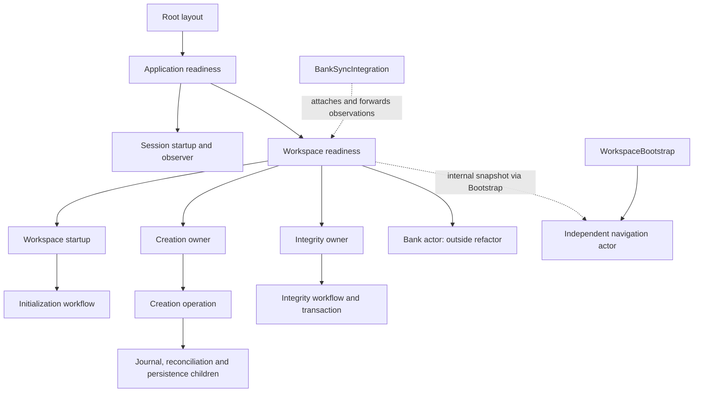
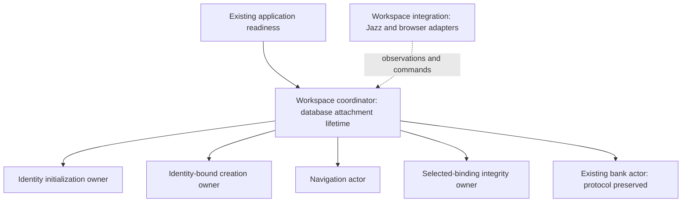

# Workspace actor ownership proposal

Status: technical baseline for [008 Actor Orchestration](../008-actor-orchestration/spec.md). Execution scope and unfinished current/deferred work are tracked in that feature’s [plan](../008-actor-orchestration/plan.md) and [tasks](../008-actor-orchestration/tasks.md). No implementation changes are made by this document.

## Scope

Improve composition of actors directly involved in workspace initialization, creation, selection, authorization and integrity. Preserve the approved create-and-switch behavior, query-based scope and `/settings/workspace` management page.

Review `readiness.ts`, `workspace-navigation.ts`, `workspace-startup.ts`, `workspace-creation.ts` and `workspace-integrity-owner.ts` as coordinating machines. Their initialization, creation, reconciliation, journal and transaction children remain resource-owning workflows; change them only if a reviewed contract requires it.

Session startup, bank-sync internals, generic scoped-form machines, rename persistence and unrelated application machines are outside this change. Existing application and bank boundaries may need small wiring adjustments, presented separately before implementation. No broad rewrite or new actor framework.

## Research baseline ownership and communication

Observed issues:

- Workspace lifetime is attached by a bank integration component, although workspace management does not require bank configuration or use.
- Navigation is a separate root actor; Svelte translates readiness internals into navigation authorization facts.
- Readiness stores integrity's entire snapshot and inspects its operation binding to authorize sync.
- Startup readiness is inferred by combining child tags, result fields and operation identity.
- The readiness owner mixes identity-wide creation, selected-workspace access, bank commands and four-child shutdown coordination.
- Several wrappers repeat binding replacement and drain protocols. Similarity alone does not justify merging them: each boundary must first be evaluated against its actual resource lifetime.

## Proposed ownership

Use the existing workspace readiness owner as the starting point. Clarify its identity/environment lifetime before deciding whether its filename needs to change. Do not introduce another supervisor wrapper merely to rename it.

This is a proposed logical tree, not a requirement to create another component. Place integration wiring where the dependencies exist and keep Jazz subscriptions there. Separate workspace attachment from bank presentation without duplicating membership subscriptions.

| Actor                 | Responsibility and lifetime                                                                            | Commands                                                                  | Public reports or output                                                              | Cleanup ownership                                                             |
| --------------------- | ------------------------------------------------------------------------------------------------------ | ------------------------------------------------------------------------- | ------------------------------------------------------------------------------------- | ----------------------------------------------------------------------------- |
| Workspace coordinator | Own workspace actors for one database/environment attachment; coordinate identity and selected binding | Observations, select, focused retries, shutdown                           | Workspace view and scoped access status                                               | Drain direct children; release attachment only after settlement               |
| Startup               | Initialize the current identity; replace identity only after old initialization settles                | Identity observation, retry, shutdown                                     | Initialization status with identity binding; initialization child has terminal output | Initialization owns its writes; startup awaits it                             |
| Creation              | Create or recover attempts for the current initialized identity, independently of selected workspace   | Identity binding, submit, retry, new, cancel, shutdown                    | Creation view; operation terminal result                                              | Operation owns journal/reconciliation; transaction owns commit/rollback       |
| Navigation            | Interpret URL and request browser navigation; resolve unscoped legacy details                          | Route/catalog observations, scoped access report, select, retry, shutdown | Route status tied to route revision                                                   | Cancel pending lookup/navigation observation; no resource settlement invented |
| Integrity             | Assess/repair the selected authorized binding                                                          | Binding observation, retry, shutdown                                      | Scoped integrity status; repair terminal result                                       | Repair/transaction owns writes; owner drains before replacement               |

The bank actor retains its current commands and cleanup protocol. The coordinator supplies existing bank observations and gates actions from its public workspace capability. Reorganizing bank internals is not part of this proposal.

## Contracts and authoritative state

1. The URL remains authoritative for the requested workspace. The coordinator records an observation of it; it does not persist a competing selected-workspace value.
2. The coordinator owns the membership/access decision currently duplicated between readiness and navigation. Route status and access status remain distinct: opening workspace management requires no selected workspace; editing a selected workspace still requires its own authorization.
3. Navigation consumes the coordinator's access report for the exact requested identity/workspace. It owns URL completion policy, not another membership policy.
4. Integrity reports a small domain status, not its entire machine snapshot: checking, usable, blocked or failed, with any partial-repair issues needed by presentation. The existing permitted profile-link-only partial result stays usable. Do not erase issue detail or change policy during this refactor.
5. Startup reports identity initialization status without requiring its parent to inspect `operationUserId` and tags. Creation's operation results remain terminal outputs handled through `invoke.onDone`.
6. Every asynchronous report carries its binding/revision. Identity includes database/environment and user; selected-workspace binding also includes organization and authority-relevant membership fields. Route revision distinguishes successive URL observations. Ignore obsolete reports, including an old result after switching away and back.
7. Input initializes an actor. Subsequent observations arrive as typed events. Use typed actor references passed through input for long-lived reports; use invocation output for finite operations. Do not add a global event bus or receptionist registry for this small tree.
8. Public selectors may read snapshots for presentation. Coordination must not depend on another actor's private state paths or copied full snapshots. This is a boundary rule, not a prohibition on XState snapshot observation.

Suggested event meanings, with exact TypeScript types deferred until review: `INITIALIZATION_STATUS`, `WORKSPACE_ACCESS_CHANGED`, `INTEGRITY_STATUS`, `ROUTE_OBSERVED`, `SELECT_WORKSPACE`, and `SHUTDOWN`. A report must carry its binding alongside its payload; a boolean `ready` alone is insufficient.

## Lifecycle model

Invoke fixed children at a compound state spanning normal work and draining. Leaving an active substate for a draining substate must not stop the invoked resource owner. Use nested states for phases sharing one responsibility; retain child machines where resources or independent lifetimes justify them.

- Identity replacement invalidates published capabilities immediately. Startup and creation settle the old identity's operations before accepting a replacement; integrity also drains its old binding.
- Workspace selection invalidates old scoped capabilities immediately. Integrity and existing bank scope cleanup settle according to their current contracts. Identity-bound creation is not cancelled merely because the selected workspace changed.
- URL observation and membership observation can arrive separately. Until bindings match, status is waiting; never reuse a prior workspace's usable status.
- Navigation does not gain a global write barrier in this refactor. Preserve existing input discard and original-scope submitted-write behavior.
- Shutdown prevents new commands, requests graceful completion from live direct children, and awaits terminal results. Already completed/failed children need no acknowledgement. Failure and successful shutdown remain distinguishable.
- Actor stopping follows required cleanup. It is not evidence of rollback, cancellation of SDK side effects or credential disposal.

## First focused implementation cycle

Replace only the integrity snapshot coupling with a typed, binding-specific integrity report consumed by readiness. Preserve the current ownership tree and bank protocol for this first cycle. Present exact states, event types and affected files before implementation; do not simultaneously relocate navigation or rewrite startup.

Acceptance for that cycle: readiness no longer stores a full integrity snapshot or reaches into its private context; usable status is rejected after any binding change; existing partial-repair policy, retry, graceful shutdown and failure behavior remain intact. Presentation receives the required view through the public boundary.

After implementation review, add/run focused coverage for stale reports, membership changes, switch-away-and-back, partial results and drain/error races. Subsequent cycles can move navigation under its explicit owner, separate workspace attachment from bank integration, and review repeated wrapper lifetimes. Each remains a separate review.

## References

Research used the installed XState 5.33.2 implementation as the version boundary; current Stately pages also expose v6 alpha material, so examples must be checked against the installed package.

- [Invoked actor lifetime and completion](https://stately.ai/docs/invoke)
- [Actor communication with sendTo](https://stately.ai/docs/actions)
- [Parallel regions within one machine](https://stately.ai/docs/parallel-states)
- [Actor systems and ownership](https://stately.ai/docs/system)
- [Version-matched promise cancellation implementation](https://github.com/statelyai/xstate/blob/xstate@5.33.2/packages/core/src/actors/promise.ts)

## Implementation follow-through

The user subsequently authorized the full workspace implementation for one combined review. The current tree, final protocol decisions and pending verification are recorded in [008 plan](../008-actor-orchestration/plan.md#workspace-implementation-batch--review-entry-point) and [008 tasks](../008-actor-orchestration/tasks.md). This research baseline is not evidence of runtime verification or authorization to implement deferred subsystems.
