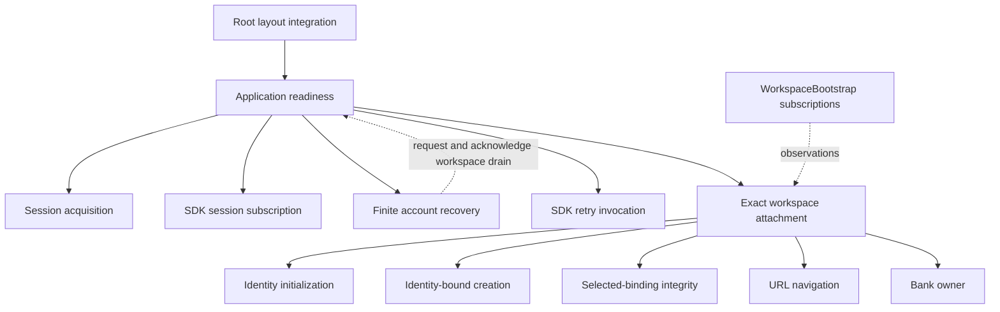
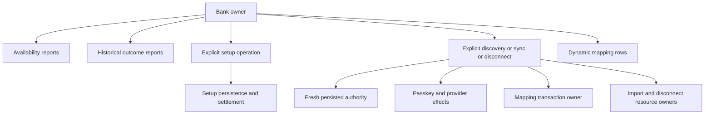
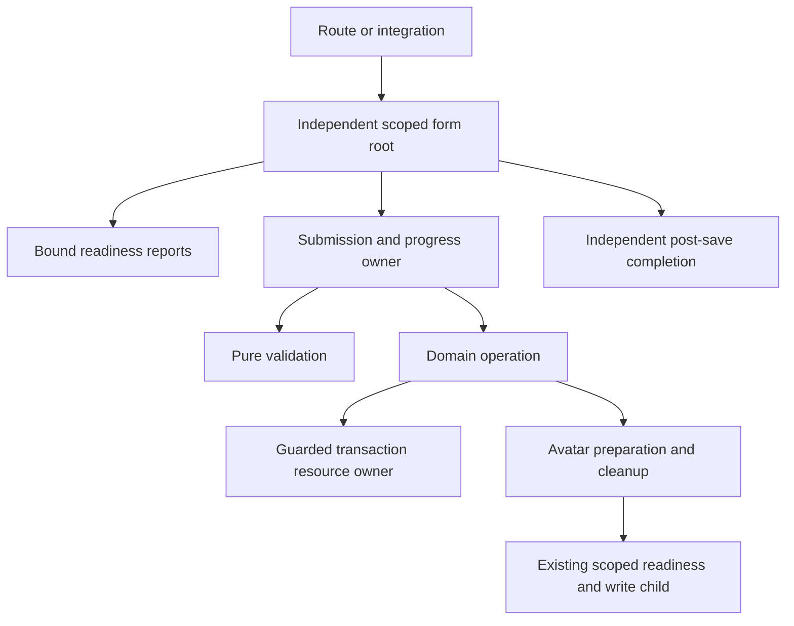

# Final actor ownership and retained limits

The orchestration feature is an ownership/refinement change, not a new actor framework. Keep its
source contracts and focused verification in the linked plans; this page is the final ownership map.

## Application and workspace

Root layout owns one application actor. The shared SDK session survives layout remounts and is
borrowed by JazzSessionProvider; layout shutdown does not close that cached session. Application
readiness owns its observer, recovery/retry and exact workspace attachment. Application-originated
restore/retry waits for workspace shutdown before calling the public SDK. Once issued, SDK calls
remain invoked until actual settlement under shutdown or observer failure. Recovery survives login
page destruction and separates successful identity restoration from failed/skipped navigation.
A settled SDK mutation advances the root's attachment revision, including same-client failure.

Workspace initialization/creation bind to identity and database; selection alone does not cancel
creation. Integrity and navigation consume generation/binding-specific reports and current access.
One workspace drains before a replacement attachment is admitted. Exact attachment/actor matching
rejects stale detaches, closure and crash reports. Each parent awaits live direct dependents; completed
or failed actors do not owe impossible acknowledgements.

## Bank resources

Availability publishes capabilities; history retains saved outcomes separately from current work.
Operation-time authority and transaction-time atomic invariants remain necessary. Setup owns the
one-use token and staged passkey; operations own transient unlocked credentials/provider data.
Mapping transactions and imported/disconnected writes retain original scope, actual commit/local
settlement and interruption cleanup. Dynamic rows have independent lifetimes; fixed children remain
invoked across normal/draining substates. No automatic provider fetching or retry was introduced.

## Forms and domain persistence

Forms remain integration-owned roots, rather than being reparented into the application for logging.
The shared controller binds observations and DOM values; presentation receives a public view and
callbacks. Readiness owns reusable eligibility; progress reports avoid copying private child snapshots.
Transaction creation/editing expose preflight and one atomic transaction's read/check/stage/commit/
settle/rollback decisions. Avatar draft validation is pure; its domain operation owns decode/resize/
encode/read and bitmap/canvas disposal before invoking the existing write owner. Navigation completion
failure can retry completion without repeating a persisted write.

Independent account-order, archive, recovery-phrase and developer-sample actors keep their existing
owners and presentation/domain responsibilities. Development inspection observes these roots and
the application/form descendants without changing parentage or creating a global actor registry.

## Proven redundant code removed

- Startup SESSION_FAILED/SESSION_READY commands had no production senders. Application readiness is
  the SDK observation owner; startup retains acquisition/retry only.
- Workspace `syncSnapshot` forwarding had no application consumer. WorkspaceBootstrap's explicit
  subscription already renders the exact actor. Domain reports and closure/crash protocols remain.
- Earlier reviewed slices removed private status copying and hidden resource orchestration where
  their audits demonstrated a concrete responsibility/settlement problem. No general controller,
  transaction, availability or supervisor abstraction was added merely to equalize file sizes.

## Remaining exceptions and platform limits

- Startup acquisition still uses its existing snapshot/result boundary. The audit found no behavior
  requiring a reporting framework or finite-output rewrite; unused SDK status commands were removed.
- The SDK owns account/client internals and shared-client shutdown semantics. Coordination covers the
  application's restore/retry entry points, not arbitrary external SDK calls. No private consumer APIs.
- Route-owned submitted forms retain their own drain/settlement protocol. This feature adds no global
  barrier over every formerly mounted route actor. Do not claim application-wide rollback or write drain.
- Cancellation cannot retract issued provider requests, SDK mutations, database commits or accepted
  browser navigation. Await meaningful settlement and keep uncertainty/partial success explicit.
- Pica owns its shared worker pool; avatar cleanup releases owned bitmap/canvas resources, not private
  SDK worker fields. IndexedDB transaction activity constraints still apply to journal boundaries.
- Browser online status is a hint, never proof of SDK delivery. Finance stays useful offline.
- Inspection is development-only, opt-in, bounded and redacted. It omits private state values, context,
  arbitrary identifiers, payloads, action parameters, outputs and errors. It is not a persisted audit
  trail, debugger with actor access, production telemetry, or PWA inspection. Bounded histories can
  omit earlier causes. See [inspection](inspection.md) for usage and verification.
- Validation evidence is scoped. Passing these checks does not claim a final rerun of all unrelated
  finance, permissions, provider, cross-device and PWA browser suites.

The [workspace architecture](../006-multiple-workspaces/plan.md#actor-ownership), [bank audit](bank-audit.md),
[form audit](form-audit.md), [session audit](session-audit.md) and their linked implementation plans
retain the concrete contracts and verification evidence behind this final map.
