# W001 — Workspace integrity reporting contract

Status: design and implementation reviewed; W002/W003 are complete. Public-protocol and lifecycle coverage passes; see [tasks.md](../tasks.md).

## Change being reviewed

Keep the existing actor tree. Replace readiness's full integrity snapshot subscription and private `context.operation` inspection with a typed `INTEGRITY_STATUS` event. The integrity owner makes the integrity decision; readiness validates report currency and combines the public result with its existing access decision.

No changes to navigation ownership, initialization reporting, bank workflows, generic forms, transaction internals or product permission policy in this cycle.

## Public protocol

A request identifies one integrity assessment lifetime:

- `generation`: a monotonically increasing number allocated by the readiness actor within its database attachment.
- `binding`: the existing integrity binding: user, profile, organization, membership ID, role and account access mode. An unavailable request has no binding.

The database/environment is fixed for this actor attachment. Reports target the exact readiness actor reference passed through input; replacing that attachment creates a new recipient and child. Generations are local correlation tokens, not persisted IDs or workspace UUIDs.

Readiness sends `OBSERVED` with the request. Integrity receives a typed recipient through initialization input and sends `INTEGRITY_STATUS` containing that request and one of these discriminated domain statuses:

| Status      | Public payload                                                      | Finance eligible? | Presentation       |
| ----------- | ------------------------------------------------------------------- | ----------------- | ------------------ |
| waiting     | No additional payload                                               | No                | Waiting; no retry  |
| checking    | No additional payload                                               | No                | Working; no retry  |
| complete    | Settlement from completed repair                                    | Yes               | Complete; no retry |
| partial     | Repair issues, settlement and `access: usable` or `access: blocked` | Only usable       | Partial; retry     |
| unavailable | Existing repair settlement                                          | No                | Waiting; no retry  |
| conflict    | Existing repair settlement                                          | No                | Conflict; retry    |
| failed      | Existing repair settlement                                          | No                | Failed; retry      |
| unresolved  | Unresolved settlement                                               | No                | Failed; retry      |
| closed      | Actual terminal settlement, if an operation ran                     | No                | Waiting; no retry  |

Use a typed union, not optional result fields or lifecycle flags that can disagree. Reuse the existing issue and settlement types. Do not send transaction resources, raw errors or child snapshots through this contract. Internal error handling keeps necessary diagnostics at the existing boundary.

The partial `access` decision is classified by integrity's existing attribution/blocked states. Only the current profile-link-only partial case is usable. Readiness and presentation do not recalculate that policy from issues. Presentation derives the existing view from public status; no new strings or styling are required.

Implementation audit confirmed that unavailable repair results previously offered retry; the public view preserves that behavior.

The generation is attached to the operation when it starts. Never relabel a draining old operation's completion with the newest request generation.

## Generation and invalidation rules

The readiness owner compares the next requested binding/eligibility with its current request. This is correlation equality, not a second authorization policy. Keep this comparison in one pure shared helper if both owners need it; do not duplicate field lists.

1. A change in identity, profile, selected organization, authority-relevant membership fields or eligibility advances the generation and clears the accepted report before subsequent external commands can be processed.
2. Loading, observer errors or loss of initialization/access eligibility withdraw eligibility. Recovery produces a fresh request even when the restored IDs match a prior request.
3. An explicit accepted retry advances the generation and clears the report. Readiness sends the fresh request to integrity; it does not independently send both a restart and a retry that could start two operations.
4. Repeated equivalent observations do not advance the generation or restart repairs. Changes in unrelated bank connection/account data do not restart integrity.
5. A → B → A always creates distinct generations, even if B is observed while A's repair is draining. The owner retains the latest pending request and starts it after old cleanup finishes.
6. A report is accepted only while the coordinator is active, for its current generation and equal current binding. Existing session/membership/catalog readiness still gates bank commands. A matching report cannot bypass current access readiness.
7. Shutdown invalidates accepted capability immediately and rejects further domain status updates. Normal invocation completion/error continues the existing shutdown protocol.

Perform invalidation within the existing observation transition and its raised-event processing. XState processes those internal transitions before the next queued external bank command. The implementation must check this ordering for initialization updates and focused retry as well as ordinary observations.

## State ownership and transitions

```mermaid
stateDiagram-v2
  [*] --> waiting
  waiting --> running: Eligible request
  state running {
    [*] --> active
    active --> replacing: New generation; request child shutdown
    active --> closing: Owner shutdown; request child shutdown
    replacing --> closing: Owner shutdown takes priority
  }
  running --> classifying: Current repair completes
  running --> waiting: Replacement settles; reconsider latest request
  running --> closed: Closing repair settles
  classifying --> complete
  classifying --> partialUsable
  classifying --> partialBlocked
  classifying --> unavailable
  classifying --> conflict
  classifying --> failed
  classifying --> unresolved
  complete --> waiting: New request or accepted retry
  partialUsable --> waiting: New request or accepted retry
  partialBlocked --> waiting: New request or accepted retry
  unavailable --> waiting: New request or accepted retry
  conflict --> waiting: New request or accepted retry
  failed --> waiting: New request or accepted retry
  unresolved --> waiting: New request or accepted retry
  closed --> [*]
```

This summarizes the existing statechart; retain its concrete checking/classifying transient states and nested partial states. Emit reports when entering meaningful public states. State transitions own lifecycle; context stores request, operation binding and actual result only.

`running` continues invoking the same repair child across active/replacing/closing substates. New observations during replacing update the pending request without interrupting draining. Unexpected repair failure follows existing unresolved/replacement/shutdown paths; an integrity-owner crash is handled by readiness's existing `invoke.onError` and cannot require an acknowledgement from that dead actor.

## Readiness and presentation consumption

- Replace `integritySnapshot` with the last accepted public report, initially absent.
- Replace integrity `invoke.onSnapshot` with recipient injection and typed event handling.
- `canSync` retains current access guards and additionally requires a current complete or usable-partial report. It reads no integrity-private state/context.
- `BankSyncIntegration` consumes a public readiness integrity selector/report for the existing notice. Its bank actor access and bank command protocol remain unchanged.
- Readiness's direct-child liveness checks during shutdown remain in place. Checking an actor's standard lifecycle status for supervision is distinct from inspecting private workflow context to infer policy.

## Exact first-cycle file set

1. New `src/lib/workspace-integrity-contract.ts`: request/report types and genuinely shared correlation/view helpers.
2. `src/lib/machines/workspace-integrity-owner.ts`: recipient input, generation-aware request replacement, public reports and status-derived presentation selector.
3. `src/lib/machines/readiness.ts`: generation allocation/invalidation, public report consumption and gating; remove private snapshot coupling.
4. `src/lib/components/BankSyncIntegration.svelte`: adapt only integrity notice consumption.

W001 was design-only; W002 changes these four production files. After implementation review, fixture/input updates and public report assertions were added and verified. If implementation reveals another production dependency, present the expanded file set before proceeding.

## Review and later verification

After W002 is reviewed, test: complete, usable/blocked partial, conflict, failure/unresolved and unavailable reports; equivalent observations; membership loading/error/recovery and authority changes; retry generations; A → B → A during drain; late report rejection; owner crash; shutdown priority and actual settlement. Verify notice rendering and unchanged bank gating through relevant workspace browser flows. Static checks alone do not prove the protocol.

W001/W002/W003 are complete after review and authorized test execution. Subsequent workspace implementation and verification are recorded in the parent plan/tasks; unrelated orchestration work remains deferred.
