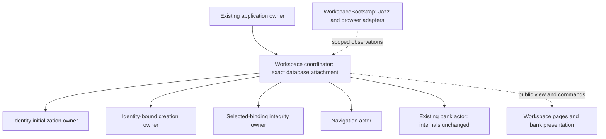

# Actor orchestration implementation boundaries

Status: workspace phase implemented and verified; broader phases remain deferred. See [spec.md](spec.md) and [tasks.md](tasks.md).

## Baseline and design

The reviewed [workspace actor proposal](../006-multiple-workspaces/workspace-actor-design.md) documents the current and proposed tree, commands, reports and cleanup responsibilities. It is the technical baseline for this spec, rather than a second independent plan.

Installed XState is 5.33.2. Check installed semantics before adopting examples from current documentation, which also contains v6 alpha material.

Current workspace coordinator candidates are `readiness.ts`, `workspace-navigation.ts`, `workspace-startup.ts`, `workspace-creation.ts` and `workspace-integrity-owner.ts`. Preserve initialization, journal, reconciliation, persistence and transaction children unless the reviewed ownership model requires a change.

## Execution order

1. Replace readiness's full integrity snapshot/private-binding dependency with a typed scoped integrity report. Keep the tree and bank protocol intact for this first cycle. Include presentation adaptation in the same reviewed boundary.
2. Publish explicit identity initialization status and review repeated owner wrappers against their actual lifetimes. Merge only when ownership/lifetime is shared; no generic supervisor abstraction by default.
3. Put navigation under an explicit workspace owner and centralize membership/access policy there. Preserve URL authority and legacy detail resolution; Svelte supplies observations and browser effects rather than coordinating child internals.
4. Separate workspace attachment/observations from bank-specific presentation. Keep identity-bound creation alive across selection changes; preserve selected-binding integrity replacement and bank cleanup.
5. Verify the complete workspace tree across identity, scope, authority, database attachment and teardown changes.

Before each cycle, show the statechart/protocol and a small file set to the user. Implementation precedes a review gate; tests follow approval of that implementation. No blanket approval of tests is inferred from approval of this spec.

## Contracts and resource lifetime

Use initialization input, typed events for updates, typed actor references for ongoing domain reports, and `invoke.onDone` output for finite operations. A report includes its binding and generation. Public selectors can project snapshots for UI; coordinators must not inspect private child context/state paths to infer policy.

Invoke fixed children on a compound state spanning work and graceful draining. Nest phases in one machine when they share responsibility and lifetime. Spawn only for dynamic lifetime/population needs. Keep transaction/credential settlement with the resource owner; never exit its invoking state before required cleanup completes.

The coordinator invalidates capabilities synchronously with binding changes. Matching UUIDs alone cannot validate a report from a prior visit. Distinguish normal failure output from an actor crash; the latter cannot acknowledge later cleanup requests. Do not add a global event bus or registry for this tree.

## Deferred boundaries

Do not refactor `bank-sync/` internals, generic `scoped-form*` machines or session startup in this phase. Minimal application/bank integration changes necessary for workspace attachment must be presented explicitly; preserve their existing protocols. Later audits may conclude an existing boundary needs no change.

## Constitution alignment

Retain local-first behavior and persistence-boundary authorization. Apply the recursive machine-first gate; use explicit states for lifecycle and terminal intent. Keep Jazz subscriptions/browser adapters in integration components and presentation pure. No new visual design, schema migration, commits, deployment or persistent-environment changes are included.

## Validation

After each implementation review, cover the relevant status, stale-generation, authority, partial-result, error and drain transitions, then relevant browser behavior. Finish with the workspace regression suite, static checks and production build; report older prefix-route test results separately from current query-route evidence. Broaden testing only for changed dependencies or unresolved failures.

## Workspace implementation batch — review entry point

The user authorized all remaining workspace implementation as one batch for review together, superseding the per-cycle implementation pauses above. Test authoring/execution still follows implementation review. Deferred subsystems remain outside scope.

Implemented tree:

### Contracts now implemented

- Initialization receives a generation-specific identity/session request and a typed recipient. It reports waiting/checking/ready/failed/closed status; the parent validates the request before accepting it. A ready report carries the initialized profile ID. Session changes and accepted retries invalidate initialization before replacement work can publish readiness.
- Integrity uses the W002 binding/generation report contract. Complete and permitted attribution-only partial statuses enable finance; blocked, failed, unresolved and obsolete reports do not.
- Navigation receives route/catalog facts and the coordinator's access decision, rather than membership rows. It reports a generation-specific route status. Readiness allocates a fresh observation generation and ignores obsolete reports. Malformed/duplicate explicit scope is denied by the coordinator; management and identity routes remain distinct from ledger access.
- Creation retains its existing lifecycle owner and journal/transaction descendants. The coordinator consumes a public identity-bound view projection through supported snapshot observation, rather than storing a whole snapshot or reading child context itself. Creation commands go through the coordinator; replacing/closing views redact old attempt payloads. Selected-workspace changes alone do not replace the identity binding.
- Workspace integration supplies one membership subscription and shared account/catalog/provider observations. Bank presentation subscribes to the existing bank actor's public view and receives query status; it no longer attaches workspace ownership or decides workspace authorization.
- Application attachment matching uses the exact dependency attachment object. A pending attachment can be cancelled before it spawns; detaching an obsolete attachment cannot shut down a replacement. This is the only application-owner boundary change; session acquisition/supervision internals remain deferred.

### Lifetime decisions retained after review

Startup owns identity initialization replacement; creation owns recovery and attempt lifetime; integrity owns selected-binding repair replacement. Their responsibilities and interruption policies differ, so merging their superficially similar wrappers would obscure ownership. No generic supervisor framework was introduced.

The coordinator owns five fixed children through normal work and draining. Each direct child either acknowledges completion/error or is already non-live when draining starts. Initialization and integrity retain the same invoked resource-owning child across active/replacing/closing substates. Navigation has no transaction resource to settle and ends its lookup/navigation observation on shutdown. Previously issued browser navigation is not claimed to be cancellable after the platform has accepted it.

### Recursive orchestration audit

Reviewed the changed owners and their initialization, creation-operation, journal/reconciliation, persistence, integrity assessment and transaction descendants. Parent policy decisions remain guarded transitions; introduced callbacks only project typed reports or adapt a single platform operation. Resource acquisition, policy checks, writes, commit/rollback and settlement remain in the existing resource statecharts. No new promise bridge or manually started child actor was introduced. Persistence-boundary invariant rechecks remain intact.

After the combined implementation review, the user authorized test migration and execution. Relevant runtime verification now passes: 198 unit tests and 15 workspace browser flows/regressions, plus full static and browser-type checks. See tasks.md for exact coverage and limits. Broader subsystem tasks remain unchecked.

## Integrity scope reduction — reviewed and verified

The user removed category checking and automatic category repair from workspace integrity.
Category definitions, category reads, category conflicts and category writes are removed from the
assessment, operation and transaction actors. Required system categories remain part of workspace
creation; existing data may be reset instead of repaired. Profile/membership assessment and the
existing authorized profile-link repair remain in scope.

The retained state sequence is scope validation → local read → profile/membership assessment;
a suspected profile-link repair still confirms server state before opening a transaction. That
transaction owns read → reassessment → profile-link staging → commit → settlement, with rollback
and cancellation/shutdown paths retained. No new promise orchestration is introduced.

The user approved test updates and execution. Removed obsolete category-repair expectations and
adapted fixtures to profile/membership-only reads. Current verification passes: 164 unit tests across
14 files, all 12 multiple-workspace browser flows, application/service-worker checks with zero errors
or warnings, browser test type checks, formatting and whitespace checks. The browser regression
confirms profile-link repair leaves an existing workspace with zero categories; workspace creation
continues to receive its starter categories. Earlier verification counts above predate this reduction.
