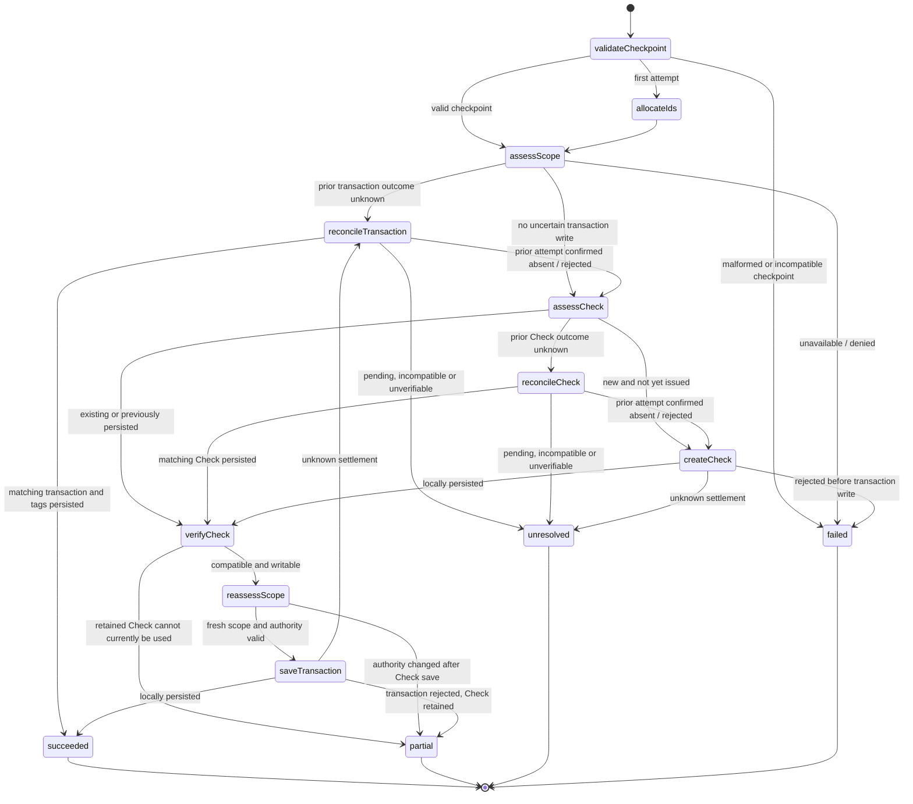

# Staged transaction save: ownership and retry contract

Status: coordinator and create/edit adoption implemented for batch review. New tests and test migration await user review. Previous focused child tests do not verify this new batch.

## Why the current save adapter is insufficient

The original scoped form created a finite submission actor per Save. That actor
creates a finite operation and persistence actor. `scoped-form-write.ts` and
`scoped-form-submission.ts` reduce interrupted results to outcome and settlement,
and `scoped-form.ts` clears the prior result when the next submission begins.
Transaction creation also generates its ID inside each persistence attempt.

Putting Check creation before that existing persistence child would therefore lose
both the retained Check identity and the uncertain transaction identity on retry.
The new coordinator must not depend on a previous invocation remaining alive.

## Ownership

Keep the existing form owner and its finite submission/operation children. Add an
optional opaque recovery checkpoint to the shared form protocol. The form owner
retains it separately from feedback and passes it into the next submission. The
domain coordinator validates it before use; it is not an authorization token.
Other forms do not produce checkpoints and retain their current behavior.

```text
transaction page / integration (Jazz binding, observations, actor lifetime)
  scoped form owner (draft, scope lifetime, opaque recovery checkpoint)
    submission (validation and interruption forwarding)
      scoped write (fresh availability assessment)
        staged transaction save coordinator (one attempt, typed checkpoint)
          Check creation resource child (already implemented)
          transaction/tag resource child (one atomic transaction)
```

The form owner retains recovery through validation errors, partial results, failed
attempts and ordinary cancellation. RESET or a new form starts a new logical save
only after the current operation drains. Scope replacement/shutdown drains the
old operation, then releases its checkpoint; a later scope cannot reuse it. The
checkpoint is memory-only. Reload recovery remains deferred.

The checkpoint is scoped to the original SDK binding, identity, organization,
account, transaction kind and edited transaction ID, if any. It contains stable
transaction/Check IDs, independently observed settlement and the submitted values
needed to reconcile uncertain writes. It contains no actor or transaction handles.
Changes to Check scope cannot silently reuse it; account movement remains a separate
product decision. Known uncommitted failures can accept corrected transaction
fields while keeping IDs; uncertain transaction outcomes must reconcile the prior
submitted values before accepting a replacement write.

## Statechart



For no Check selection, `assessCheck` proceeds directly to `reassessScope` and the
transaction saves with no Check reference. No physical-check matching or Check
catalog query is introduced. Existing Check selection uses an explicit ID and a
fresh scoped read.

A second control region tracks active/cancelled/scopeChanged/closed. Interruption
forwards to the currently active resource child without exiting its invocation.
The coordinator waits for the child's terminal output, records actual settlement,
then finishes with the highest-priority interruption and its checkpoint. It issues
no further read/write after interruption. Shutdown overrides invalidation and
cancellation; invalidation overrides cancellation. Read-only actors can be stopped
because they acquire no persistent resource. All child crashes have explicit error
transitions; an errored child is never awaited for a drain acknowledgement.

## Result and retry protocol

Every result after ID allocation carries the updated checkpoint, including
interrupted and uncertain results. Both generic form wrappers must preserve it.
The form owner replaces it only with a newer checkpoint from the current request
and scope revision; older submission reports cannot overwrite it.

- Success means the transaction and its tag changes locally settled. Check local
  settlement alone is partial success, never full transaction success.
- Partial means a Check was retained but the transaction did not complete. A new
  Save revalidates the draft and scope, verifies that Check, and reuses its ID.
- Unresolved means an issued write cannot yet be classified. Retry reconciles it
  using the same stable IDs before issuing another mutation. An absent ordinary
  local query is not proof that an unknown write can safely be repeated.
- Cancellation, scope change and shutdown carry actual Check/transaction settlement
  even when their outcome is interrupted. They do not delete a persisted Check.

The transaction/tag child accepts a caller-supplied transaction ID and compatible
payment/check reference. It stages the ledger row and all tag changes in one SDK
transaction. Existing Check metadata edits need their own observed write result;
create-only support must not claim that edit adoption is finished.

## Leaf effects and invariants

Leaf actors allocate IDs, read a scoped snapshot, inspect an SDK write handle,
stage already-planned rows, request commit, await local settlement, or request
rollback. State guards choose the next operation. Reconciliation is a statechart,
not a promise containing reads, decisions and writes. Resource children keep the
transaction open across read/check/stage/commit/settle/rollback states.

The SDK policy remains the authority boundary. Cached readiness and checkpoints
cannot authorize writes. Ordinary saves wait for local settlement, not an online
round trip. Pending remote writes remain pending; remote denial must not be labeled
as successful synchronization. Cross-write remote ordering/rejection behavior still
requires dedicated SDK coverage before claiming offline correctness.

## Implementation sequence

1. Add checkpoint retention/forwarding to the shared form contract and its owners,
   including interrupted results, scope correlation and reset semantics. Review and
   test this focused foundation before using it for finance writes.
2. Adopt direction-neutral canonical transaction values and explicit Check intent
   without changing rendered controls. Keep optional payment method semantics
   aligned with the approved spec; the current manual-income requirement is a
   staged-adoption rule, not the final independent-Check contract.
3. Adapt the atomic transaction/tag child to caller-owned IDs and independent
   references. Retain transaction-time scope/category/tag invariants.
4. Implement this finite coordinator and reconciliation children, invoking the
   tested Check creation child. Review, then test retries, partial/unknown outcomes,
   interruptions, authority changes and late child results.
5. Wire the create/edit integrations and existing income controls, then add browser
   and offline synchronization coverage after review.

## Implemented recovery boundary

SDK local-first reads include pending writes, so a matching local row is not used
to prove an unknown write settled. Unknown Check/ledger reconciliation uses
`ReadTier.Remote` and exact prior-value comparison (including ledger tag assignments).
Absence remains unresolved. Read-only reconciliation may be cancelled without
domain cleanup; resource child invocations must drain. Known local success needs no
remote query, and ordinary saves remain local-first. Explicit
`PersistedWriteRejectedError` results retain confirmed rejection through rollback;
other failures after commit issuance remain uncertain. No retry is automatic.
The Check child now has explicit creation/update staging states. The ledger child
reads editable provenance and tag links within its SDK transaction before planning
updates/removals/additions; all ledger/tag mutations share one commit.

## Approved movement simplification

There is no existing-Check selector. Inline creation and edits to the currently
attached Check are the UI paths. Existing Check metadata edits settle in its source
account; an account change is staged with the ledger/tag writes in the ledger child.
That child reads and checks the Check source account and existing ledger reference
before staging both updates atomically. The coordinator accepts the source-scoped
Check only for the edited transaction's current reference. It passes the observed
source account into the ledger child for a transaction-time recheck. Unknown ledger
reconciliation also verifies that the referenced Check reached the target account.
SDK old/new account permissions and immutable organization remain mandatory.
