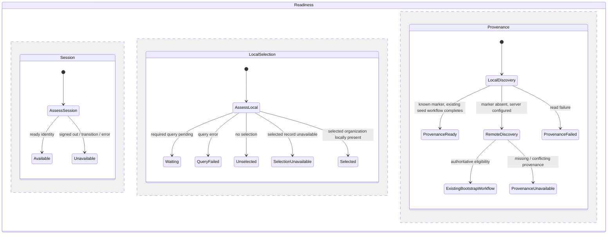

# Local-first startup: first delivery plan

Status: T004 approved; T005 reviewed and focused unit checks passed. Browser verification remains pending.
Base: `feature/local-first-startup-pr26`, stacked on PR #26.

## Scope and constraints

T005 changes `workspace-initialization.ts`, `readiness.ts`, and `WorkspaceBootstrap.svelte`.
The reviewed presentation refinement also changes `+layout.svelte`, `AppShell.svelte`, and
`JazzStartup.svelte`, plus removal of the redundant landmark in `+error.svelte`: the root layout owns the single persistent main landmark; shell content keeps
its scrolling and drawer inert behavior on a div; startup renders internal messages without an inline
mode. Initialization error/retry feedback remains alongside usable finance content. It removes initialization provenance from the ordinary local
query/navigation path. No schema, permission, localization, provider, transaction, or visual changes
are planned. Constitution I/IV/IX and the XState/Jazz memories govern the slice.

Current dependency: initialization completes (including optional seeding) → `workspace-ready`
→ organization subscription → selection/navigation. Initialization's combined profile/organization
read uses `LocalFirstUnlessEmpty`, so either empty result can wait remotely.

Target: current ready session → local subscriptions → scoped selection and membership assessment
→ locally permitted navigation. Initialization remains an independent supervised workflow.
Its failures must not hide available finance data. Missing local records still constrain the
specific actions needing them; an empty result never authorizes bootstrap or repair.

## Ownership and statechart

Retain the existing application → workspace readiness ownership tree. Readiness continues to invoke
startup, navigation, integrity, creation, and bank children across active/drain states. No new owner,
manual actor bridge, or context lifecycle flags are needed.

The diagram describes independent dimensions, not a replacement machine implementation. Existing
membership assessment remains a separate readiness region: current user/workspace matching,
loading/error handling, and observed membership loss still govern scoped access. Session availability
permits subscriptions and navigation assessment; it alone never grants finance write permission.

T005 will use explicit `ReadTier.LocalFirst` for initialization's initial discovery. Remote discovery
and bootstrap eligibility remain unchanged. Ordinary query enablement and selection evaluation will
use session availability rather than provenance completion. The public view must distinguish usable
local shell/data from provenance failure so an initialization error cannot replace available content.
Creation and integrity binding still require a valid initialized profile; bank operation-specific
guards remain intact pending T007. T006 separately moves seeding off the provenance completion path.

## Events, replacement, and cleanup

Keep typed `OBSERVED` and generation-correlated initialization/navigation/integrity reports. Session
or identity replacement immediately disables affected local capabilities and rebinds subscriptions;
selection and membership observations re-evaluate scoped access. A → B → A must not reuse an old
report. Startup failure remains independently retryable even when local work is available.

Preserve existing startup replacement/shutdown drain: send child shutdown, await acquired transaction
or seed cleanup/settlement, then release ownership. Closing states consume late reports and reject new
work. No promise cancellation is represented as cancellation of an issued database write. Existing
success, partial, unavailable, cancellation, failure, and settlement outputs remain distinct.

## Machine-first gate

Local discovery is a leaf: related profile and organization reads, no policy or writes. Existing
statechart guards decide provenance and bootstrap eligibility. T005 adds no async orchestration.
Before review, inspect all changed guards/selectors and recursively inspect changed actor helpers;
preserve transaction/seed resource owners and their terminal outcomes. Do not move their policy into
promise bodies. New-identity offline bootstrap remains T010; this plan does not infer identity
provenance from an empty replica or claim that offline bootstrap is solved.

## Review and verification

After implementation approval, inspect and update `workspace-initialization.test.ts`,
`readiness.test.ts`, `workspace-startup.test.ts`, and `application-readiness.test.ts` where contracts
are affected. Preserve authoritative bootstrap/cancellation cases. Add focused assertions that local
navigation works while initialization waits or fails, identity replacement invalidates capabilities,
and observed membership loss denies access. Review shared startup doubles before execution.

Inspect `tests/offline-access.e2e.ts` for returning users with locally retained records and a remote
connection that opens but never answers. Cold runtime/asset verification in `tests/pwa.e2e.ts` belongs
to T013/T014; a warmed browser result must not be reported as cold restart proof. Run only relevant
checks after exact implementation approval, using the isolated environment required by testing memory.
No timing gain or complete offline guarantee is claimed from static analysis. Capture comparable
pre-change measurements before any timed comparison; broader device budgets remain T015.

Next review cycles: T005 code → review → affected T009 tests; then T006 seeding and T007 integrity as
separate designs/changes. Each cycle remains a small related file set. T004 is complete only after
this plan is reviewed.

Selection readiness evaluates observed session status and identity, shared with the session region,
rather than testing the session region while both regions traverse transient checking states.
The navigation capability retains organization and membership states; bank and creation retain
provenance requirements. Four focused unit suites passed (89 tests); an additional pending-provenance
case subsequently passed in the 25-test readiness suite. Type checking remains blocked by dependency
resolution/API mismatches outside this slice. No browser or cold-start guarantee is established.
