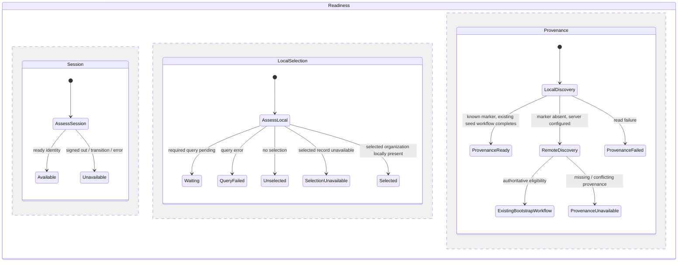

# Local-first startup: first delivery plan

Status: T004 approved; T005 reviewed; focused unit checks, type checks, and the offline owner browser workflow passed.
Base: `feature/local-first-startup-pr26`, stacked on PR #26.

## Scope and constraints

T005 changes `workspace-initialization.ts`, `readiness.ts`, and `WorkspaceBootstrap.svelte`.
The reviewed presentation refinement also changes `+layout.svelte`, `AppShell.svelte`, and
`JazzStartup.svelte`, plus removal of the redundant landmark in `+error.svelte`: the root layout owns the single persistent main landmark; shell content keeps
its scrolling and drawer inert behavior on a div; startup renders internal messages without an inline
mode. Initialization error/retry feedback remains alongside usable finance content. It removes initialization provenance from the ordinary local
query/navigation path. No schema, permission, localization, provider, transaction, or visual changes
are planned. Constitution I/IV/IX and the XState/Jazz memories govern the slice.

Current dependency: initialization completes (including optional seeding) → `workspace-ready`
→ organization subscription → selection/navigation. Initialization's combined profile/organization
read uses `LocalFirstUnlessEmpty`, so either empty result can wait remotely.

Target: current ready session → local subscriptions → scoped selection and membership assessment
→ locally permitted navigation. Initialization remains an independent supervised workflow.
Its failures must not hide available finance data. Missing local records still constrain the
specific actions needing them; an empty result never authorizes bootstrap or repair.

## Ownership and statechart

Retain the existing application → workspace readiness ownership tree. Readiness continues to invoke
startup, navigation, integrity, creation, and bank children across active/drain states. No new owner,
manual actor bridge, or context lifecycle flags are needed.

The diagram describes independent dimensions, not a replacement machine implementation. Existing
membership assessment remains a separate readiness region: current user/workspace matching,
loading/error handling, and observed membership loss still govern scoped access. Session availability
permits subscriptions and navigation assessment; it alone never grants finance write permission.

T005 will use explicit `ReadTier.LocalFirst` for initialization's initial discovery. Remote discovery
and bootstrap eligibility remain unchanged. Ordinary query enablement and selection evaluation will
use session availability rather than provenance completion. The public view must distinguish usable
local shell/data from provenance failure so an initialization error cannot replace available content.
Creation and integrity binding still require a valid initialized profile; bank operation-specific
guards remain intact pending T007. T006 separately moves seeding off the provenance completion path.

## Events, replacement, and cleanup

Keep typed `OBSERVED` and generation-correlated initialization/navigation/integrity reports. Session
or identity replacement immediately disables affected local capabilities and rebinds subscriptions;
selection and membership observations re-evaluate scoped access. A → B → A must not reuse an old
report. Startup failure remains independently retryable even when local work is available.

Preserve existing startup replacement/shutdown drain: send child shutdown, await acquired transaction
or seed cleanup/settlement, then release ownership. Closing states consume late reports and reject new
work. No promise cancellation is represented as cancellation of an issued database write. Existing
success, partial, unavailable, cancellation, failure, and settlement outputs remain distinct.

## Machine-first gate

Local discovery is a leaf: related profile and organization reads, no policy or writes. Existing
statechart guards decide provenance and bootstrap eligibility. T005 adds no async orchestration.
Before review, inspect all changed guards/selectors and recursively inspect changed actor helpers;
preserve transaction/seed resource owners and their terminal outcomes. Do not move their policy into
promise bodies. New-identity offline bootstrap remains T010; this plan does not infer identity
provenance from an empty replica or claim that offline bootstrap is solved.

## Review and verification

After implementation approval, inspect and update `workspace-initialization.test.ts`,
`readiness.test.ts`, `workspace-startup.test.ts`, and `application-readiness.test.ts` where contracts
are affected. Preserve authoritative bootstrap/cancellation cases. Add focused assertions that local
navigation works while initialization waits or fails, identity replacement invalidates capabilities,
and observed membership loss denies access. Review shared startup doubles before execution.

Inspect `tests/offline-access.e2e.ts` for returning users with locally retained records and a remote
connection that opens but never answers. Cold runtime/asset verification in `tests/pwa.e2e.ts` belongs
to T013/T014; a warmed browser result must not be reported as cold restart proof. Run only relevant
checks after exact implementation approval, using the isolated environment required by testing memory.
No timing gain or complete offline guarantee is claimed from static analysis. Capture comparable
pre-change measurements before any timed comparison; broader device budgets remain T015.

Next review cycles: T005 code → review → affected T009 tests; then T006 seeding and T007 integrity as
separate designs/changes. Each cycle remains a small related file set. T004 is complete only after
this plan is reviewed.

Selection readiness evaluates observed session status and identity, shared with the session region,
rather than testing the session region while both regions traverse transient checking states.
The navigation capability retains organization and membership states; bank and creation retain
provenance requirements. Four focused unit suites passed (89 tests); pending-provenance and empty first-workspace cases subsequently passed in the 26-test readiness
suite. Installing locked dependencies resolved the earlier type-check blockers; type checking now
passes with zero errors/warnings. The existing offline owner Playwright workflow passes, covering
local edits and reconnection in a running session. Cold restart and an unresponsive remote remain
unverified.

Browser verification exposed an early redirect while bootstrap was still creating the first workspace.
Readiness now waits before redirecting an empty, unscoped finance route while provenance is pending.
Explicit workspace/global routes and existing local workspaces remain independently usable. This
wait does not authorize bootstrap or claim the local replica is complete.

## T006 proposed design — independent optional seeding

Status: implementation approved and focused verification passed.

Initialization finishes after established provenance or successful bootstrap and returns the profile
ID plus initial workspace ID. Startup publishes the existing ready report immediately, then owns
optional seeding independently of that report.
The public initialization report can remain unchanged; the extra workspace ID is internal output.

```mermaid
stateDiagram-v2
  [*] --> Initializing
  Initializing --> Ready: provenance established / bootstrap succeeded
  state Ready {
    [*] --> Seeding
    Seeding --> Settled: child completes or fails; preserve typed result
    Seeding --> Replacing: identity or request replaced; drain live child
    Seeding --> Closing: shutdown; drain live child
    Replacing --> Closing: shutdown supersedes replacement
  }
  Replacing --> Initializing: cleanup settled, latest request eligible
  Closing --> Closed: cleanup settled
  Settled --> Initializing: request replaced
  Settled --> Closed: shutdown
```

Keep the seed child invoked on the compound ready state so it survives transitions into its replacing
and closing substates. Only seeding and settled states carry readiness tags; draining
states publish waiting. Publish initialized readiness before starting the optional child. A seed
failure must not clear the valid profile binding or turn initialization into failure. Preserve the
seed's typed result/settlement as observed context data; the child owns explicit outcome states. The
workspace seed adapter will expose seeded/skipped distinctly instead of translating both into an
initialization-ready result. No seed retry is introduced; request replacement retains existing retry
semantics and authoritative deduplication.

Replacement and shutdown must check child liveness: completed/failed children cannot acknowledge
shutdown. An active child receives shutdown and remains owned until cleanup/settlement completes.
Shutdown supersedes replacement; late reports cannot publish readiness for the old request. Preserve
original operation binding while draining and retain only the latest replacement request. Unexpected
child crashes route to seed failure or complete an already requested drain; never wait for a crashed
child's acknowledgement. Existing initialization/bootstrap drain behavior remains unchanged.

Machine-first gate: this is a workflow with initialization, readiness publication, optional seeding,
replacement, and shutdown. Model it in startup states first. Retain `fakeDataSetup` as the exclusive
transaction owner: local populated-data skip, authoritative emptiness/ownership/categories reads,
guarded eligibility, resource acquisition, transaction recheck, staging, commit/confirmation, and
rollback remain there. Moving ownership must not change these safety checks or introduce promise
orchestration. Review its resource adapters recursively before presenting implementation.

Implementation scope: `workspace-initialization.ts`, `workspace-startup.ts`, and
`workspace-fake-data.ts`; no readiness, schema, localization, or presentation changes expected.
After exact implementation review, update initialization output assertions and startup fixtures, add
seed waiting/failure/replacement/shutdown coverage, and inspect `workspace-fake-data.test.ts`,
`fake-data.test.ts`, and `tests/fake-data.e2e.ts` before relevant execution. Keep seeding disabled in
ordinary offline browser coverage; use its dedicated disposable preview environment for seed tests.

T006 implementation review: startup captures its invoked seed reference in an action before raising
a drain/replacement event; liveness guards inspect that reference. The child remains invoked on the
compound ready state throughout cleanup. Completion routes prioritize shutdown and replacement
before seed outcome classification. Initialization now returns its established initial workspace ID;
seed results preserve seeded/skipped/cancelled/closed/failure and original settlement without
translating them into initialization success. Seed failure retains valid initialized readiness.
No new promise actors or asynchronous orchestration were introduced. The existing transaction
resource adapters and seed workflow remain unchanged.

T006 verification: six affected unit suites passed (117 tests). After preserving the generic SDK
query signature in the new fixture, the startup suite passed again (10 tests). Application/Svelte
and test TypeScript checks passed. The seed-enabled, debug-disabled Playwright case passed on
disposable in-memory Jazz storage, including reload without duplicate records. Its assertions now
wait for seed data independently of the Accounts heading. Unit tests cover a seed authority read
that never responds, nonblocking seed failure, latest-identity replacement after commit settlement,
and shutdown priority while seeding drains. These results do not establish full cold offline startup.

## Startup simplification review

Implemented the two approved simplifications in `workspace-startup.ts`. Startup now models only
seeding, settled, replacing, and closing for seed ownership. The child retains outcome classification;
startup preserves its typed result without repeating the child outcome states. Replacement/shutdown
events carry the observed seed actor reference directly; no context actor reference or reset is
needed. Liveness remains a guarded transition, and shutdown/replacement routes still precede normal
settlement. The seed workflow and its feature-gate adapter are unchanged in this simplification.

Formatting and diff checks pass. Prior T006 results precede this simplification. The startup failure test now awaits settled while retaining the failure-result and readiness
assertions. A readiness regression test covers a failed workspace query during pending initialization;
query failures are excluded from the empty-workspace bootstrap wait.

Post-review verification: both affected readiness/startup suites pass (37 tests), including query
failure during pending initialization and seed settlement/cleanup after simplification. Application
and test type checks pass with zero Svelte diagnostics. The earlier seed browser result predates
the simplification; it was not rerun for these review fixes.

Latest slice verification after simplification and the loading-message fix: application and test
type checks pass, and both focused Playwright cases pass (seed-enabled reload/deduplication and
visible workspace loading feedback). The presentation regression mounts the real notice in its
loading state and verifies the visible paragraph as well as its screen-reader announcement, without
relying on startup timing. The previously passing 37 readiness/startup unit tests still cover the
current machine changes; those files have not changed since that run. Temporary verification config
was removed. Cold offline restart and general unresponsive-remote coverage remain later work.
