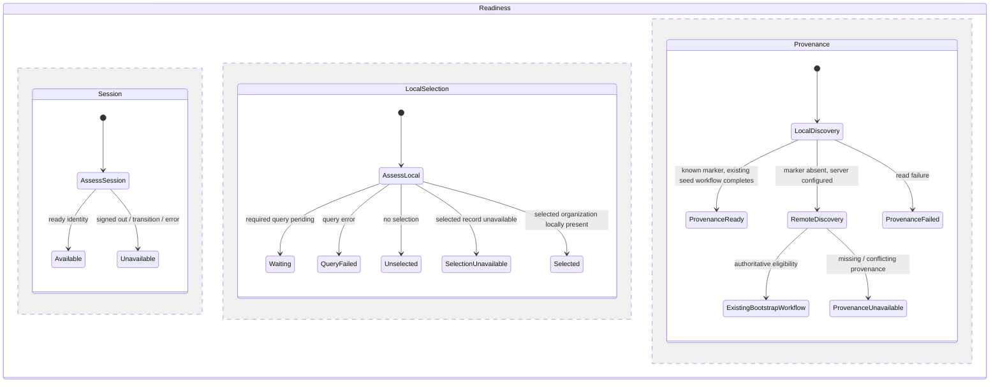
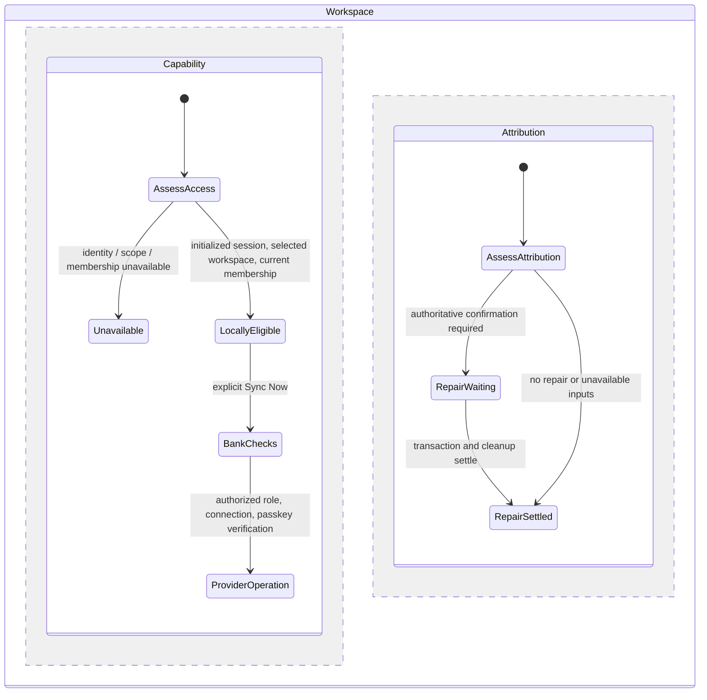
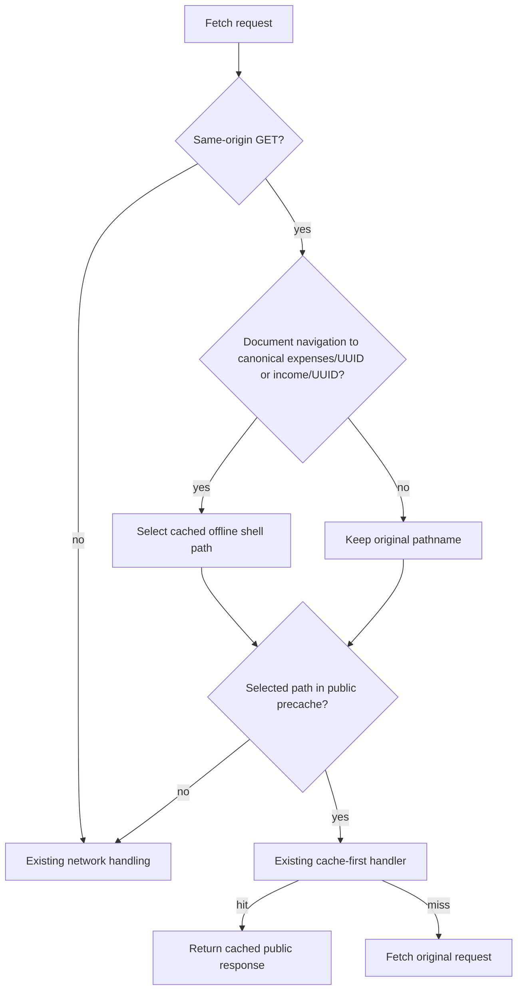

# Local-first startup: first delivery plan

Status: T004 approved; T005 reviewed; focused unit checks, type checks, and the offline owner browser workflow passed.
Base: `feature/local-first-startup-pr26`, stacked on PR #26.

## Scope and constraints

T005 changes `workspace-initialization.ts`, `readiness.ts`, and `WorkspaceBootstrap.svelte`.
The reviewed presentation refinement also changes `+layout.svelte`, `AppShell.svelte`, and
`JazzStartup.svelte`, plus removal of the redundant landmark in `+error.svelte`: the root layout owns the single persistent main landmark; shell content keeps
its scrolling and drawer inert behavior on a div; startup renders internal messages without an inline
mode. Initialization error/retry feedback remains alongside usable finance content. It removes initialization provenance from the ordinary local
query/navigation path. No schema, permission, localization, provider, transaction, or visual changes
are planned. Constitution I/IV/IX and the XState/Jazz memories govern the slice.

Current dependency: initialization completes (including optional seeding) → `workspace-ready`
→ organization subscription → selection/navigation. Initialization's combined profile/organization
read uses `LocalFirstUnlessEmpty`, so either empty result can wait remotely.

Target: current ready session → local subscriptions → scoped selection and membership assessment
→ locally permitted navigation. Initialization remains an independent supervised workflow.
Its failures must not hide available finance data. Missing local records still constrain the
specific actions needing them; an empty result never authorizes bootstrap or repair.

## Ownership and statechart

Retain the existing application → workspace readiness ownership tree. Readiness continues to invoke
startup, navigation, integrity, creation, and bank children across active/drain states. No new owner,
manual actor bridge, or context lifecycle flags are needed.

The diagram describes independent dimensions, not a replacement machine implementation. Existing
membership assessment remains a separate readiness region: current user/workspace matching,
loading/error handling, and observed membership loss still govern scoped access. Session availability
permits subscriptions and navigation assessment; it alone never grants finance write permission.

T005 will use explicit `ReadTier.LocalFirst` for initialization's initial discovery. Remote discovery
and bootstrap eligibility remain unchanged. Ordinary query enablement and selection evaluation will
use session availability rather than provenance completion. The public view must distinguish usable
local shell/data from provenance failure so an initialization error cannot replace available content.
Creation and integrity binding still require a valid initialized profile; bank operation-specific
guards remain intact pending T007. T006 separately moves seeding off the provenance completion path.

## Events, replacement, and cleanup

Keep typed `OBSERVED` and generation-correlated initialization/navigation/integrity reports. Session
or identity replacement immediately disables affected local capabilities and rebinds subscriptions;
selection and membership observations re-evaluate scoped access. A → B → A must not reuse an old
report. Startup failure remains independently retryable even when local work is available.

Preserve existing startup replacement/shutdown drain: send child shutdown, await acquired transaction
or seed cleanup/settlement, then release ownership. Closing states consume late reports and reject new
work. No promise cancellation is represented as cancellation of an issued database write. Existing
success, partial, unavailable, cancellation, failure, and settlement outputs remain distinct.

## Machine-first gate

Local discovery is a leaf: related profile and organization reads, no policy or writes. Existing
statechart guards decide provenance and bootstrap eligibility. T005 adds no async orchestration.
Before review, inspect all changed guards/selectors and recursively inspect changed actor helpers;
preserve transaction/seed resource owners and their terminal outcomes. Do not move their policy into
promise bodies. New-identity offline bootstrap remains T010; this plan does not infer identity
provenance from an empty replica or claim that offline bootstrap is solved.

## Review and verification

After implementation approval, inspect and update `workspace-initialization.test.ts`,
`readiness.test.ts`, `workspace-startup.test.ts`, and `application-readiness.test.ts` where contracts
are affected. Preserve authoritative bootstrap/cancellation cases. Add focused assertions that local
navigation works while initialization waits or fails, identity replacement invalidates capabilities,
and observed membership loss denies access. Review shared startup doubles before execution.

Inspect `tests/offline-access.e2e.ts` for returning users with locally retained records and a remote
connection that opens but never answers. Cold runtime/asset verification in `tests/pwa.e2e.ts` belongs
to T013/T014; a warmed browser result must not be reported as cold restart proof. Run only relevant
checks after exact implementation approval, using the isolated environment required by testing memory.
No timing gain or complete offline guarantee is claimed from static analysis. Capture comparable
pre-change measurements before any timed comparison; broader device budgets remain T015.

Next review cycles: T005 code → review → affected T009 tests; then T006 seeding and T007 integrity as
separate designs/changes. Each cycle remains a small related file set. T004 is complete only after
this plan is reviewed.

Selection readiness evaluates observed session status and identity, shared with the session region,
rather than testing the session region while both regions traverse transient checking states.
The navigation capability retains organization and membership states; bank and creation retain
provenance requirements. Four focused unit suites passed (89 tests); pending-provenance and empty first-workspace cases subsequently passed in the 26-test readiness
suite. Installing locked dependencies resolved the earlier type-check blockers; type checking now
passes with zero errors/warnings. The existing offline owner Playwright workflow passes, covering
local edits and reconnection in a running session. Cold restart and an unresponsive remote remain
unverified.

Browser verification exposed an early redirect while bootstrap was still creating the first workspace.
Readiness now waits before redirecting an empty, unscoped finance route while provenance is pending.
Explicit workspace/global routes and existing local workspaces remain independently usable. This
wait does not authorize bootstrap or claim the local replica is complete.

## T006 proposed design — independent optional seeding

Status: implementation approved and focused verification passed.

Initialization finishes after established provenance or successful bootstrap and returns the profile
ID plus initial workspace ID. Startup publishes the existing ready report immediately, then owns
optional seeding independently of that report.
The public initialization report can remain unchanged; the extra workspace ID is internal output.

```mermaid
stateDiagram-v2
  [*] --> Initializing
  Initializing --> Ready: provenance established / bootstrap succeeded
  state Ready {
    [*] --> Seeding
    Seeding --> Settled: child completes or fails; preserve typed result
    Seeding --> Replacing: identity or request replaced; drain live child
    Seeding --> Closing: shutdown; drain live child
    Replacing --> Closing: shutdown supersedes replacement
  }
  Replacing --> Initializing: cleanup settled, latest request eligible
  Closing --> Closed: cleanup settled
  Settled --> Initializing: request replaced
  Settled --> Closed: shutdown
```

Keep the seed child invoked on the compound ready state so it survives transitions into its replacing
and closing substates. Only seeding and settled states carry readiness tags; draining
states publish waiting. Publish initialized readiness before starting the optional child. A seed
failure must not clear the valid profile binding or turn initialization into failure. Preserve the
seed's typed result/settlement as observed context data; the child owns explicit outcome states. The
workspace seed adapter will expose seeded/skipped distinctly instead of translating both into an
initialization-ready result. No seed retry is introduced; request replacement retains existing retry
semantics and authoritative deduplication.

Replacement and shutdown must check child liveness: completed/failed children cannot acknowledge
shutdown. An active child receives shutdown and remains owned until cleanup/settlement completes.
Shutdown supersedes replacement; late reports cannot publish readiness for the old request. Preserve
original operation binding while draining and retain only the latest replacement request. Unexpected
child crashes route to seed failure or complete an already requested drain; never wait for a crashed
child's acknowledgement. Existing initialization/bootstrap drain behavior remains unchanged.

Machine-first gate: this is a workflow with initialization, readiness publication, optional seeding,
replacement, and shutdown. Model it in startup states first. Retain `fakeDataSetup` as the exclusive
transaction owner: local populated-data skip, authoritative emptiness/ownership/categories reads,
guarded eligibility, resource acquisition, transaction recheck, staging, commit/confirmation, and
rollback remain there. Moving ownership must not change these safety checks or introduce promise
orchestration. Review its resource adapters recursively before presenting implementation.

Implementation scope: `workspace-initialization.ts`, `workspace-startup.ts`, and
`workspace-fake-data.ts`; no readiness, schema, localization, or presentation changes expected.
After exact implementation review, update initialization output assertions and startup fixtures, add
seed waiting/failure/replacement/shutdown coverage, and inspect `workspace-fake-data.test.ts`,
`fake-data.test.ts`, and `tests/fake-data.e2e.ts` before relevant execution. Keep seeding disabled in
ordinary offline browser coverage; use its dedicated disposable preview environment for seed tests.

T006 implementation review: startup captures its invoked seed reference in an action before raising
a drain/replacement event; liveness guards inspect that reference. The child remains invoked on the
compound ready state throughout cleanup. Completion routes prioritize shutdown and replacement
before seed outcome classification. Initialization now returns its established initial workspace ID;
seed results preserve seeded/skipped/cancelled/closed/failure and original settlement without
translating them into initialization success. Seed failure retains valid initialized readiness.
No new promise actors or asynchronous orchestration were introduced. The existing transaction
resource adapters and seed workflow remain unchanged.

T006 verification: six affected unit suites passed (117 tests). After preserving the generic SDK
query signature in the new fixture, the startup suite passed again (10 tests). Application/Svelte
and test TypeScript checks passed. The seed-enabled, debug-disabled Playwright case passed on
disposable in-memory Jazz storage, including reload without duplicate records. Its assertions now
wait for seed data independently of the Accounts heading. Unit tests cover a seed authority read
that never responds, nonblocking seed failure, latest-identity replacement after commit settlement,
and shutdown priority while seeding drains. These results do not establish full cold offline startup.

## Startup simplification review

Implemented the two approved simplifications in `workspace-startup.ts`. Startup now models only
seeding, settled, replacing, and closing for seed ownership. The child retains outcome classification;
startup preserves its typed result without repeating the child outcome states. Replacement/shutdown
events carry the observed seed actor reference directly; no context actor reference or reset is
needed. Liveness remains a guarded transition, and shutdown/replacement routes still precede normal
settlement. The seed workflow and its feature-gate adapter are unchanged in this simplification.

Formatting and diff checks pass. Prior T006 results precede this simplification. The startup failure test now awaits settled while retaining the failure-result and readiness
assertions. A readiness regression test covers a failed workspace query during pending initialization;
query failures are excluded from the empty-workspace bootstrap wait.

Post-review verification: both affected readiness/startup suites pass (37 tests), including query
failure during pending initialization and seed settlement/cleanup after simplification. Application
and test type checks pass with zero Svelte diagnostics. The earlier seed browser result predates
the simplification; it was not rerun for these review fixes.

Latest slice verification after simplification and the loading-message fix: application and test
type checks pass, and both focused Playwright cases pass (seed-enabled reload/deduplication and
visible workspace loading feedback). The presentation regression mounts the real notice in its
loading state and verifies the visible paragraph as well as its screen-reader announcement, without
relying on startup timing. The previously passing 37 readiness/startup unit tests still cover the
current machine changes; those files have not changed since that run. Temporary verification config
was removed. Cold offline restart and general unresponsive-remote coverage remain later work.

## T007 design — attribution repair and bank capability

Status: implementation approved; focused verification passed.

Ordinary page navigation uses `navigationCanUseWorkspace` and does not read integrity reports.
Bank setup commands use `canUseWorkspace`; bank access publication also checks credential-management
role. Only Sync Now still depends on successful attribution repair: `canSync` requires a current
complete/usable-partial integrity report. `BankSyncIntegration.svelte` consumes this capability to
disable Sync Now. The bank availability and per-operation authorization machines separately verify
current identity, workspace, membership, owner/admin role, credential/connection availability, and
operation authority. No bank-sync machine reads membership `profileId`. The integrity issue is only
profile attribution, but unavailable/conflict outcomes can also describe missing or ambiguous repair
inputs; these must not be reinterpreted as proof of current access. Current access remains readiness
and bank authorization's responsibility.

Proposed change: remove the integrity report prerequisite from Sync Now. Keep current
`canUseWorkspace`, the bank owner's own readiness decisions, explicit user initiation, passkey
verification, connection ownership, and fresh per-operation authorization. Existing initialization
requirements for bank binding remain in this slice. Changing an integrity report must neither grant
access nor revoke otherwise eligible bank access. Observed membership/identity/scope changes still
invalidate operation access independently.

This is a capability dependency change, not a new workflow: use existing readiness guards and bank
child machines; introduce no actors, promises, or context lifecycle flags. Keep repair resource
ownership, authoritative confirmation, request generations, replacement, shutdown, and repair retry
unchanged. Integrity reports remain observable progress/diagnostics; they no longer authorize bank
commands. No schema, permission, localization, or presentation changes are proposed.

Implementation scope: `readiness.ts` and its integrity reporting contract documentation. The audit
found no need to modify `workspace-integrity.ts` or `workspace-integrity-owner.ts`. Their historical
finance-ready tags have no production consumers and can be considered separately rather than
rewriting resource owners for this change.

After exact implementation approval, update the readiness tests that currently expect integrity
failure or a stale report alone to disable Sync Now; preserve stale-report rejection, current role,
membership loss, identity changes, and scope invalidation assertions. Exercise bank availability and
operation authorization tests so repair independence cannot weaken provider requirements. Inspect
`tests/readiness.e2e.ts` and `tests/bank-sync-offline.e2e.ts` before relevant browser checks. No bank
provider request should occur merely because repair finishes, startup runs, or connectivity changes.

T007 implementation: explicit SYNC forwarding reuses the existing `bankAccessAllowed` guard, which
requires current initialized workspace access and credential-management role. Removed the unused
integrity-based canSync guard; the public canSync selector still asks whether the SYNC event is
accepted. Integrity report correlation, repair/retry/cleanup, and all bank child authorization and
credential checks remain unchanged. No new actors or effects were introduced. Readiness tests now assert repair-independent SYNC eligibility while preserving report currency,
role requirements and observed membership invalidation.

T007 verification: readiness and bank authorization/availability/owner suites pass (85 unit tests).
Application and test type checks pass. All four focused browser cases pass: offline setup, offline
sync controls with no provider request on reconnection, explicit startup-storage recovery, and
failed-history reload without machine errors or provider requests. The history fixture now reads
the canonical workspace URL instead of a removed selector and checks both drawer/page Sync Now
buttons under the single main landmark. The first three browser cases passed initially; the history
case passed after its stale single-button locator was corrected.

## T013 fix A — include emitted worker dependencies in precache

Status: implementation approved; isolated build/type checks and four focused production browser
checks pass.

Implementation scope: `tooling/worker-assets-manifest.ts` and `vite.config.ts`. No service-worker
runtime, Jazz loader/session, schema, localized messages or update lifecycle changes.

Build sequence: Vite emits client/worker outputs and its client manifest → a client-only post-order
`generateBundle` hook adds otherwise-unlisted emitted worker assets to that manifest → SvelteKit
collects immutable paths → existing service-worker code precaches those paths. The plugin validates
the manifest and preserves existing fields; it uses emitted filenames under SvelteKit's immutable
worker directory, excludes source maps, and never hardcodes content hashes or reads a stale build
folder. It fails the build if the required client manifest is absent. This is a synchronous build
output transformation, not an async workflow or runtime actor change.

The installed SvelteKit build reads the completed Vite client manifest and collects each entry's
file/assets/css fields. Vite emits the nested worker Wasm but omits it from that manifest. A standard
file-only manifest entry lets SvelteKit include it without modifying framework internals, overriding
runtime assets, or introducing a second fetch/cache implementation.

Verification in the isolated worktree: application/Svelte and service-worker type checks pass;
production build succeeds; generated client manifest adds exactly
`_app/immutable/workers/assets/jazz_wasm_bg-ayzBUhbu.wasm` in this build; generated service-worker
precache now lists both required Wasm URLs. The running development checkout was not rebuilt.

Cost: this correctness fix adds the missing 19,342,148-byte asset to installation, alongside an
existing identical root Wasm copy. It does not claim reduced startup time or download/storage
usage. Avoiding that duplication needs a separate measured build/loader/cache design; do not infer
that distinct cache keys share quota or that requesting identical bytes avoids another transfer.

After review, validate actual Cache Storage coverage and cold worker/Wasm startup with HTTP cache
masking removed. Keep update consent and public-only cache behavior covered. Dynamic finance detail
navigation remains separate fix B; this manifest correction alone does not fix offline detail URLs.

T024 verification: `tests/pwa-cold-start.e2e.ts` is included in the PWA configuration. It checks
that all emitted Wasm URLs are in Cache Storage and serve valid Wasm offline with HTTP cache
disabled. Its persistent-profile case creates an account online, clears HTTP cache, exits the
browser process, relaunches the profile offline, and verifies the saved account through the cached
Accounts shell. These two cases plus existing public-cache-scope and update-consent cases all passed
in the isolated worktree (four tests). Test TypeScript checks passed; app/service-worker type checks
and build had already passed for the unchanged plugin. The production build used only the known
disposable agent backend for setup; no cloud backend or existing browser profile was used. Dynamic
detail documents remain unfixed; no claim is made that this static Accounts scenario covers them.

## T025 — route-neutral offline detail shell

Status: implementation committed as 5bb7225; isolated build/type checks and focused PWA verification
passed. Test/research follow-up remains uncommitted.

Four implementation files: `src/service-worker/index.ts`, `src/routes/offline/+page.ts`,
`src/routes/offline/+page.svelte`, and `vite.config.ts`. No Jazz, data, finance workflow, permission,
localization or update-consent change.

A prerendered `/offline` route has SSR disabled, producing a public route-neutral client entry. It
contains no fixed SvelteKit hydration node IDs and starts client routing from the actual document
URL. Ordinary pages retain their existing SSR settings. The SvelteKit paths configuration uses
`relative: false`, so imports, styles and service-worker registration resolve against configured
absolute asset paths when this document is served at another URL. Reusing cached list HTML directly
would incorrectly reuse route-specific hydration data and relative asset bases at deeper paths.

Implementation performs synchronous URL/cache-key selection only. Existing install, cache lookup,
network miss and activation/message adapters remain intact; no new async workflow or actor resource
lifetime is introduced. Cross-origin/non-GET guards still precede respondWith. The mapping is limited
to request mode `navigate` and the registered scope's exact two-segment finance detail paths, with
canonical UUID shape. Route prefixes are case-sensitive; UUID hex accepts either case. Unsupported
paths, API/data fetches and assets do not acquire a generic HTML fallback. Query/hash processing and
record authorization remain in the client, not in the cached response. The requested document URL
must remain the actual detail URL, not navigate to `/offline`.

Isolated generated-output inspection confirms: offline.html exists; its boot script has no fixed
hydration payload; client entry URLs and service-worker registration are absolute; `/offline` appears
in the generated precache list. The generated worker includes the exact finance-detail matcher.
Type checking reports zero errors/warnings, and the production build succeeds. These are build
checks, not proof of saved-record offline navigation.

After implementation review: update the public-cache test to include the new public shell and the
existing online detail test to expect a service-worker public response once controlled. Extend the
cold persistent-profile test with saved expense/income details, close every tested client, clear HTTP
cache only, relaunch offline and verify correct route/component, workspace query and local values.
Cover unknown paths and non-document fetches so APIs/data never receive the fallback shell. Rerun
public-cache and update-consent cases. Keep missing-record/local-unavailability and actual
cross-version compatibility claims separate from the successful shell-routing case.

T025 browser verification: both expense and income cases create local records, warm their required
detail data, clear HTTP cache, exit the persistent browser/SharedWorker process, relaunch the same
profile offline and navigate directly to the original detail URL. Both display Transaction details
with the original description, amount, date, workspace query and hash; offline reload also passes.
The returned cached document contains no record description and the URL does not become /offline.
Boundary checks confirm ordinary fetches, POST document navigation, API paths, malformed IDs, extra
segments, uppercase route prefixes and unknown routes do not receive a generic shell.

All 15 PWA cases were verified: 13 passed in the initial run, while two existing update/draft cases
opened a form before canonical workspace/navigation scope settled and failed before their update
assertions. Their fixture now awaits the scoped root and Accounts URLs before editing; both passed
on targeted rerun, without a production workaround. Existing cache/update tests now include the
public offline shell and controlled online detail responses. Test TypeScript checks pass.

These cases cover one production asset graph with simulated service-worker byte updates. They do
not establish compatibility across two distinct application builds or every browser; those remaining
T014/update-matrix scenarios are not marked complete.

### T026 deferred: cross-build cache retention

User deferred this work to keep the startup slice focused. The distinct-build probe remains useful
asset-level evidence, but did not establish a failed user navigation. Do not implement client/build
reporting, additional cache-lookup machines or retention changes in this slice. Existing activation
and update consent remain unchanged. An older tab may lose access to a changed lazy module after
activation; reloading into the current build is the recovery, potentially discarding unsaved edits.
Revisit from a reproduced user workflow and storage/update measurements (T021), with a separately
reviewed design. This deferral does not claim cross-build compatibility has been validated.

### T009 repeatable silent-remote regression

Run `pnpm exec playwright test --config playwright.startup.config.ts` in an isolated checkout with
its own installed dependencies. The config builds production output with a fixed disposable Jazz
proxy origin and serves the app on 127.0.0.1:4185. The test starts its own in-memory Jazz server on
an available port, initializes the real schema/permissions and binds the proxy on 127.0.0.1:6193.
Occupied ports fail rather than stopping an existing process. Playwright owns the preview lifetime;
fixtures own the proxy/backend and temporary browser profile. No pre-existing agent backend needed.

The proxy forwards during preparation, then completes WebSocket upgrades without sending Jazz
frames. The test closes its browser before changing modes and launching the same profile online.
It asserts client transport activity, service-worker document responses, local detail values,
explicit save confirmation and persisted edits after reload. This is a stalled-negotiation test,
not a post-server-hello query stall or a remote acceptance/rejection test.

The suite is excluded from the ordinary dev-server config. Its explicit tests/tsconfig.json mapping
lets Playwright resolve #lib/*.js imports to application TypeScript when initializing the backend's
schema/permissions. It does not change application module resolution or SDK behavior.

T009 late-rejection follow-up uses the same owned backend/proxy fixtures. A separate backend
session uses the SDK's public createJazzSession API with backend admission to read authoritative
records and change membership while the browser connection is silent. After a globally accepted
12.34 baseline, the authority changes the owner membership to viewer with all-account read access.
The browser still has its old local authorization and confirms a 42.13 save before reconnecting.
Restoring forwarding causes a real serving-authority rejection, exercising the application's SDK
observer rather than a synthetic callback. Assertions cover notice delivery/dismissal, retained
workspace/read access, disabled write controls, unchanged server amount/membership and accepted
12.34 after reload. Both focused cases pass; no production code change was necessary. This covers
a known rejected outcome, not T012's durable recovery of an unknown outcome across interruption.

### T011 acquisition investigation and current constraints

The earlier per-workspace-child recommendation is not required by the query model. The installed
SDK can subscribe to a whole table under the current user's permissions. Candidate preparation
can therefore use a fixed dataset set across all accessible workspaces rather than multiplying
actors/subscriptions by workspace count. This is a proposal, not implemented coverage.

Candidate datasets: organizations, profiles, organizationMembers, accountMemberships, accounts,
categories, tags, transactions (including audit fields), transactionTags, checks, internalTransfers,
transactionBatches, batchTemplates, transactionAttachments, files, simplefinConnections and
simplefinAccountLinks. Preserve all server policies, archived references and unrestricted history
within those policies. File metadata queries never include parts. Exclude fileParts, uploads and
legacy checkDetails; do not unlock encrypted credentials or make provider requests. Separate roots
for attachments/files avoid using transactionDetailQuery, which includes file contents today.

Before selecting this design, use a bounded isolated-browser experiment to establish:

1. Whole-table queries acquire the same permitted rows/relationships as scoped queries for a
   never-opened workspace, including selected grants and read-only users. Verify the exact files
   root permission predicate rather than extrapolating from the earlier included-file probe.
2. Metadata remains queryable after subscription release and browser/SharedWorker restart while
   file content remains unavailable until explicitly requested. Do not infer durability from a
   warm query or infer physical byte eviction from query visibility.
3. Compare retained subscriptions with one-shot acquisition on controlled small/large histories and
   multiple workspaces. Record initial acquisition, callback sizes/frequency during one ordinary
   edit, page JS heap and responsiveness. Report page/worker measurement boundaries separately.
   The public subscribe method materializes full result arrays on each update; its incremental
   subscribeDelta method is private. Keeping only counts in app context does not avoid that copy.
   Counts/heap from Node fixtures are not measurements of the browser page.

Proposed ownership/state model if those checks support retained subscriptions:

- Root layout integration mounts preparation alongside WorkspaceBootstrap inside the existing
  session attachment key. It owns typed SDK subscriptions; selected workspace/navigation/provenance
  do not determine preparation lifetime. No application worker or change to the main render path.
- A focused machine owns a session/database generation: waitingForSession -> observing -> released.
  Observing invokes fixed dataset children; replacement/shutdown releases subscriptions before
  retiring the generation. Releasing has synchronous platform unsubscribe cleanup, not a domain
  write/commit operation. Every callback is scoped to its binding generation.
- Each dataset has starting -> observing, with a terminal subscription error -> failed. Other
  datasets stay active on a sibling failure; retry replaces only the failed subscription. Failure
  to acquire a subscription releases any resource already acquired. No timers infer connectivity,
  remote absence or completeness. Local empty delivery does not mean remotely prepared.
- Do not store entire result arrays in machine context or add a second collection cache. Do not
  publish ready/complete from local callbacks. Public preparation status/UI and remote checkpoint
  semantics require a later review; page readiness and ordinary saves never wait for this owner.

Limit the first runtime implementation review to the root integration, one focused preparation
integration, its machine and a typed dataset definition (approximately four files), after the
experiment selects a viable acquisition policy. Assess unit lifecycle/failure tests and Playwright
never-opened-workspace, authorization, metadata/content and cold-restart coverage at that review.
No production preparation code or tests have been added for this proposal.

T011 experiment disposition: do not adopt the candidate yet. A minimal browser reproduction found
that files/attachment links and explicitly requested parts were readable even when their parent
transaction was filtered by selected-account authorization. The attachment allowRead predicate
checks existence rather than parent readability. T027 is the next focused repair: one predicate in
permissions.ts, followed by reviewed unit/browser regressions. Details and fixture limits are in
research.md. The large-history/cold-persistence experiment remains unfinished; no performance
budget or live-subscription policy was selected from these incomplete runs.

Initial T027 disposition: the proposed allowedTo.read('transaction') predicate failed permission
publication on Jazz alpha.59. The converted files read policy referenced accountId on
transactionAttachments, which has no such column. The user rejected proceeding with an unsupported
Jazz rule. The predicate and its newly added tests were reverted; no repair or deployment occurred.
The existing authorization gap remains documented. Broad preparation remains paused until a
permission expression supported by the installed SDK is established and reviewed. The b39d9fa
follow-up below resolves that blocker without an SDK change.

T027 follow-up: b39d9fa implements a supported alternative on the installed alpha.59. Attachment
links inherit transaction reads. Files inherit reads directly from their existing transaction
relation and additionally require a link matching both fileId and transactionId; parts inherit file
reads. No parent organization, role or grant predicate is weakened and no schema change is needed.
The full permission suite passes 73 cases and five attachment/image browser cases pass, including
offline replacement/reload and viewer download. The authorization blocker is resolved. T011 still
requires cold-query, metadata/content and workload evidence before choosing a preparation policy;
an upstream SDK change is not part of the implementation plan.

T011 controlled follow-up (cold-query-follow-up.json): whole-table transaction acquisition retains
5,000 permitted of 10,000 records across full reader exit and an unanswered connection, including
exact-root and scoped/ID reads. Separate metadata roots retain permitted file/link references without
content; later explicit online acquisition retrieves the bytes. Closed/silent/disconnect controls
also pass at small scale. The earlier NotObserved failure remains unexplained, so this is bounded
positive evidence rather than a fixed SDK defect or completeness guarantee. Keep the candidate
unadopted until relationship coverage, workload/storage costs and progress semantics are reviewed.

T011 acquisition-policy review: preparation-cost-follow-up.json compares one-shot versus retained
whole-table subscriptions at 500 and 5,000 permitted transactions across two shared workspaces.
A one-shot snapshot remained stale after the observed remote edit window. Retained full-row results
receive edits but add about 21 MiB page heap at 5,000 rows. The supported public select('id') projection
reduces that measured retention to 10.3 MiB, still delivers complete ID arrays, and preserves tested
full transaction fields/audit provenance across cold restart, including a remotely created record.
ID-only file/link metadata also survives cold restart without acquiring file parts; explicit content
acquisition still succeeds. Page measurements exclude worker/Wasm/storage and are not latency or
device-budget guarantees.

Initial ID-only candidate (superseded by the final responsiveness gate below): preserve the
existing proposed session-bound parent and per-dataset observation/failure states, synchronous
unsubscribe cleanup, generation-bound callbacks, sibling independence and absence of a readiness
gate. Integration owns typed SDK query/subscription adapters. Do not retain ID arrays in machine
context, add an app collection cache, publish remote completeness from a local count, or subscribe
to fileParts. Public subscribe still materializes full ID result arrays; no counts-only/private API
is assumed. Assess exact relationship, permission-change and lifecycle tests at implementation
review. Other dataset coverage and worker/storage/progress limits remain open, so T011 stays open.

Final T011 responsiveness gate: the Remote-only global prototype replicated correctly, but initial
acquisition of 5,006 permitted records produced a 3,027 ms main-thread long task. Do not enable an
unbounded initial sweep based only on steady-state memory/edit measurements. The bounded paging
experiment is a workflow: acquire one Remote ID subscription page -> classify its first result ->
yield one animation frame when full -> acquire the next offset page, or finish the bounded fixture
when short. Success and failure are terminal test-machine states; the browser fixture owns every
retained lease and releases them on success/error/teardown. Measure frames/UI and verify cold full
query coverage before considering paging. This is an investigation, not a production paging plan;
concurrent inserts, permission changes and page-boundary coverage remain separate requirements.

Final T011 decision (remaining-investigation-results.json): Remote-only global ID subscriptions,
with full user-scoped authorization facts, pass live access and cold-data checks across the supported
browser engines. This is background server acquisition; it does not replace foreground LocalFirst
reads or gate readiness. The earlier global LocalFirst subscription proposal is not qualified.
No SDK fix, source patch or private delta API is part of the path forward.

Do not implement the unbounded 17-table sweep as a startup side effect. Its initial 5,006-record burst
caused a roughly three-second main-thread stall, including in a single-query control. Bounded public
orderBy(id)/offset/limit subscriptions retain full cold data and live boundary updates, but the
200-row prototype took 111 seconds and still had approximately 120 ms tasks. Smaller pages reduce
individual stalls further at higher acquisition cost. The next implementation must first expose
acquisition/yield/tail-observation/growth/trimming/failure/cancellation and session replacement states;
retained page leases remain owned until release. No actor may hide that workflow in an async helper.

Keep only counts/status facts in the production owner, not another row/ID cache. Treat observations
as snapshots, not current-global completeness. Current membership/grant facts determine eligibility;
previously cached organization rows are not access grants. Independent dataset errors do not stop
siblings. Integration owns SDK subscriptions and synchronous unsubscribe; ordinary navigation/saves
remain independent. Review initial responsiveness with the real integration and explicit scheduling
before enabling preparation. Real quota pressure and physical supported-device budgets remain
unverified; namespace deletion and a non-enforced quota override do not establish them.

### T028 audit outcome: first subscription consolidation review

The current evidence is in research.md and subscription-audit-results.json. Alpha.59 already
shares exact query keys and retains unused entries for 30 seconds; no generic ownership layer,
cache-delay override, rebinding machine, or lifecycle rewrite is justified by the measured routes.
Internal SDK developer introspection was used only in the disposable audit, not as an app API.

The first T030 candidate is one implementation file: `src/lib/components/AccountCreation.svelte`.
Add `orderBy('name')` to its active-account query so it matches the shell's existing ordered query.
Keep its predicates, default read tier, component ownership, readiness, duplicate-name checks,
workspace currency, and form lifetime. Existing SDK cache ownership supplies shared acquisition and
cleanup; do not add a helper/context/registry. Expected structural change: Accounts has 10 distinct
active SDK subscriptions instead of 11. This expectation is not an implemented or measured speedup.

Review this audit before implementing that slice. After implementation review, inspect affected
account-creation/access unit cases, workspace account-form cases, account-order coverage and stalled
transport coverage, then run focused checks and compare counts/startup timings using the same
isolated harness. T029/T031/T032 require their own confirmed candidate and review; hidden dialog
queries currently contribute to trigger readiness, and unused old query entries did disappear after
the SDK's cleanup window. Broader T015 measurement requirements remain open.

T030 first slice is implemented and verified after review: AccountCreation.svelte uses the same
name-ordered active-account query as the shell. One implementation file changed; no actors/helpers
were added. Accounts subscriptions are verified at 10 instead of 11; a saved-detail navigation
snapshot has 20 instead of 21. Focused validation passed 28 unit tests and nine browser workflows,
including cold local account creation with an unanswered Jazz connection, live updates, workspace
replacement and real rejection. App/test types and formatting pass. Timing samples do not establish
a startup speedup. See research.md and subscription-audit-results.json. Review this completed slice
before starting another cleanup task.

### T031 focused slice: acquire account-administration data when Manage opens

Source inspection identifies two dialog-only queries on `src/routes/accounts/+page.svelte`:
workspace-wide organizationMembers and accountMemberships. Their only consumers are the delete-grant
writer observations and the Manage Account permission controls. Own membership/grants, active
accounts, balances and creation queries remain independently live. The T030 closed-dialog snapshot
contains these two distinct broad keys, so expected initial Accounts count is 10 -> 8. This is a
structural expectation, not a measured latency improvement.

Machine-first gate: this slice adds a single visibility predicate to existing QuerySubscription
bindings, not a new async workflow. Simple closed/open disclosure stays in AccountList, reported to
the page as an observation. SDK effects own query subscribe/unsubscribe/cache cleanup. The existing
account-delete-grants statechart still owns read/check/write decisions and the issued writer:
idle -> assessing -> operating.writing -> succeeded/failed (or denied); SHUTDOWN during writing
enters operating.closing and drains before closed. Closing a dialog does not send SHUTDOWN or stop
that actor. Reads used to choose GrantWrite precede writer invocation; the writer already receives
its complete input and does not acquire/inspect new grant data. A later grant command still refreshes
observations and uses the same scoped/loading/error/authorization guards. No busy/context flags,
new actor, registry, promise orchestration or SDK cache override is needed.

Implementation scope (four files): Accounts page gates those two query getters on observed dialog
visibility and passes loading/error views; AccountList forwards the visibility and query-view props;
AccountActionsDialog wraps only permission fields in existing QueryContent; messages/en.json adds
shared plural noun permission; no new strings with interpolation beyond existing generic structures.
Archive controls remain outside permission-data loading/error feedback. Scope-removal and native
Dialog close events must publish closed visibility; component destruction releases page demand.
Local-first query tiers remain unchanged. Deferring this data means first access while offline can
use only locally retained results or the SDK query error/loading outcome; empty local results are
partial knowledge, not a complete permission inventory. This must not block ordinary account/finance
operations or infer global absence. Jazz can keep unused entries for its
normal 30-second window after component listener release.

Review implementation before tests. Affected coverage: account archive/offline/role workflows,
query loading/error presentation, permission write behavior, close/reopen and close-during-write,
workspace/session change, current account-creation and cold startup regressions. Production audit
should prove no broad keys before Manage, two acquired on opening, no reacquisition for unrelated
input, normal cleanup after close and correct live permission updates. Existing account-delete-grants
coverage is absent as a direct machine suite; add meaningful writer/drain cases only after review if
needed, rather than mirroring ternary query syntax. T031 remains open until focused verification.

T031 verification completed after review: initial Accounts subscriptions are 8 instead of 10;
Manage adds exactly two, reopen reuses them, and close returns to 8 after Jazz's normal cache delay.
Permission presentation, live grants, immediate-close write completion, cold local work, offline
archive, workspace replacement and role regressions pass (22 unit tests and 14 browser workflows).
App/test types and formatting pass. One post-change timing sample does not establish a startup
speedup. Read tiers and writer actors remain unchanged; no new statechart or SDK override was added.
See the final research disposition and dialogDemandVerification in subscription-audit-results.json.
This reviewed slice remains uncommitted. Do not expand into another cleanup without its own review.

### T034 first balance-read slice

The balance helper reads only accountId, kind, amountMinor and currency. Both the shell and Accounts
page currently request complete transaction rows. Categories also shares their un-ordered full
workspace query to read categoryId for usage counts; changing only the two balance consumers would
introduce an extra query key there. Preserve sharing through a canonical transactionSummaryQuery
in schema.ts selecting id, accountId, categoryId, amountMinor, currency and kind. Explicit id retains
the SDK subscription/delta identity. All three consumers apply their existing organization predicate.
The pure helper accepts only its four required transaction fields; no account-row contract changes.

Implementation scope: schema.ts, domain/account-balances.ts, WorkspaceBootstrap.svelte,
routes/accounts/+page.svelte and routes/settings/categories/+page.svelte. No persistent schema,
permission, actor, asynchronous workflow, read-tier, query lifetime, archive or calculation algorithm
changes. This is a declarative projection plus a structural type restriction; no machine is needed.

Verification completed after implementation approval: all 3 balance unit cases passed, including
minimal-field input; both sidebar viewport cases passed, covering live/offline edits, reload,
currencies, filtering and workspace changes. Both category usage/history and selected-account access
cases passed after narrowing the archive confirmation locator. Svelte/type checks, formatting and
whitespace checks passed. The agent server used disposable in-memory Jazz with explicit blank server
URL/admin-secret overrides so local development environment settings could not redirect it to 5174.

The user explicitly omitted performance measurements. No startup latency, heap, network or storage
benefit is claimed; dedicated cold projection and update/delete probes were not run. Jazz can retain
or replicate full records despite projected application results. T035 calculation sharing and T036
transaction-list work remain separate tasks.

### T035 shared balance calculation review

WorkspaceBootstrap owns the existing account and summary-transaction subscriptions and derived
balance map. Publish that synchronous read-only map through accountBalancesKey context; Accounts
consumes it and removes its redundant transaction subscription and calculation. Account queries,
archive/grant actors and authorization decisions remain locally owned by their existing integrations.
The map is unavailable while workspace readiness or either source query is unavailable/loading/failed.
This is pure synchronous derivation, with no acquired resource, asynchronous workflow, or new actor.
The calculation stays within the mounted workspace integration lifetime. No measured CPU or startup
benefit is claimed. Implementation awaits review before tests; affected coverage is balance unit,
sidebar viewport/workspace/offline cases and account archive/order/access scenarios.

### T036 bounded date-group scan review

TransactionView acquires all readable transactions of the selected kind, filters selected accounts,
and builds full-day groups/totals. TransactionList renders 25 rows but previously flatMapped every
date group for each page. Replace that scan with a loop that skips preceding groups and stops at the
page end. Keep original group totals, count, page clamping, ordering, links and date-boundary slices.
This synchronous presentation transformation acquires no resource and needs no workflow machine.

Jazz limit/offset alone cannot preserve the current full filtered count and full-day totals without
additional reads/aggregation design; acquisition and grouping remain unchanged. No latency or memory
measurement is claimed, per the user's instruction to omit measurements. The bounded scan reduces
visited groups on earlier pages; the final page still scans preceding groups. Implementation awaits
review before tests. Inspect transaction pagination/browser cases for cross-day page boundaries,
full-day totals, direct/out-of-range page URLs and live edits/deletes before focused verification.

T036 focused verification: four pagination browser cases passed against disposable in-memory Jazz.
Coverage includes URL/history/reload/filter reset, full-day totals, out-of-range clamping, mobile
navigation, live deletes, and a new 60-row/three-date scenario whose pages cross date boundaries.
The new scenario verifies 10+15, 5+20 and 10 visible rows while retaining full-day totals. No measured
performance claim is made. Broader query acquisition changes remain deferred; this completes the
bounded presentation scan slice.

T035 verification completed: 3 account balance unit tests and 8 focused account browser cases passed
(account archive, account ordering/workspace reset/direct create routes, and sidebar/table balance
agreement at both viewport sizes including offline updates and workspace switching). Svelte/type,
test type, formatting and whitespace checks passed. The malformed dual-key context registration was
fixed and the four relevant account-order cases passed after correction. No performance measurement
was requested or claimed.
