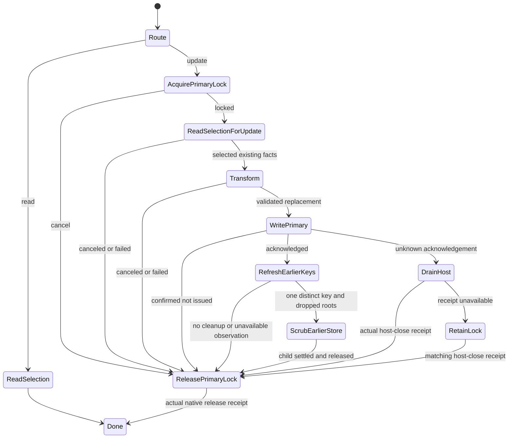

# Finance v6 account-store graph

Status: implemented for source review; not activated, behavior-tested or committed.
Foundation commit: `5daf37a` on `feat/xstate-v6-worker-runtime`.

## Connected migration boundary

The new graph imports the exact published `xstate-v6@npm:xstate@6.0.0-beta.1`
migration alias. The installed v6 migration guide explicitly documents that
side-by-side approach. Existing UI/shared-library graphs keep their v5 peer
contracts until their complete connected conversion; no v5/v6 actor references
are exchanged. Remove the alias at the coordinated final runtime cutover.

No XState patches, declaration overrides, assertion casts or blanket literal
assertions are used. Production mechanisms are public v6 exports. The installed
execution, actor, state-input, typestate, event, lifecycle, parallel, persistence
and inspection guides match the already reviewed exact package. Serialization
inspection is a development-only experimental API; it is not an app dependency.

## Implemented ownership and decisions

- `runtime/worker/account-selection.ts`: existing namespace derivation, earlier-key
  admission and persisted selection validation. It uses public SDK
  `accountRegistryUrl` and `parseAuthSecret`, preserving the SDK's v1 namespace,
  opaque environment and default `dev`, canonical secrets, unknown persisted
  fields and selected-root identity when roots are removed.
- `machines/runtime/account-store-read.ts`: an invoked chart chooses primary
  selection, exactly one readable earlier selection, or no selection. It does
  not create an identity or interpret empty storage as globally absent data.
- `machines/runtime/account-store-operation.ts`: owns one SDK read/update request,
  the primary Web Lock, transformation, acknowledged write, legacy cleanup and
  release. Independent cancellation state preserves in-flight work.
- `machines/runtime/account-store-legacy.ts`: invoked cleanup child owns the
  earlier key's Web Lock, re-reads its latest value, removes only dropped roots,
  preserves other roots/fields, and waits for native release acknowledgement.
- `machines/runtime/account-store-lock.ts`: native lease adapter acquires/releases
  a Web Lock. Aborting an acquisition and releasing a held lease both report
  actual native request settlement. It contains no identity decisions.
- `machines/runtime/account-store-contracts.ts`: typed native I/O and completion
  contracts. Native methods perform one selected operation each; they must not
  conceal an account-selection or write/cleanup workflow.

The earlier-store child has its own
`acquire -> read -> guarded scrub -> write -> release` sequence. Cancellation
before a primary write cannot start that write; after issue, the graph preserves
acknowledgement and required cleanup. Earlier keys are discovered again after the
primary acknowledgement, matching SDK timing if an old tab creates a key during
the operation. Cleanup on the same key is skipped to avoid self-deadlock.

Transient transform arguments use state input. Writing states refine the
replacement value; release/terminal states require a classified result.
Transform callbacks and dropped-root payloads are cleared from context on exit;
this is lifecycle hygiene, not a promise of memory zeroization. Control state is
in states; a closed-host scope is an observed receipt, not a second lifecycle.
Native callbacks and host reports are public actor events, not private self events.

## Unknown-write custody

Releasing a worker Web Lock immediately after a port timeout is unsafe: a queued
Window write might still execute after a replacement manager acquired the lock.
Therefore `AccountStoreStorage.closeHostAndDrain()` must resolve only after the
Window host removed the old listeners and acknowledged that queued writes cannot
execute. A timeout or failed close is not this receipt. The graph retains the
lock when that receipt is unavailable and accepts only a matching host scope.
Early close receipts also preserve legacy-child release ordering and cannot be
lost merely because a drain promise rejects later. Forced actor stop/worker
termination is not an approved cleanup path.

The primary result remains separate from legacy cleanup: an acknowledged primary
write is still updated if best-effort earlier cleanup is unavailable. Neither
transport delivery nor actor stopping is reported as a successful storage write.

## Checks and current integration limits

The six implementation files pass strict TypeScript with exact optional fields
and unchecked-index checks. Machine construction/serialization diagnostics were
inspected without starting actors or native operations. The code-authored graphs
have source expressions, type-only schemas and runtime implementations; JSON
serialization therefore requires evaluators/implementations and is not a durable
write-replay mechanism. No stored actor checkpoints are introduced.

The approved foundation's 17 transport tests pass on Node 24.22.2. No tests of this
new account-store implementation have been added or run before its review.
Qualification will use independent `@xstate/test` models for lock/cancellation,
legacy ambiguity and root preservation, duplicate/stale receipts and unknown-write
custody. The test beta must have a compatible v6 peer context while the UI remains
v5; do not resolve it against Finance's v5 runtime or override its peer contract.

Still required before activation:

1. Extend the Window storage bridge with bounded, admitted earlier-key inventory
   and reads/writes; keep selection policy in these worker charts.
2. Implement and verify the actual cross-realm host-close/drain receipt. Do not
   satisfy the contract with `port.close()`, a timeout, or an optimistic promise.
3. Bind the SDK `AccountStore` facade to a worker-tree owner that retains every
   request through completion, rejects new work on shutdown, and supervises
   errors without force-stopping held writes/locks.
4. Review/test that integration, then move the actual session/workspace graph and
   qualify identity reuse, cold persistence and multi-tab behavior. No second SDK
   owner or worker session has been started by this batch.
