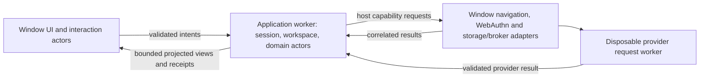

# XState v6 and UI/worker ownership specification

Status: approved; implementation in progress. Source baseline: main `218bd98`.
This supplements startup planning without changing the active feature, provider
consent, permissions, localization, visual design or accepted qualification limits.
The specification was approved separately. See
`xstate-v6-finance-implementation.md` for the current implementation checkpoint,
qualification, and remaining application-worker handoff.

## Goal and dependency boundary

Convert Finance by complete connected actor graphs and establish explicit Window
and application-worker machine ownership. Use the XState 6 authoring model to make
resource validity, event provenance and cancellation easier to inspect. A codemod
is a starting point; successful compilation alone does not satisfy this design.

Coordinated scope: DUI, DLF, Clipper and Finance. local-first-ux-patterns is
excluded. Use published, unpatched `xstate@6.0.0-beta.1` as the compatibility
candidate; recheck release changes when implementing. Record the exact codemod
version (initially `@xstate/codemod@0.1.0-beta.1`) and framework binding whose
actual peer contract supports the selected runtime. Do not assume the existing
`@xstate/svelte@^5` is compatible because its major number resembles XState's.

Current main uses XState v5, Jazz alpha.60, vendored DLF Jazz-alpha.60 and DUI
typography archives. DLF's v6 review branch currently pins Jazz alpha.59. Produce
and qualify matching shared artifacts for Finance's selected runtime; neither a
v6 DUI archive nor a v6 DLF peer declaration proves compatibility of the other
connected graph. Do not downgrade Jazz or copy unqualified archive metadata.

Read the exact installed package's `docs/index.md`, `agents.md`,
`api-stability.json`, execution, invoke, typestate, state-input, event, lifecycle,
parallel, persistence and inspection guides before implementation. XState patches,
declaration overrides and broad actor casts are outside this migration.

## Placement and host boundaries

| Owner                               | Machines and capabilities                                                                                                                                                                                               |
| ----------------------------------- | ----------------------------------------------------------------------------------------------------------------------------------------------------------------------------------------------------------------------- |
| Window UI tree                      | DUI interaction, dialogs/input, focus, navigation, browser history, file picking, camera/canvas surfaces, WebAuthn/user verification, PWA registration/update UI. Keep browser capabilities behind owned host adapters. |
| Application worker                  | One SDK/session owner; workspace access, initialization and domain query ownership; account/transaction/import/write coordination; operation identity, eligibility, settlement, draining and projected views.           |
| Window storage/broker host          | Required localStorage primitives and SharedWorker opening for the exact patched Jazz runtime. It does not become a second independent Jazz/domain owner.                                                                |
| Existing disposable provider worker | HTTP/decode/validation for one explicitly requested SimpleFIN operation. Keep it until consolidation into the domain worker is separately justified and qualified. It does not own Jazz or passkeys.                    |

The diagram describes ownership, not live cross-realm actor references. The
Window host may route provider results back over its runtime channel; it must
not forward secrets through public projections or diagnostics. Keep ordinary
commands and privileged capability requests distinct.

Inventory `+layout.svelte`, `machines/runtime`, workspace/account/transaction
charts, image/attachment owners, bank setup/import and their integration
components before selecting each migration unit. File/image metadata can cross
realms where cloneable; DOM objects, live actor refs, SDK clients and native
transaction handles stay with their resource owner. Canvas/File/Blob/transfer
behavior must be qualified per feature rather than assumed from TypeScript.

WebAuthn and explicit user verification remain Window-owned. The domain actor
selects the permitted operation; the Window adapter performs the selected native
capability and returns a short-lived, correlated result. Preserve existing PRF
verification before claiming a setup token, encrypted credential persistence and
explicit unlock for every provider operation. Do not add startup/reconnect/timer
sync, implicit retries or a new automatic authorization path.

## Concrete source findings

- `integrations/simplefin-worker.ts` already bounds bootstrap/request lifetime
  and terminates one disposable worker. It is not Finance's missing Jazz runtime.
  Preserve its abort, error and message-error cleanup when adding a longer-lived
  application worker; domain writes need drain, unlike a disposable HTTP request.
- `integrations/simplefin.worker.ts` accepts a TypeScript-annotated message and
  creates a root. An annotation is not decoding. Introduce explicit input shape,
  size and endpoint/capability admission before creating the request actor; keep
  provider reply validation and sanitized failure mapping.
- `machines/bank-sync/provider-request.ts` stores a transient response and raw
  payload across request/decode/validation states. Evaluate state input and
  typestates at those boundaries, and clear access URLs/payloads on every terminal
  path. A state's input disappearing does not erase copies captured by queued
  effects or guarantee memory zeroization. Preserve disposal of the actual owner.
- `diagnostics/machine-diagnostics.ts` and `diagnostics/inspector.ts` consume v5
  inspection events. Upgrade their protocol and redaction for v6 actor/transition
  events, not just import names. Never serialize raw context, credential-bearing
  input, query contents or provider payloads into cross-realm diagnostics.
- `WorkspaceBootstrap.svelte` uses `@xstate/svelte`; components also own actor
  roots and subscriptions directly. Review input rebinding, initial snapshot,
  error supervision and cleanup with the actual compatible binding. A stopped
  actor is single-use; create a new root on genuine reattachment.

## Clipper's Jazz worker reference

Use Clipper main `78d611f8bcf8e7a05d61408515545a711c7598bd` as the inspected
source reference. Its full application worker is under
`apps/web/src/lib/runtime/worker/`, especially `application.worker.ts`,
`host-machine.ts`, `protocol.ts`, `account-store.ts`, `storage-channel.ts` and
`broker-channel.ts`. The configured
`patches/jazz-tools@2.0.0-alpha.60.patch` adds worker runtime detection,
`browserWorkerHost` broker opening and persistent generation handling.

Finance's existing Jazz patch does not supply that worker-host support. Extract
and qualify the required mechanisms against Finance's exact SDK build; the
Clipper patch also includes unrelated auth/origin changes, which must not be
imported indiscriminately. Preserve the Window account-storage namespace and
Web Lock semantics through worker account updates. Sharing an account ID or DB
name is not evidence of shared physical storage.

DLF owns reusable identity/transaction contracts; Clipper's library/reader/tag
protocols remain Clipper domain code. Promote a shared capability only after its
bounded contract and native behavior are independently identified. This review
does not certify the patch or supersede historical worker limitations without
fresh Finance evidence.

## v6 model requirements for each unit

1. Put I/O, mutable native state and time/random generation behind queued effects
   or owned leaves. Transition/entry/exit calculations must be safe during
   selection and `can`, and must preserve earlier snapshots. Keep descriptive
   domain predicates and literal target objects in the chart.
2. Use choice nodes only for total, effect-free routing. Keep context-producing
   and conditional eventless steps as `always`. Use state schemas to establish
   valid resource facts; evaluate state input for state-scoped submission data,
   not receipts that must survive cancellation. Do not force new syntax where it
   weakens drain ownership or readability.
3. Distinguish public intents, actor/native reports and self-coordination. Only
   genuine self events use internal schemas; a Window/worker message or child
   callback cannot deliver a private event. Decode runtime DTOs separately from
   v6 inference schemas. Runtime validation is opt-in, not supplied by types.
4. Invoke state-owned work. Explicitly own spawned/shared lifetimes and
   subscriptions. Type child IDs/protocols without losing generic completion
   contracts. Use completion/error events rather than reading removed children.
5. Final states support entry/exit/output; they cannot continue work or handle
   transitions. Preserve terminal secret clearing and output/notification order.
   Actions are not awaited: operations deciding success/cleanup need acknowledgments
   from invoked logic. Observe queued-promise failures and supervise root errors.
6. Audit every parallel region's same-event observations, cancellation precedence,
   exit/reentry set and drain join. v6 region-local transitions preserve siblings.
   Scope changes must not reset a closing region or admit a late result.
7. Missing/stopped recipients are dead letters, not successful delivery or
   automatically failed senders. Define host failure/rejection observations and
   explicit acknowledgments where work or termination depends on delivery.
8. Inventory actor checkpoint consumers before adding versioning. Preserve Jazz
   data/journal formats and unknown-write reconciliation. Experimental durable
   execution, registries and address-only snapshots do not replace a worker
   transport or make SDK effects replay-safe.

References: [agent guide](https://stately.ai/docs/xstate/v6/agents),
[transitions](https://stately.ai/docs/xstate/v6/transitions),
[typestates](https://stately.ai/docs/xstate/v6/typestates),
[state input](https://stately.ai/docs/xstate/v6/state-input),
[internal events](https://stately.ai/docs/xstate/v6/internal-events),
[lifecycle](https://stately.ai/docs/xstate/v6/lifecycle-and-errors),
[parallel states](https://stately.ai/docs/xstate/v6/parallel-states),
[persistence](https://stately.ai/docs/xstate/v6/persistence).

## Protocol and qualification contract

All messages carry a protocol version, binding generation/scope and request or
operation identity where applicable. Validate shape, size, admission and current
binding on receipt and result consumption. Bound outstanding requests/projections;
close obsolete ports and reject stale A → B → A reports. Return projected views
and explicit accepted/settled outcomes, never raw actor snapshots. “Received”
means delivery only, not save/commit.

Worker shutdown closes admission, requests child drain, retains or reconciles
unknown receipts, closes the actual SDK/session and ports, and only then
acknowledges safe termination. Worker crash recovery restores durable intent, not
blind execution of the last command. Keep the current app owner until replacement
and handoff are proven; do not briefly run duplicate SDK/query owners.

Stage the work for focused review:

1. Approve this spec and record actor placement, native capability contracts and
   the exact shared artifact/Jazz patch lineage. Retain v5 trace/source baselines.
2. Convert connected v6 units while retaining current placement. Reconcile
   machine-first memory syntax, framework binding and inspection at that boundary.
3. Present each implementation before adding/running its implementation tests,
   as required by AGENTS and constitution. Keep batches focused and explain
   cross-cutting changes before editing dozens of files.
4. Qualify v6 behavior, then introduce the worker host/protocol and move domain
   units incrementally. Keep UI/browser capabilities in Window throughout.
5. After approval, test forbidden/stale/duplicate messages, native cancellation,
   sibling reentry, uncertain writes, failed drain, private-event rejection,
   frame/worker failures and restart. Use bounded waits and controlled scheduling.
6. Run actual packaged-consumer and browser checks: local identity reuse, offline
   writes and restart visibility, account switching, multi-tab/multi-worker
   coordination, broker/storage loss, WebAuthn and explicit provider consent.
   Record engine/SDK versions, skipped paths and performance measurements.

No startup/performance/privacy/platform improvement is claimed until the actual
Finance implementation has passed those checks. Static source review and the
Clipper reference are design evidence, not Finance acceptance results.

## Generated testing with the v6 test beta

Use the published `@xstate/test@2.0.0-beta.0` with its required peer
`fast-check@4.10.2` for generated machine coverage. These are experimental APIs;
keep exact versions and review changes on upgrade. Zod and Effect are optional,
not prerequisites. See the [model-based testing guide](https://stately.ai/docs/xstate/v6/model-based-testing)
and the README shipped with the installed test package.

Prefer `propertyTest` for varied command sequences and shrinking, and `testPaths`
for bounded reachable paths. Use an independent product contract with a real actor
or adapter as `sut`; compare observed behavior through `read` and `projectModel`.
Do not implement the SUT by copying the expected model snapshot. Declare generators
explicitly for type-only event schemas. Keep bounds, seeds and coverage thresholds
visible, and distinguish generated coverage from exhaustive proof. Shortest paths
omit ignored/self-loop commands; exercise rejection and duplicates in generated
sequences and targeted regressions.

For asynchronous actors use executed mode with generated outcomes where appropriate.
Scheduler exploration covers only work instrumented through that scheduler; it does
not prove all browser, worker, Jazz or native interleavings. Preserve integration
coverage for actual cleanup, cancellation, persistence and realm boundaries.

Use the library failure store (`failures` with a stable key) to retain shrunk traces,
ignore `.xstate-test/` in source control, and upload it on CI failure once campaigns
are enabled. Promote meaningful fixed failures into tracked regression fixtures
using `replayTest` with `expect: 'pass'`; the automatic store removes fixed failures.
Do not build another custom sequence runner or patch XState/test declarations.

This repository still uses XState v5. Install the v6 test beta when the connected
actor graph moves to v6, rather than introducing incompatible peers now. Plan
independent UI/worker contract models for cancellation, stale replies, duplicate
completion, account switches and disposal, then verify actual worker/Jazz adapters
with integration tests. Preserve existing implementation-review gates.
